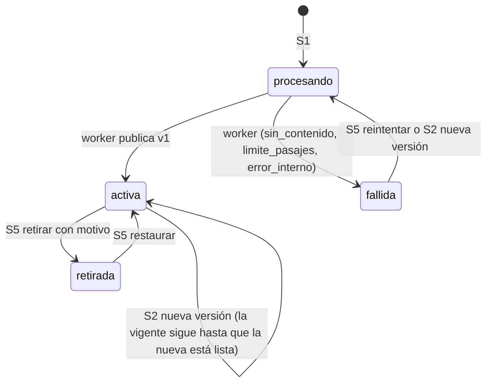

# Contrato API — SERUMS IA, épica E2 Repositorio de fuentes (MVP)

- **Historias:** SIA-E2-02 (#16), SIA-E2-03 (#17), SIA-E2-05 (#19), SIA-E2-06 (#20), SIA-E2-07 (#21). Fuera de alcance: E2-01 y E2-08 (v3), E2-04 (v2).
- **Estado:** aprobado, pendiente de implementación (2026-11-11)
- **Convenciones transversales:** [README.md](README.md)
- **ADR relacionado:** [0003](../adr/0003-puerto-source-repository-y-adaptador-postgres.md): puerto, adaptador Postgres, búsqueda FTS, worker y normalización.

## Resumen

| # | Método y ruta | Rol | Historia |
|---|---|---|---|
| S1 | `POST /admin/fuentes` (multipart) | admin | E2-03 |
| S2 | `POST /admin/fuentes/versiones` (multipart) | admin | E2-06 (nueva versión) |
| S3 | `GET /admin/fuentes` | admin | E2-07 |
| S4 | `GET /admin/fuentes/{id}` | admin | E2-07 |
| S5 | `PATCH /admin/fuentes/{id}/estado` | admin | E2-06 (retirar, restaurar, reintentar) |
| S6 | `PATCH /admin/fuentes/{id}/oficial` | admin | E2-06 (marcar y desmarcar «oficial verificada») |
| S7 | `PUT /admin/fuentes/{id}` | admin | E2-07 regla 7 (editar título y profesiones) |
| — | Puerto Go `SourceRepository` (sin ruta HTTP) | interno | E2-02 (ver ADR 0003) |
| — | Worker de ingesta (sin ruta HTTP) | sistema | E2-03, E2-05 |

Paquete backend: `internal/fuentes` nuevo, con `Mount(mux, svc, audLog, jwtSecret, checkSession)`. El worker arranca en `cmd/server/main.go` junto al de email (`main.go:149-157`).

**Por qué multipart:** el `.md` admite hasta 2 MiB (E2-03 regla 1). Eso ya supera el límite JSON de 1 MB (`bodylimit.go:10`), y en base64 dentro de un JSON pesaría unos 2,7 MiB. Además, el precedente de subida del repo es multipart (`questions/handler.go:223-250`).

**Rutas de subida sin `{id}`:** `MaxBodySize` sube el límite a 20 MB solo para rutas multipart cuyo `METHOD + r.URL.Path` coincida **exactamente** con una entrada de la lista (`internal/middleware/bodylimit.go:38-40`; lista en `cmd/server/main.go:138-143`). Una ruta con `{id}` nunca coincidiría y el archivo chocaría con el límite JSON de 1 MB (`bodylimit.go:10`). Por eso la nueva versión va en una ruta fija con `fuente_id` en el formulario. Backend-dev añade `"POST /admin/fuentes"` y `"POST /admin/fuentes/versiones"` a esa lista.

## Estados



| Entidad | Estados | Notas |
|---|---|---|
| Fuente (`fuentes.estado`) | `procesando`, `activa`, `fallida`, `retirada` | `procesando` y `fallida` solo se dan mientras la fuente no tiene versión vigente (primera versión o tras fallar todas) |
| Versión (`fuente_versiones.estado`) | `procesando`, `lista`, `fallida`, `archivada` | Si falla la versión n+1 de una fuente `activa`, la fuente sigue `activa` con la versión n vigente |
| Motivo de fallo (`motivo_fallo`) | `sin_contenido`, `limite_pasajes`, `error_interno` | Claves i18n `dashboard.serumsIa.fuentes.motivos.<motivo>` (E2-05, sección i18n) |
| Tipo (`tipo`) | `balotario`, `guia`, `norma`, `otro` | |

## Objetos

### `FuenteResumen` (S3)

```json
{
  "id": 9,
  "titulo": "Balotario SERUMS 2025 — Medicina",
  "tipo": "balotario",
  "estado": "activa",
  "aplica_a_todas": false,
  "especialidades": [{ "id": 2, "nombre": "Medicina" }],
  "version_vigente": { "numero": 2, "oficial_verificada": true, "pasajes_count": 412 },
  "version_en_proceso": null,
  "created_at": "2026-11-11T15:04:05Z",
  "updated_at": "2026-11-11T16:00:00Z"
}
```

- `version_vigente` vale `null` si la fuente está `procesando` o `fallida`.
- `version_en_proceso` es la última versión posterior a la vigente que **no** está `lista`: `{"numero": 3, "estado": "procesando" | "fallida", "motivo_fallo": null | "…"}`. Si no hay ninguna, vale `null`.

### `FuenteDetalle` (S4, S5, S6)

`FuenteResumen` más:

```json
{
  "anio": 2025,
  "proceso": { "id": 12, "nombre": "SERUMS 2026-I" },
  "motivo_retiro": null,
  "oficial": { "entidad_emisora": "MINSA", "nota": "Descargado de la web oficial del MINSA el 2026-11-10…", "marcado_at": "2026-11-11T16:10:00Z" },
  "contenidos_citantes": 0,
  "versiones": [
    { "numero": 2, "estado": "lista", "motivo_fallo": null, "nombre_archivo": "balotario-2025.md", "sha256": "9f2c…", "tamano_bytes": 307200, "lineas": 5120, "pasajes_count": 412, "oficial_verificada": true, "oficial_entidad": "MINSA", "created_at": "…", "procesada_at": "…" },
    { "numero": 1, "estado": "lista", "motivo_fallo": null, "nombre_archivo": "balotario-2025.md", "sha256": "41aa…", "tamano_bytes": 301000, "lineas": 5030, "pasajes_count": 405, "oficial_verificada": false, "oficial_entidad": null, "created_at": "…", "procesada_at": "…" }
  ]
}
```

- `oficial` es la marca de la **versión vigente**, o `null`.
- `versiones` va ordenado de la más nueva a la más vieja (≤ 20 no archivadas, más las archivadas).
- `contenidos_citantes` es el número de contenidos aprobados que citan cualquier versión de la fuente. Lo calcula el gancho `Citantes` (abajo). **Vale 0 hasta SIA-E3-02.**
- No se expone ninguna ruta de archivo del servidor: no se escriben archivos a disco (E2-07, sección Seguridad).

---

## S1 `POST /admin/fuentes`

Rol admin. `Content-Type: multipart/form-data`.

| Campo | Obligatorio | Regla |
|---|---|---|
| `file` | sí | Ver la validación del archivo |
| `titulo` | sí | `TrimSpace`; 3–150 caracteres |
| `tipo` | sí | `balotario` \| `guia` \| `norma` \| `otro` |
| `especialidad_ids` | no | Campo repetido (`especialidad_ids=2&especialidad_ids=5`); 0–50 ids sin repetidos, existentes y `activo`. Ninguno = todas |
| `anio` | no | Entero 1900–2100 |
| `proceso_id` | no | Proceso existente |

### Validación del archivo, en orden

| # | Regla | Error |
|---|---|---|
| 1 | El handler aplica `http.MaxBytesReader(w, r.Body, 2 MiB + 64 KiB)` y `ParseMultipartForm`. Si devuelve `*http.MaxBytesError`, o si `header.Size > 2 097 152` | **413 `archivo_demasiado_grande`**. Los import existentes devuelven 400 en este caso (`questions/handler.go:227-230`); aquí debe ser 413 (escenario «Archivo demasiado grande») |
| 2 | Falta la parte `file` o el formulario no es multipart | 400 `cuerpo_invalido` |
| 3 | Nombre saneado (`filepath.Base`, sin caracteres de control, ≤ 255) con extensión `.md` (sin distinguir mayúsculas) | 422 `archivo_invalido`, `detalle.motivo = "extension"` |
| 4 | `Content-Type` de la parte con tipo `text/markdown` o `text/plain` (se ignoran los parámetros, como `charset`) | 422 `archivo_invalido`, `detalle.motivo = "tipo"` |
| 5 | `utf8.Valid` y sin bytes NUL. Un BOM UTF-8 inicial se acepta | 422 `archivo_invalido`, `detalle.motivo = "codificacion"` (escenario «Tipo inválido»: .pdf o bytes no UTF-8) |
| 6 | ≤ 20 000 líneas | 422 `archivo_invalido`, `detalle.motivo = "lineas"` |
| 7 | Metadatos (tabla anterior) | 422 `validacion` / 422 `referencia_invalida` |
| 8 | SHA-256 del archivo igual al de **cualquier** versión guardada de **cualquier** fuente, sea cual sea el estado de la fuente o de la versión, incluidas las archivadas (E2-03 regla 3) | **409 `fuente_duplicada`**, `detalle = {"fuente_id", "titulo", "estado", "version"}`. No se crea nada. La UI muestra el título y el estado con un enlace al detalle, desde donde se puede reintentar, restaurar o editar profesiones (E2-07 regla 8) |
| 9 | Límite de fuentes (abajo) | **422 `limite_fuentes`**, `detalle = {"limite": 100, "especialidad_id": 2}` o `{"limite": 500}` |

- Un archivo vacío **no** se rechaza aquí: se crea, y el worker lo deja `fallida` con `sin_contenido` (SIA-E2-05, escenario «Contenido sin texto»).
- **Frontend:** al armar el `FormData`, enviar el archivo como `new Blob([file], { type: "text/markdown" })` con su nombre. Algunos sistemas operativos mandan `.md` con tipo vacío o `application/octet-stream`. Validar los 2 MiB en el cliente antes de enviar (E2-07, «Validación en el cliente»).

### Límite de fuentes (SIA-E2-03 regla 4; `docs/stories/serums-ia/README.md:158`)

- Cuentan las fuentes `activa` y `procesando`. No cuentan `fallida` ni `retirada`.
- Por profesión E, después del cambio: `(fuentes contadas sin especialidades) + (fuentes contadas con E) ≤ 100`, para cada E del pedido. Una fuente sin especialidades cuenta para **todas** las especialidades `activo`, así que se rechaza si cualquiera de ellas ya está en 100.
- Total de fuentes contadas, después del cambio: ≤ 500.
- Se valida en estos puntos:
  - S1 (alta);
  - S2, cuando la fuente está `fallida` (pasa a `procesando`);
  - S5 al reintentar una `fallida` y al restaurar una `retirada`;
  - S7 al cambiar profesiones de una fuente que cuenta.

  Si se supera, responde **422 `limite_fuentes`** y no cambia nada.
- El chequeo y la escritura se serializan con `pg_advisory_xact_lock` sobre una clave constante del módulo. Así dos operaciones simultáneas no pueden pasarse del límite.

### Respuesta `202 Accepted`

Devuelve `FuenteDetalle` con `estado: "procesando"`, `version_vigente: null` y `versiones: [{ "numero": 1, "estado": "procesando", … }]`.

En la misma transacción se escribe la auditoría `fuente.crear`, `entidad = "fuente"`, `entidad_id`, `detalle = {"version": 1, "sha256", "tamano_bytes", "tipo", "especialidad_ids", "estado_nuevo": "procesando"}`. Nunca lleva el contenido del archivo.

---

## S2 `POST /admin/fuentes/versiones`

Rol admin. Multipart con `fuente_id` (obligatorio) y `file`. El archivo pasa por la misma validación que en S1 (pasos 1–6 y 8). El duplicado se busca contra todas las fuentes, incluida esta (E2-06 regla 3a; escenario «Versión nueva duplicada»). Los metadatos no cambian aquí: se editan con S7.

| Estado de la fuente | Resultado |
|---|---|
| `activa` sin versión en `procesando` | Crea la versión n+1 en `procesando`; la fuente sigue `activa` con la versión vigente anterior |
| `fallida` | Valida el límite de fuentes (422 `limite_fuentes`). Crea la versión n+1 en `procesando` y la fuente pasa a `procesando` |
| `procesando`, `retirada`, o `activa` con una versión en `procesando` | **409 `estado_invalido`** |

- **Límite de 20 versiones (SIA-E2-06 regla 2):** si ya hay 20 versiones no archivadas, en la misma transacción se archiva la más antigua que cumpla todo esto:
  - no es la vigente;
  - no está `procesando`;
  - el gancho `Citantes.VersionCitada` dice que ningún contenido la cita.

  Archivar significa `estado = 'archivada'`, `contenido = NULL`, `motivo_fallo = NULL` (lo exigen `ck_fuente_versiones_contenido` y `ck_fuente_versiones_fallo`) y borrar sus pasajes. Se conservan `numero`, `sha256`, la marca oficial que tuviera y las fechas. Si ninguna versión se puede archivar, responde **422 `limite_versiones`**.
- **Subida manual con el mismo hash que la versión vigente de la propia fuente:** también da 409 `fuente_duplicada` (E2-06 regla 3a dice «cualquier versión de cualquier fuente»). El resultado `sin_cambios` es solo para la recaptura de URL (ver «Nota para SIA-E2-04»).
- La versión nueva nace con `oficial_verificada = false` y nunca la hereda (regla 7; escenario «Versión nueva no hereda la marca»).
- `202` con `FuenteDetalle`.
- Errores: `404 no_encontrado` (fuente inexistente), más los de S1 (413, 400, 422 `archivo_invalido`, 409 `fuente_duplicada`, 422 `limite_fuentes`) y 422 `limite_versiones`. Ante cualquier error, la fuente no cambia.
- Auditoría: `fuente.version_crear`, `detalle = {"version", "sha256", "estado_anterior", "estado_nuevo", "version_archivada": n | null}`.

---

## S3 `GET /admin/fuentes`

Rol admin. Listado paginado (E2-07 reglas 1–2).

| Query | Valores |
|---|---|
| `estado` | `procesando` \| `activa` \| `fallida` \| `retirada` |
| `tipo` | `balotario` \| `guia` \| `norma` \| `otro` |
| `especialidad_id` | id; incluye las fuentes que aplican a todas |
| `oficial` | `true` \| `false` (marca de la versión vigente) |
| `q` | búsqueda en el título, ≤ 100 caracteres, `ILIKE` con `%` y `_` escapados (como `admin/repository.go:363`) |
| `page`, `per_page` | 20 por defecto, máx. 100 |

- Orden: `updated_at DESC, id DESC`.
- `200` con `{"data": [FuenteResumen], "total", "page", "per_page"}`.
- Errores: `400 parametro_invalido`; `q` de más de 100 caracteres da `422 validacion`.
- **Refresco (E2-07 regla 6):** mientras alguna fila tenga `estado = "procesando"` o `version_en_proceso.estado = "procesando"`, el frontend vuelve a pedir la página actual cada 5 s. Deja de hacerlo al desmontar la pantalla o cuando no quedan filas en proceso.

## S4 `GET /admin/fuentes/{id}`

Rol admin. `200` con `FuenteDetalle`. Errores: `404 no_encontrado` y `400 parametro_invalido`.

---

## S5 `PATCH /admin/fuentes/{id}/estado`

Rol admin. Request con `estado` destino. Mismo patrón que `PATCH /…/estado` de catálogos.

| Request | Desde | Efecto | Errores |
|---|---|---|---|
| `{"estado": "retirada", "motivo": "…"}` | `activa` sin versión en `procesando` | Guarda `motivo_retiro`. En la misma transacción emite **una vez** el aviso «fuente retirada» (id de la fuente, actor) a cada `SuscriptorRetiro` registrado (regla 3; ver abajo). Si un suscriptor falla, se revierte todo y el retiro no se aplica. La fuente deja de aparecer en las búsquedas (regla 4) | `motivo` falta o tiene fuera de 5–500 caracteres → **422 `validacion`** (escenario «Retirar sin motivo»). Desde otro estado (p. ej. `procesando`) → **409 `estado_invalido`** (escenario «Transición inválida») |
| `{"estado": "activa"}` | `retirada` | Restaura: borra `motivo_retiro` y **no** reaprueba contenido (regla 5). Vuelve a validar el límite de fuentes | 409 `estado_invalido`; 422 `limite_fuentes`, y la fuente sigue `retirada` (escenario «Restaurar por encima del límite») |
| `{"estado": "procesando"}` (reintentar) | `fallida`, o `activa` cuya última versión está `fallida` | La última versión fallida vuelve a `procesando` (`intentos = 0`, `claimed_at = NULL`, `motivo_fallo = NULL`). La fuente `fallida` pasa a `procesando` tras validar el límite; la `activa` sigue `activa` (ya contaba) | 409 `estado_invalido`; 422 `limite_fuentes` (solo desde `fallida`), sin cambiar el estado |
| Otro valor de `estado` | — | — | 422 `validacion` |

- `200` con `FuenteDetalle`. Al retirar, la respuesta incluye además `"contenidos_marcados": n`: la suma de lo que devuelven los suscriptores, 0 sin suscriptores.
- Si un suscriptor devuelve error, responde `500 error_interno`, se registra en el log `op` y el nombre del suscriptor (sin datos personales), y la fuente sigue `activa`.
- Auditoría: `fuente.retirar`, `fuente.restaurar` o `fuente.reintentar`, siempre con `detalle = {"estado_anterior", "estado_nuevo", …}`. Al retirar también lleva `motivo` y `contenidos_marcados`; al reintentar, `version` (escenario «Auditoría»).
- **El diálogo de retiro** (E2-07, «Retirar con confirmación») muestra `contenidos_citantes` de S4 antes de confirmar.

## S6 `PATCH /admin/fuentes/{id}/oficial`

Rol admin. Actúa sobre la **versión vigente**.

| Request | Precondición | Errores |
|---|---|---|
| `{"oficial_verificada": true, "entidad_emisora": "MINSA", "nota": "…"}` | Fuente `activa` y versión vigente sin marca | `entidad_emisora` fuera de 3–100 o `nota` fuera de 10–500 → **422 `validacion`**, y la marca no cambia (escenario «Marcar sin entidad o nota»). Fuente `procesando`, `fallida` o `retirada` → **409 `estado_invalido`** (escenario «Marcar una fuente no activa»). Ya marcada → 409 `estado_invalido` |
| `{"oficial_verificada": false, "motivo": "…"}` | Fuente `activa` o `retirada` con la versión vigente marcada | `motivo` fuera de 5–500 → 422 `validacion`; sin marca → 409 `estado_invalido` |

- **Marcar:** `oficial_verificada = true`, `oficial_entidad`, `oficial_nota`, `oficial_por` (id del admin) y `oficial_at`.
- **Desmarcar:** pone `false` y borra esos cuatro campos. El historial queda en `audit_log`.
- Se permite marcar cualquier `tipo`. El caso típico es `balotario`, pero la regla 7 no lo restringe.
- Ni marcar ni desmarcar cambia el estado de ninguna pregunta (regla 8). SIA-E3-05 calcula la ruta de revisión de las preguntas **pendientes** leyendo la marca vigente en el momento de revisar. Por eso desmarcar hace que pase a exigirse la verificación de clave sin tocar datos (escenario «Desmarcar»).
- `200` con `FuenteDetalle`.
- Auditoría: `fuente.marcar_oficial`, `detalle = {"version", "entidad_emisora", "nota"}`; `fuente.desmarcar_oficial`, `detalle = {"version", "entidad_emisora", "motivo"}` (regla 9).
- La UI usa un diálogo de confirmación que explica el efecto (E2-07 regla 5) y deshabilita confirmar mientras los campos no sean válidos (E2-07, «Validación del diálogo de marca»).

## S7 `PUT /admin/fuentes/{id}`

Rol admin. Edita los metadatos editables **sin** crear versión nueva (E2-07 regla 7). Reemplaza los dos campos.

```json
{ "titulo": "Balotario SERUMS 2025 — Medicina y Enfermería", "especialidad_ids": [2, 5] }
```

| # | Regla | Error |
|---|---|---|
| 1 | `titulo` 3–150 tras `TrimSpace`; `especialidad_ids` 0–50 sin repetidos (vacío = todas). `tipo`, `anio` y `proceso_id` no se editan: si vienen, es un campo desconocido | 400 `cuerpo_invalido` / 422 `validacion` |
| 2 | Especialidades existentes y `activo` | 422 `referencia_invalida` |
| 3 | La fuente existe | 404 `no_encontrado` |
| 4 | Estado `activa`, `fallida` o `retirada`; en `procesando` no se puede | 409 `estado_invalido` |
| 5 | Si la fuente cuenta para el límite (`activa`), el nuevo conjunto de profesiones no supera el límite. Pasar a «todas» cuenta para todas las profesiones | 422 `limite_fuentes`, y nada cambia (escenario «Editar profesiones por encima del límite») |

- `200` con `FuenteDetalle`. La versión vigente y la marca oficial no cambian (escenario «Editar profesiones»).
- Auditoría: `fuente.editar`, `detalle = {"antes": {"titulo", "especialidad_ids"}, "despues": {…}}`.

---

## Puntos de extensión hacia E3-02 y E6-06

Hoy no existe una tabla de citas ni el estado `en_revision`: `preguntas.estado` solo admite `activo` | `eliminada` (`014_create_preguntas.sql:14-15`). SIA-E3-02, que depende de E2-06, los crea. Para no invertir la dependencia, `internal/fuentes` define dos interfaces. Cada módulo registra sus implementaciones al montar el servidor, en `cmd/server/main.go`.

```go
// Aviso «fuente retirada» (SIA-E2-06 regla 3). Se llama una vez por suscriptor, dentro de la
// transacción del retiro. Si devuelve error, se revierte el retiro completo.
type SuscriptorRetiro interface {
    Nombre() string // para logs
    FuenteRetirada(ctx context.Context, tx sqlx.ExtContext, fuenteID int64, actorID int64) (afectados int, err error)
}

// Lectura de citas: conteo para el diálogo de retiro (E2-07) y archivado de versiones (E2-06 regla 2).
type Citantes interface {
    ContarPorFuente(ctx context.Context, q sqlx.QueryerContext, fuenteID int64) (int, error)
    VersionCitada(ctx context.Context, q sqlx.QueryerContext, versionID int64) (bool, error)
}
```

- En el MVP de E2 no hay ningún suscriptor ni citante registrado. El retiro funciona igual (escenario «Retirar sin suscriptores»), los conteos dan 0 y `VersionCitada` da `false`.
- El escenario «Retirar emite el aviso» se prueba con un suscriptor de prueba que cuenta las llamadas y comprueba que recibe una sola llamada con el id y el actor correctos. Otro suscriptor de prueba que devuelve error comprueba que la fuente sigue `activa`.
- **SIA-E3-02 regla 8:** registra un suscriptor (las preguntas `aprobada` o `activo` que citan la fuente pasan a `en_revision`) y un citante. La tabla de citas `(pregunta_id, pasaje_id)` lleva FK a `pasajes(id)`.
- **SIA-E6-06 regla 8:** registra lo mismo para el material. **SIA-E6-08:** para las explicaciones.

El efecto sobre las preguntas se verifica en SIA-E3-02, y el de «Desmarcar» sobre las pendientes, en SIA-E3-05.

## Nota para SIA-E2-04 (ingesta de URL, v2; fuera de este contrato)

El hash duplicado se comporta distinto en las capturas de URL (E2-04 regla 11, confirmado por el PO). El modelo de este contrato ya lo soporta:

| Caso de URL | Resultado | Cómo encaja en el modelo |
|---|---|---|
| Recaptura de la misma fuente con el mismo hash que su **versión vigente** | `sin_cambios`, no es un 409. No se crea versión y la fuente no cambia | Se compara antes de insertar; no se escribe en `fuente_versiones` |
| Alta nueva cuyo hash coincide con otra fuente o con una versión anterior | La fuente nueva queda `fallida` con motivo `fuente_duplicada` | **No** se inserta la fila de versión, porque `uq_fuente_versiones_sha256` la rechazaría. E2-04 tendrá que guardar el motivo de una fuente sin versiones: p. ej. ampliando `motivo_fallo` a nivel de fuente. Lo diseña E2-04 |
| Recaptura cuyo hash coincide con otra fuente o con una versión anterior de la misma | No crea versión y la fuente queda como está | Igual que la primera fila |

## Puerto `SourceRepository` (SIA-E2-02)

Interfaz y tipos (`NuevaFuente`, `FiltroFuentes`, `Pagina`, `FuenteResumen`, `Pasaje`), errores (`consulta_invalida`, `cita_invalida`, `fuente_duplicada`, `publicacion_invalida`), consulta SQL, suite de contrato y adaptador en memoria: ver la [ADR 0003](../adr/0003-puerto-source-repository-y-adaptador-postgres.md) § El puerto. El `FuenteResumen` del puerto es mínimo (ids de especialidad, sin nombres). El objeto `FuenteResumen` de S3, más completo, lo arma el repositorio admin fuera del puerto (E2-07). No tiene ruta HTTP en el MVP: lo consumen E3-01, E6-03, E6-04 y E6-08 dentro del backend. La regla 5 de SIA-E2-03 (el contenido se trata como datos al enviarlo a la IA) la aplica E6-01/E6-03 al armar los prompts.

---

## Modelo de datos — migración 062 (número propuesto)

```sql
-- +goose Up
CREATE TABLE fuentes (
    id                 BIGSERIAL    PRIMARY KEY,
    titulo             VARCHAR(150) NOT NULL CHECK (char_length(titulo) BETWEEN 3 AND 150),
    tipo               VARCHAR(20)  NOT NULL CHECK (tipo IN ('balotario', 'guia', 'norma', 'otro')),
    estado             VARCHAR(20)  NOT NULL DEFAULT 'procesando'
                       CHECK (estado IN ('procesando', 'activa', 'fallida', 'retirada')),
    anio               INT          CHECK (anio BETWEEN 1900 AND 2100),
    proceso_id         BIGINT       REFERENCES procesos(id),
    version_vigente_id BIGINT,
    motivo_retiro      VARCHAR(500),
    creado_por         BIGINT       REFERENCES usuarios(id),
    created_at         TIMESTAMPTZ  NOT NULL DEFAULT NOW(),
    updated_at         TIMESTAMPTZ  NOT NULL DEFAULT NOW(),
    CONSTRAINT ck_fuentes_vigente CHECK ((estado IN ('activa', 'retirada')) = (version_vigente_id IS NOT NULL)),
    CONSTRAINT ck_fuentes_motivo  CHECK ((estado = 'retirada') = (motivo_retiro IS NOT NULL))
);
CREATE INDEX idx_fuentes_estado_updated ON fuentes (estado, updated_at DESC);
CREATE INDEX idx_fuentes_proceso ON fuentes (proceso_id) WHERE proceso_id IS NOT NULL;

CREATE TABLE fuente_especialidades (
    fuente_id       BIGINT NOT NULL REFERENCES fuentes(id) ON DELETE CASCADE,
    especialidad_id BIGINT NOT NULL REFERENCES especialidades(id),
    PRIMARY KEY (fuente_id, especialidad_id)
);
CREATE INDEX idx_fuente_especialidades_especialidad ON fuente_especialidades (especialidad_id);

CREATE TABLE fuente_versiones (
    id                   BIGSERIAL    PRIMARY KEY,
    fuente_id            BIGINT       NOT NULL REFERENCES fuentes(id),
    numero               INT          NOT NULL CHECK (numero >= 1),
    estado               VARCHAR(20)  NOT NULL DEFAULT 'procesando'
                         CHECK (estado IN ('procesando', 'lista', 'fallida', 'archivada')),
    motivo_fallo         VARCHAR(30)  CHECK (motivo_fallo IN ('sin_contenido', 'limite_pasajes', 'error_interno')),
    nombre_archivo       VARCHAR(255) NOT NULL,
    sha256               CHAR(64)     NOT NULL,
    tamano_bytes         INT          NOT NULL CHECK (tamano_bytes BETWEEN 0 AND 2097152),
    lineas               INT          NOT NULL CHECK (lineas BETWEEN 0 AND 20000),
    contenido            TEXT,        -- original tal como se subió (UTF-8); el worker lo normaliza
    normalizador_version SMALLINT     NOT NULL DEFAULT 1,
    pasajes_count        INT          NOT NULL DEFAULT 0 CHECK (pasajes_count BETWEEN 0 AND 5000),
    intentos             INT          NOT NULL DEFAULT 0,
    claimed_at           TIMESTAMPTZ,
    oficial_verificada   BOOLEAN      NOT NULL DEFAULT false,
    oficial_entidad      VARCHAR(100),
    oficial_nota         VARCHAR(500),
    oficial_por          BIGINT       REFERENCES usuarios(id),
    oficial_at           TIMESTAMPTZ,
    creado_por           BIGINT       REFERENCES usuarios(id),
    created_at           TIMESTAMPTZ  NOT NULL DEFAULT NOW(),
    procesada_at         TIMESTAMPTZ,
    CONSTRAINT uq_fuente_versiones_numero    UNIQUE (fuente_id, numero),
    CONSTRAINT uq_fuente_versiones_id_fuente UNIQUE (id, fuente_id),        -- destino de la FK compuesta
    CONSTRAINT ck_fuente_versiones_contenido CHECK ((estado = 'archivada') = (contenido IS NULL)),
    CONSTRAINT ck_fuente_versiones_fallo     CHECK ((estado = 'fallida') = (motivo_fallo IS NOT NULL)),
    CONSTRAINT ck_fuente_versiones_oficial   CHECK (oficial_verificada =
        (oficial_entidad IS NOT NULL AND oficial_nota IS NOT NULL AND oficial_at IS NOT NULL))
);
-- Duplicado por hash (E2-03 regla 3): global entre todas las versiones de todas las fuentes, en cualquier estado.
CREATE UNIQUE INDEX uq_fuente_versiones_sha256 ON fuente_versiones (sha256);
-- Como máximo una versión en proceso por fuente; también es el índice del worker.
CREATE UNIQUE INDEX uq_fuente_versiones_una_procesando ON fuente_versiones (fuente_id) WHERE estado = 'procesando';
CREATE INDEX idx_fuente_versiones_oficial_por ON fuente_versiones (oficial_por) WHERE oficial_por IS NOT NULL;

-- La vigente pertenece a la misma fuente (MATCH SIMPLE: NULL no se comprueba).
ALTER TABLE fuentes ADD CONSTRAINT fk_fuentes_version_vigente
    FOREIGN KEY (version_vigente_id, id) REFERENCES fuente_versiones (id, fuente_id);

CREATE TABLE pasajes (
    id                BIGSERIAL    PRIMARY KEY,
    fuente_version_id BIGINT       NOT NULL REFERENCES fuente_versiones(id),
    orden             INT          NOT NULL CHECK (orden BETWEEN 1 AND 5000),
    linea_inicio      INT          NOT NULL CHECK (linea_inicio >= 1),
    linea_fin         INT          NOT NULL,
    seccion           VARCHAR(300),
    texto             TEXT         NOT NULL,
    palabras          INT          NOT NULL CHECK (palabras >= 1),
    tsv               TSVECTOR     NOT NULL,     -- to_tsvector('spanish', plegar(texto)), ver ADR 0003
    CONSTRAINT uq_pasajes_version_orden UNIQUE (fuente_version_id, orden),
    CONSTRAINT ck_pasajes_lineas CHECK (linea_fin >= linea_inicio)
);
CREATE INDEX idx_pasajes_tsv ON pasajes USING GIN (tsv);

-- +goose Down
ALTER TABLE fuentes DROP CONSTRAINT IF EXISTS fk_fuentes_version_vigente;
DROP TABLE IF EXISTS pasajes;
DROP TABLE IF EXISTS fuente_versiones;
DROP TABLE IF EXISTS fuente_especialidades;
DROP TABLE IF EXISTS fuentes;
```

Notas:

- **Compatibilidad:** son tablas nuevas que no tocan nada existente, y el Down es exacto. Una migración posterior que cree FK a `pasajes` (E3-02) tendrá que quitarse antes en su propio Down; el orden natural de goose ya lo garantiza.
- **150–800 palabras** no se fuerza con `CHECK` por dos excepciones: el documento entero de 1–149 palabras (E2-05 regla 2) y la segmentación por pregunta de los balotarios (E3-01). La garantiza `normalizar.go` con sus tests (escenario «Segmentación»).
- `pasajes` no tiene `ON DELETE CASCADE`. Solo se borran explícitamente al archivar una versión no citada, y las FK de citas de E3-02 impedirán borrar un pasaje citado.
- **Tamaño:** ≤ 2 MiB de `contenido` por versión × 20 versiones × 500 fuentes. Es el peor caso teórico; el archivado libera `contenido` y pasajes.

## Trazabilidad

| Historia | Escenario / regla | Cubierto por |
|---|---|---|
| E2-02 | Buscar pasajes (≤ 20, con ids de fuente, versión y pasaje y el texto, por relevancia) | Puerto `BuscarPasajes`, SQL de la ADR 0003, `idx_pasajes_tsv` |
| E2-02 | Área y tema no filtran en el MVP (mismos pasajes con o sin área/tema) | `Busqueda.AsignaturaID` y `Busqueda.TemaID` se aceptan pero el adaptador MVP los ignora: el SQL de la ADR 0003 solo filtra por profesión, estado `activa` y versión vigente (regla 6; ADR 0003 § Área y tema). Test de la suite de contrato: la misma consulta con y sin área/tema devuelve los mismos pasajes en el mismo orden |
| E2-02 | Fuente inactiva excluida | Filtro `f.estado = 'activa'` y versión vigente |
| E2-02 | Resolver cita histórica | `ResolverCita` sin filtro de estado; los pasajes de versiones anteriores se conservan |
| E2-02 | Consulta fuera de límite → `consulta_invalida` | `Busqueda.Consulta` 3–300 |
| E2-02 | Intercambiabilidad | `fuentestest.RunContract` sobre Postgres y memoria |
| E2-02 | Regla 5 (migración con Down) | 062 |
| E2-03 | Subida correcta (202, procesando → activa) | S1 + worker |
| E2-03 | Archivo demasiado grande → 413 | S1 paso 1 + entrada en `main.go:138-143` |
| E2-03 | Tipo inválido → 422 `archivo_invalido` | S1 pasos 3–5 |
| E2-03 | Duplicado global → 409 con id, título y estado | S1 paso 8, `uq_fuente_versiones_sha256` (sin condición) |
| E2-03 | Duplicado de una fuente retirada | S1 paso 8 (`detalle.estado = "retirada"`); la UI ofrece restaurar |
| E2-03 | Falla de procesamiento (> 5000 pasajes, sin publicar) | Worker: transacción única, `limite_pasajes` |
| E2-03 | Límite por profesión → 422 `limite_fuentes` | S1 paso 9 |
| E2-03 | Fuente sin profesiones con una profesión en el límite | S1 paso 9 (cuenta para todas) |
| E2-03 | Fallidas y retiradas no cuentan | Conteo solo de `activa` y `procesando` |
| E2-03 | Límite total (500) | S1 paso 9 |
| E2-03 | Permisos (403) | `RequireAdmin` |
| E2-03 | Auditoría (`fuente.crear` con id, hash y actor) | S1 |
| E2-03 | Regla 2 (metadatos) | S1 tabla de campos |
| E2-03 | Regla 5 (contenido como datos al ir a la IA) | Fuera de E2: lo aplica E6-01/E6-03 |
| E2-03 | Seguridad (sanear el nombre, sin rutas, sin contenido en logs) | S1 paso 3; sin disco; logs solo con ids |
| E2-05 | Segmentación 150–800 con líneas y sección | ADR 0003 § Normalización; `pasajes.linea_*`, `seccion` |
| E2-05 | Sección corta (se une al pasaje anterior) | ADR 0003 § Normalización, paso 4 |
| E2-05 | Documento corto (un único pasaje de 1–149 palabras) | ADR 0003 § Normalización, paso 5 |
| E2-05 | Idempotencia | Algoritmo determinista + `normalizador_version` |
| E2-05 | Conserva `<mark>` | ADR 0003 § Normalización, paso 3 |
| E2-05 | Exceso de pasajes → fallida, nada publicado | Worker + `motivo_fallo = limite_pasajes` |
| E2-05 | Contenido sin texto → `sin_contenido` | Worker + `motivo_fallo` |
| E2-06 | Nueva versión (v2 activa, v1 sigue resolviendo) | S2 + worker mueve `version_vigente_id`; `ResolverCita` |
| E2-06 | Retirar emite el aviso (una vez, con id y actor) | S5 + `SuscriptorRetiro` (test con suscriptor de prueba) |
| E2-06 | Retirar sin suscriptores | S5 con la lista vacía |
| E2-06 | Regla 3: suscriptor que falla → no se retira | S5, transacción única (test con suscriptor que devuelve error) |
| E2-06 | Efecto en preguntas (`en_revision`) | **SIA-E3-02 regla 8** como suscriptor; se verifica en esa historia |
| E2-06 | Restaurar por encima del límite → 422, sigue retirada | S5 |
| E2-06 | Versión nueva duplicada → 409, «A» no cambia | S2 + paso 8 de S1 |
| E2-06 | Retirar sin motivo → 422 | S5 |
| E2-06 | Reintentar fallida → procesando | S5 `estado = procesando` |
| E2-06 | Transición inválida (procesando → retirar) → 409 | S5 |
| E2-06 | Auditoría (estado anterior y nuevo) | S1, S2, S5 y worker (`fuente.procesar` / `fuente.fallar`, actor `NULL`) |
| E2-06 | Marcar oficial verificada (+ audit con entidad y nota) | S6 |
| E2-06 | Marcar sin entidad o nota → 422 | S6 |
| E2-06 | Marcar una fuente no activa → 409 | S6 |
| E2-06 | Versión nueva no hereda la marca | S2 (`oficial_verificada = false`) |
| E2-06 | Desmarcar (las aprobadas siguen, las pendientes exigen clave) | S6; la ruta la calcula **SIA-E3-05** a partir de la marca vigente |
| E2-06 | Regla 2 (20 versiones) | S2 archivado + 422 `limite_versiones` |
| E2-07 | Listado (20 por página, paginación) | S3 |
| E2-07 | Estado vacío | S3 `data: []` (UI) |
| E2-07 | Seguimiento de procesamiento (refresco solo) | S3 + sondeo cada 5 s |
| E2-07 | Validación de tamaño en el cliente | UI (`ZonaArchivos` + yup) |
| E2-07 | Retirar con confirmación (motivo y nº de contenidos) | S4 `contenidos_citantes` + S5 |
| E2-07 | Marcar como oficial verificada (insignia, entidad y nota) | S6 + `FuenteResumen.version_vigente.oficial_verificada`, `FuenteDetalle.oficial` |
| E2-07 | Validación del diálogo de marca | UI (formik/yup con las reglas de S6) |
| E2-07 | Subida sin marca automática | S1 (siempre `false`) |
| E2-07 | Editar profesiones (misma versión, audit `fuente.editar`) | S7 |
| E2-07 | Editar profesiones por encima del límite → 422 | S7 regla 5 |
| E2-07 | Regla 7: editar en `procesando` → 409 | S7 regla 4 |
| E2-07 | Subida duplicada (aviso con título, estado y enlace) | S1 paso 8 `detalle` + UI |
| E2-07 | Acceso (redirección + 403) | guard admin del layout + `RequireAdmin` |

## UI implicada (khipu)

| Pantalla | Componentes ya copiados |
|---|---|
| Listado de fuentes | `TablaListado`, `PillEstado` (estado), `Badge` (insignia «Oficial verificada»), `Buscador` (título), `SelectCampo` (filtros), `EstadoVacio`, `Skeleton`, `PieTabla` y `Pagination` |
| Subida y nueva versión | `ZonaArchivos` (`formularios/zona-archivos.tsx`, con `accept=".md"`), `Campo`, `SelectCampo`, un grupo de `Casilla` (profesiones) y `Alerta` con el aviso de no subir documentos con datos personales (E2-03, sección Seguridad) |
| Detalle | `Card`, `Timeline` (`datos/timeline.tsx`, historial de versiones), `Badge` |
| Retirar, marcar y desmarcar | `Dialog` + `CabeceraDialogo`, `Campo` (motivo, entidad, nota), `BotonAsync` |
| Editar metadatos (S7) | `Dialog`, `Campo` (título), grupo de `Casilla` (profesiones) |
| Aviso de duplicado | `Alerta` con el título, `PillEstado` y enlace al detalle |

Si falta algún componente, primero se abre un PR en khipu (regla del repo).
