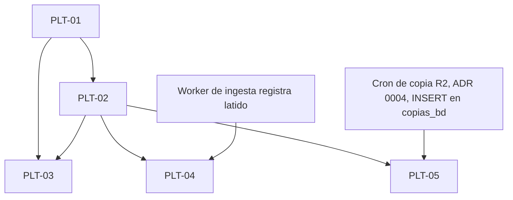

# Plataforma — historias de usuario

Historias transversales de operación de Capacitate que no son una capacidad del módulo SERUMS IA. Por eso no van en `docs/stories/serums-ia/` ni cambian su índice, su total de historias ni sus puntos. Usan el prefijo `PLT-` y el mismo formato que las historias de SERUMS IA: front matter, Como/quiero/para, reglas, Gherkin, fuera de alcance, seguridad, i18n y DoD.

Fuente: pedido del usuario al tech-lead (2026-11-11): «desde el panel de administrador, ver el /health de todos los servicios, de tal manera que se pueda ver la salud».

## Índice de épicas

| Épica | Documento | Historias | Pts |
|---|---|---|---|
| PLT-E1 Salud de servicios | este README + PLT-01..05 | 5 | 12 |
| PLT-E2 Multi-institución (crítica, antes de la ola 1). **En esta ronda solo PLT-06**; PLT-07..10 y PLT-14 están **Diferidas** | [sección en este README](#épica-plt-e2-multi-institución) | PLT-06..10, PLT-14 (6) | 16 (3 en la ronda) |
| PLT-E3 Aviso de decisiones al postulante | [sección en este README](#épica-plt-e3-aviso-de-decisiones-al-postulante) | PLT-11..13 (3) | 7 |
| Borrador de textos legales neutros (pendiente de aprobación del usuario) | [PLT-borrador-textos-legales-neutros.md](PLT-borrador-textos-legales-neutros.md) | — | — |

## Épica PLT-E1 Salud de servicios

**Objetivo:** que un admin vea en una sola pantalla del panel si cada servicio de Capacitate funciona en este momento y cuándo se comprobó por última vez. Así puede detectar un problema (base de datos lenta, correos atascados, worker detenido, copia sin hacer) antes de que lo reporte un postulante.

**Lo que este panel NO es:** no es un sistema de alertas. Railway no vigila `/health` después del despliegue y este panel solo muestra el estado **cuando un admin lo abre**. Si nadie lo mira, nadie se entera. Las alertas, el histórico y el uptime quedan fuera de alcance (ver más abajo).

| Id | Historia | Fase | Pts | Depende de |
|---|---|---|---|---|
| PLT-01 | [Estado de salud agregado: API y base de datos](PLT-01-estado-salud-api-bd.md) | MVP | 3 | — |
| PLT-02 | [Pantalla «Salud de servicios» en el panel admin](PLT-02-pantalla-salud-servicios.md) | MVP | 3 | PLT-01 |
| PLT-03 | [Salud del correo y versión del frontend](PLT-03-salud-correo-version-frontend.md) | MVP | 2 | PLT-01, PLT-02 |
| PLT-04 | [Latido del worker de ingesta de fuentes](PLT-04-latido-worker-ingesta.md) | v2 | 2 | PLT-01, PLT-02, worker de ingesta (SIA-E2-03/E2-05) |
| PLT-05 | [Última copia diaria a Cloudflare R2](PLT-05-copia-diaria-r2.md) | v2 | 2 | PLT-01, PLT-02, cron de copia (ADR 0004, Decisión 11) con INSERT en `copias_bd` |

Total: 5 historias, 12 pts (MVP 3 historias / 8 pts; v2 2 historias / 4 pts). Cada historia se reparte en tareas de 1–3 h.

**Por qué PLT-04 y PLT-05 van en v2:**
- **Worker de ingesta:** está definido en el contrato de E2 (`docs/api/serums-ia-e2-fuentes.md`, SIA-E2-03/E2-05), pero no registra ningún latido. PLT-04 **incluye** que lo registre.
- **Copia a R2:** está decidida en la [ADR 0004, Decisión 11](../../adr/0004-alojamiento-base-de-datos-produccion.md), aprobada por el usuario: un cron de Railway con `pg_dump` cifrado con `age` hacia Cloudflare R2. Devops la implementa en `deploy/backup/`. PLT-05 depende de que el cron registre cada ejecución con un INSERT en la tabla `copias_bd`. Usa `backup_ro` con un único permiso de INSERT sobre esa tabla (diseño del architect, aprobado por el tech-lead). La API lee la tabla de la base, sin credenciales de R2.

No se escriben criterios sobre datos que nadie produce.

## Decisiones del PO (aplican a toda la épica)

1. **Estados por servicio** (5, cerrados):
   - `operativo`: responde dentro del umbral.
   - `degradado`: responde, pero fuera del umbral de «degradado» de su servicio (lento, con atraso o con fallos parciales). Funciona, pero hay que mirarlo.
   - `caido`: no responde, da error o supera el umbral de «caído».
   - `no_configurado`: el servicio es opcional en este entorno y no está configurado (p. ej. SMTP en desarrollo). No es una falla y no empeora el estado global.
   - `desconocido`: el servicio todavía no tiene datos (p. ej. el worker nunca registró un latido o no hay ninguna copia registrada). Cuenta como `degradado` para el estado global. Una comprobación que no termina a tiempo **no** es `desconocido`: es `caido` (decisión 4).
2. **Estado global** = el peor de los individuales, con este orden: `caido` > `degradado` = `desconocido` > `operativo`. `no_configurado` no cuenta.
3. **Umbrales del MVP**, que el PO puede ajustar más adelante. Son constantes de configuración del backend y no se editan desde la UI en el MVP:

   | Servicio | Degradado | Caído |
   |---|---|---|
   | Base de datos | latencia de la consulta de prueba > 500 ms | error, o sin respuesta en 2 s |
   | Correo | el correo sin enviar más antiguo tiene > 10 min, o hay ≥ 3 fallidos definitivos en las últimas 24 h | en los últimos 30 min hay ≥ 3 fallidos definitivos y ningún enviado |
   | Worker de ingesta (v2) | último latido hace > 2 min | último latido hace > 10 min |
   | Copia a R2 (v2) | última copia correcta hace > 26 h | última copia correcta hace > 50 h |

4. **Tiempo máximo por comprobación:** 2 s. Las comprobaciones corren en paralelo; una lenta no bloquea a las demás y se informa como `caido` (categoría `tiempo_agotado`). La respuesta completa tarda como máximo unos 3 s.
5. **Caché en servidor de 15 s:** varias consultas dentro de ese plazo reciben el mismo resultado, con su `comprobado_en`. Así refrescar la pantalla no castiga a la base de datos ni al correo.
6. **Refresco de la pantalla:** automático cada 30 s mientras la pestaña está visible, y se pausa en segundo plano. Además hay un botón «Actualizar» que pide una comprobación nueva, limitado por la caché de 15 s. Siempre se muestra «Última comprobación» en `America/Lima`.
7. **El `/health` público actual no cambia:** sigue haciendo ping a la base y responde 200 `{"status":"ok","version"}` o 503 `{"status":"unhealthy"}`, sin más detalle, porque lo puede usar el despliegue. El detalle va en `GET /admin/salud`, solo para admin. El contrato lo define el architect en `docs/api/`.
8. **Fallos sin detalle técnico:** un fallo se informa como una categoría cerrada y traducible: `sin_conexion`, `tiempo_agotado`, `error_interno`, `atrasado`, `sin_datos`. Nunca se muestra el mensaje crudo del error, porque los errores de driver y de SMTP suelen incluir host, usuario o cadena de conexión.
9. **Sin `audit_log`:** consultar la salud es una lectura sin efectos y no se audita. Es una excepción explícita a «toda acción de admin se audita», que aplica a acciones que cambian datos.
10. **Frontend:** si el frontend está caído, el admin no puede ver el panel. Por eso la tarjeta del frontend muestra solo la **versión desplegada** del frontend que está viendo, sin estado operativo/caído. La comparación con la versión del backend es solo informativa. La versión es el `version` de `frontend/package.json`, la misma que se ve en «Acerca de».
11. **Base de datos totalmente caída:** la autenticación consulta la base, así que con la base caída `GET /admin/salud` no puede responder con el detalle. La autenticación responde **503** (no 401), el frontend no cierra la sesión y la pantalla muestra «No se pudo consultar» (PLT-01 regla 9, PLT-02). Aprobado por el tech-lead.
12. **«Degradado» mientras no hay ninguna copia** (observación O3 del informe de qa de PLT, 2026-11-11): con `copias_bd` sin filas, `copia_r2` queda `desconocido` / `sin_datos`, que cuenta como `degradado` (decisión 2). Así, un entorno recién creado muestra el estado global «Degradado» hasta que se registra la primera copia.
    - **Se acepta así.** En producción es la señal correcta: si no hay ninguna copia, hay que mirarlo.
    - En desarrollo o preproducción sin cron de copia, esa marca es ruido conocido y no indica una falla.
    - No cambia el contrato (`docs/api/plataforma-salud.md`). Si el ruido molesta, se pide como historia aparte, por ejemplo `copia_r2` en `no_configurado` cuando el entorno no tiene cron de copia.

## Preguntas abiertas para el usuario

Cada una ya tiene una decisión por defecto, para no bloquear al architect. Si el usuario no dice otra cosa, se aplica esa decisión.

| # | Pregunta | Decisión por defecto | Historias |
|---|---|---|---|
| Q1 | ¿Qué servicios entran en el MVP? | API, base de datos, correo y versión del frontend (PLT-01..03). Worker de ingesta y copia a R2 en v2, cuando existan los procesos que registran su ejecución. | PLT-01..05 |
| Q2 | ¿La pantalla se refresca sola? ¿Cada cuánto? | Sí, cada 30 s con la pestaña visible, más el botón «Actualizar». Caché de 15 s en servidor. | PLT-02 |
| Q3 | ¿Qué es «degradado» frente a «caído»? | Degradado: funciona, pero lento, con atraso o con fallos parciales (umbrales de la tabla). Caído: no responde, da error o pasa el umbral de caído. | PLT-01, PLT-03..05 |
| Q4 | ¿Los umbrales de la tabla sirven para producción? | Sí, para el MVP. Se ajustan con datos reales después del primer mes. | PLT-01, PLT-03..05 |
| Q5 | ¿Hacen falta alertas (correo o mensaje cuando algo cae)? | Fuera de alcance en esta épica. Si se quieren, es una historia nueva, idealmente con un monitor externo, porque el panel solo ve el estado cuando alguien lo abre. | — |
| Q6 | ~~¿Existe ya la copia diaria a R2?~~ | **Resuelta:** sí, como decisión aprobada por el usuario ([ADR 0004, Decisión 11](../../adr/0004-alojamiento-base-de-datos-produccion.md)); devops la implementa en `deploy/backup/`. Queda para el architect y devops: dónde registra el cron la última copia correcta para que la API la lea. PLT-05 sigue en v2 hasta que exista ese registro. | PLT-05 |

## Fuera de alcance de la épica

Alertas o notificaciones automáticas, histórico de estados, porcentaje de uptime, gráficos, métricas de Railway (CPU, memoria), acciones correctivas desde el panel (reiniciar, reencolar, lanzar una copia), monitor externo y página de estado pública.

---

## Épica PLT-E2 Multi-institución

Fuente: informe de qa del 2026-11-15 y decisiones del usuario (elegibilidad, vocabulario por institución, prioridad crítica antes de la ola 1). La app nació para el Ejército del Perú y hoy sirve a varias instituciones. Dos problemas:
1. **Fuga entre instituciones (crítico).** `inscripciones/repository.go:46-57` lista todos los procesos activos sin filtrar por institución, y `service.go` (`ListProcesosActivos`, `Inscribir`) solo compara `nivel`. qa reprodujo que una persona de una institución se inscribió a un proceso de otra. El subtítulo de /procesos promete «procesos activos de tu institución» (`es.json:333`).
2. **Vocabulario militar fijo.** `nivel` solo admite `suboficial|oficial` (`catalogs/dto.go:42,64` y CHECK de la migración 012), el tipo de proceso es `ascenso|pase_efectividad|admision` (`dto.go:98`) y la regla «SO 3°» (`catalogs/validation.go:8-22`) está escrita a mano.

| Id | Historia | Pts | Depende de | Roles |
|---|---|---|---|---|
| PLT-06 | [Elegibilidad por institución](PLT-06-elegibilidad-institucion.md) | 3 | — | postulante, admin |
| PLT-07 | [Catálogo de niveles y tipos por institución: migración y API](PLT-07-catalogo-niveles-tipos-institucion.md) | 3 | — (tras PLT-06) | admin |
| PLT-08 | [Regla de grado exigido genérica](PLT-08-regla-grado-exigido-generica.md) | 2 | PLT-07 | admin |
| PLT-09 | [Pantallas de catálogo y selectores en el admin](PLT-09-pantallas-catalogo-admin.md) | 3 | PLT-07, PLT-08 | admin |
| PLT-10 | [Institución filtrable en el admin; persona sin institución fija](PLT-10-institucion-filtrable-admin.md) | 3 | — | admin |
| PLT-14 | [Institución visible al postulante y en la landing](PLT-14-institucion-visible-postulante-landing.md) | 2 | PLT-06 | postulante, visitante |

Total: 6 historias, 16 pts (la Historia A completa excedía 8 pts, por eso se divide).

**Alcance de la ronda (decisión del usuario, 15-nov):** solo las correcciones de lo que encontró qa: PLT-06, PLT-11, PLT-12 y PLT-13 (10 pts: 3 + 2 + 3 + 2). **Diferidas, sin borrar:** PLT-07, PLT-08, PLT-09, PLT-10 y PLT-14 (catálogo por institución, filtros y landing agrupada). Las decisiones P3 (PLT-10), P5 (PLT-07 y PLT-09) y P9 (PLT-10) quedan anotadas en esas historias y se aplican cuando se retomen.

### Decisiones del PO (E2)

1. **Institución del postulante** = la `institucion_id` de su persona. Verificado en el código: todo usuario tiene `usuarios.persona_id` y `personas.institucion_id` es NOT NULL, así que siempre tiene institución. El nivel (`userNivel`) sale del grado de esa persona. Pertenece a una sola institución.
2. **Admin global:** ve y gestiona todas las instituciones. Admins por institución quedan fuera de alcance.
3. **Elegibilidad** = misma institución **y** (como hoy) nivel compatible. Un proceso de otra institución no se lista y su inscripción se rechaza con 403 y código propio, distinto del de nivel.
4. **Landing pública:** sigue mostrando todos los procesos, agrupados por institución; solo informativa, sin inscripción. Agrupar requiere ampliar `GET /procesos/publico` (PLT-14).
5. **Catálogo por institución:** cada institución define sus **niveles** y **tipos de proceso** (código estable en minúsculas, nombre visible, orden, estado). El código no cambia; el nombre sí. Un valor en uso se inactiva, no se borra.
6. **Regla de grado exigido genérica:** el tipo de proceso tiene `exige_grado`; si es sí, el proceso lleva un `grado_id` de su misma institución. Desaparece la comparación con «SO 3°».
7. **Datos existentes:** migran como filas del catálogo, **sin cambiar** ningún proceso, grado ni inscripción. La migración se guía por los datos: por cada institución, todo nivel y tipo en uso se crea en su catálogo; las instituciones sin datos nacen con catálogo vacío. `pase_efectividad` queda con `exige_grado = sí` y los procesos existentes mantienen «SO 3°». **Vacío = todos los niveles** en `procesos.nivel` y `especialidades.nivel` se conserva (`inscripciones/service.go:93,132`). **Inscripciones cruzadas ya existentes:** no se borran ni modifican; backend entrega en el PR el conteo y los ids (sin datos personales) para que el PO decida caso por caso.
8. **Orden de entrega:** PLT-06 primero y sin dependencias; luego PLT-07 → PLT-08 → PLT-09. PLT-10 y PLT-14 son independientes de PLT-07..09.
9. **Alcance de la elegibilidad:** cubre **inscribirse**, **crear una práctica** (`practices/service.go:80`) y **crear un simulacro** (`simulations/service.go:74-89`, mismo hueco confirmado por el architect, P1). Las preguntas no tienen hueco (todos sus endpoints son admin). Las lecturas por `proceso_id` de configuración de simulacros y asignaturas quedan fuera (sin datos personales, P8) y van a un issue de prioridad baja.
11. **Inscripciones cruzadas ya aprobadas (P2):** siguen visibles en `/inscripciones/me`; una práctica o un simulacro **nuevo** sobre ese proceso da 403 y los intentos en curso no se cortan. Las **pendientes** todavía se pueden aprobar (P10): el PR de PLT-06 trae el conteo y los ids y el usuario decide caso por caso.
12. **`GET /procesos` aplica la regla a todos los roles (P4)**; las pantallas de admin usan `/admin/procesos`. En `/admin/inscripciones` la institución mostrada es la del **proceso** (P3).
13. **`procesos.nivel` no se podía escribir por la API** (P5): PLT-07 agrega `nivel` opcional a `POST` y `PUT /admin/procesos` y PLT-09 el selector. Hasta entonces vale NULL en producción.
14. **`PUT /admin/personas`** valida que grado y especialidad sean de la institución de la persona (P9, en PLT-10).
10. **Capacitate no es certificadora ni ente oficial** (indicación del usuario, 15-nov): es una ayuda para estudiar y no tiene vínculo con las instituciones. «Inscripción» y «proceso» se refieren a la práctica dentro de la app. En los textos visibles no se usa «oficial», «certificado» ni «acreditado» para Capacitate, sus resultados o sus procesos. (Valores de catálogo como el nivel «oficial» son datos de la institución.) Se revisa en PLT-06, PLT-09 y PLT-14.

### Preguntas abiertas (E2)

| # | Pregunta | Decisión por defecto |
|---|---|---|
| Q1 | ¿Hay otras instituciones con datos que deban recibir catálogo en la migración? | Sí: se crea el catálogo con los valores que ya usan (decisión 7). |
| Q2 | ¿Qué hacemos con inscripciones cruzadas ya existentes? | Se dejan y se listan para decisión del PO. |
| Q3 | ¿Una persona puede pertenecer a dos instituciones? | No en esta épica. |

---

## Épica PLT-E3 Aviso de decisiones al postulante

Fuente: informe de qa del 2026-11-15.
- Al aprobar o rechazar una inscripción no se envía correo ni notificación, aunque el diálogo del admin dice «El usuario será notificado por correo». El motivo del rechazo solo se ve si el postulante vuelve a /procesos.
- Los correos de cuenta activada y desactivada están fijos en español (`backend/internal/auth/email_templates.go:96-151`). Los de registro y recuperación ya usan el `locale` de la petición (`docs/api/auth-idioma-correos.md`); como la activación la dispara el admin, hace falta guardar el idioma del usuario.

| Id | Historia | Pts | Depende de |
|---|---|---|---|
| PLT-11 | [Guardar el idioma del usuario](PLT-11-idioma-del-usuario.md) | 2 | — |
| PLT-12 | [Aviso de aprobación o rechazo de inscripción](PLT-12-aviso-decision-inscripcion.md) | 3 | PLT-11 |
| PLT-13 | [Correos de cuenta activada, rechazada y desactivada en el idioma del usuario](PLT-13-correos-cuenta-idioma-usuario.md) | 2 | PLT-11 |

Total: 3 historias, 7 pts. Prioridad: Alta. En esta ronda entran PLT-11, PLT-12 y PLT-13 junto con PLT-06 (PLT-07..10 y PLT-14 diferidas).

### Decisiones del PO (E3)

1. **Idioma del usuario:** `es` o `en`. Se fija al **verificar el correo** (ahí se crea el usuario; P11) y se actualiza al cambiar de idioma con sesión iniciada. Usuarios existentes: `es`. Ausente o inválido se trata como `es`.
2. **Qué se avisa:** aprobación y rechazo de inscripción (con motivo), cuenta activada, cuenta rechazada y cuenta desactivada (P7). «Correo cambiado» queda fuera.
3. **Canales:** correo **y** notificación en la app para las decisiones de inscripción. Cuenta activada/desactivada: solo correo, en el idioma del usuario.
4. **Motivo del rechazo:** lo escribe el admin en un solo idioma y se muestra tal cual; la plantilla que lo rodea va en el idioma del usuario. Se incluye completo en correo y notificación.
5. **Un fallo de correo no deshace la decisión.** El correo sigue el mecanismo de envío existente (cola/reintentos, visible en la salud del correo, PLT-03). La notificación en la app se crea siempre.
6. **Sin reenvíos:** el aviso se genera solo en la transición real de estado.
7. **Notificación en el idioma actual:** se ve en el idioma que el usuario tenga al leerla. El architect decide el mecanismo y lo documenta en `docs/api/`.
8. El diálogo del admin «El usuario será notificado por correo» pasa a ser verdad con PLT-12; solo se añade que también se notifica en la app.

### Preguntas abiertas (E3)

| # | Pregunta | Decisión por defecto |
|---|---|---|
| Q1 | ¿El motivo del rechazo se envía completo por correo? | Sí. |
| Q2 | ¿Se avisa también cuando el admin reactiva una inscripción rechazada? | No en esta épica. |
| Q3 | ¿Máximo de longitud del motivo? | **Resuelta (P6):** el servidor exige el motivo al rechazar, de 1 a 500 caracteres; al aprobar es opcional, hasta 500. |
