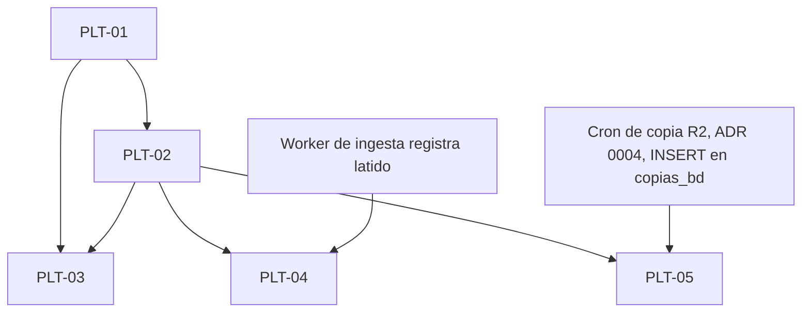

# Plataforma — historias de usuario

Historias transversales de operación de Capacitate que no son una capacidad del módulo SERUMS IA. Por eso no van en `docs/stories/serums-ia/` ni cambian su índice, su total de historias ni sus puntos. Usan el prefijo `PLT-` y el mismo formato que las historias de SERUMS IA: front matter, Como/quiero/para, reglas, Gherkin, fuera de alcance, seguridad, i18n y DoD.

Fuente: pedido del usuario al tech-lead (2026-11-11): «desde el panel de administrador, ver el /health de todos los servicios, de tal manera que se pueda ver la salud».

## Épica PLT-E1 Salud de servicios

**Objetivo:** que un admin vea en una sola pantalla del panel si cada servicio de Capacitate funciona en este momento y cuándo se comprobó por última vez. Así puede detectar un problema (base de datos lenta, correos atascados, worker detenido, copia sin hacer) antes de que lo reporte un postulante.

**Lo que este panel NO es:** no es un sistema de alertas. Railway no vigila `/health` después del despliegue y este panel solo muestra el estado **cuando un admin lo abre**. Si nadie lo mira, nadie se entera. Las alertas, el histórico y el uptime quedan fuera de alcance (ver más abajo).

| Id | Historia | Fase | Pts | Depende de |
|---|---|---|---|---|
| PLT-01 | [Estado de salud agregado: API y base de datos](PLT-01-estado-salud-api-bd.md) | MVP | 3 | — |
| PLT-02 | [Pantalla «Salud de servicios» en el panel admin](PLT-02-pantalla-salud-servicios.md) | MVP | 3 | PLT-01 |
| PLT-03 | [Salud del correo y versión del frontend](PLT-03-salud-correo-version-frontend.md) | MVP | 2 | PLT-01, PLT-02 |
| PLT-04 | [Latido del worker de ingesta de fuentes](PLT-04-latido-worker-ingesta.md) | v2 | 2 | PLT-01, PLT-02, worker de ingesta (SIA-E2-03/E2-05) |
| PLT-05 | [Última copia diaria a Cloudflare R2](PLT-05-copia-diaria-r2.md) | v2 | 2 | PLT-01, PLT-02, cron de copia (ADR 0004, Decisión 11) con INSERT en `copias_bd` |

Total: 5 historias, 12 pts (MVP 3 historias / 8 pts; v2 2 historias / 4 pts). Cada historia se reparte en tareas de 1–3 h.

**Por qué PLT-04 y PLT-05 van en v2:**
- **Worker de ingesta:** está definido en el contrato de E2 (`docs/api/serums-ia-e2-fuentes.md`, SIA-E2-03/E2-05), pero no registra ningún latido. PLT-04 **incluye** que lo registre.
- **Copia a R2:** está decidida en la [ADR 0004, Decisión 11](../../adr/0004-alojamiento-base-de-datos-produccion.md), aprobada por el usuario: un cron de Railway con `pg_dump` cifrado con `age` hacia Cloudflare R2. Devops la implementa en `deploy/backup/`. PLT-05 depende de que el cron registre cada ejecución con un INSERT en la tabla `copias_bd`. Usa `backup_ro` con un único permiso de INSERT sobre esa tabla (diseño del architect, aprobado por el tech-lead). La API lee la tabla de la base, sin credenciales de R2.

No se escriben criterios sobre datos que nadie produce.

## Decisiones del PO (aplican a toda la épica)

1. **Estados por servicio** (5, cerrados):
   - `operativo`: responde dentro del umbral.
   - `degradado`: responde, pero fuera del umbral de «degradado» de su servicio (lento, con atraso o con fallos parciales). Funciona, pero hay que mirarlo.
   - `caido`: no responde, da error o supera el umbral de «caído».
   - `no_configurado`: el servicio es opcional en este entorno y no está configurado (p. ej. SMTP en desarrollo). No es una falla y no empeora el estado global.
   - `desconocido`: el servicio todavía no tiene datos (p. ej. el worker nunca registró un latido o no hay ninguna copia registrada). Cuenta como `degradado` para el estado global. Una comprobación que no termina a tiempo **no** es `desconocido`: es `caido` (decisión 4).
2. **Estado global** = el peor de los individuales, con este orden: `caido` > `degradado` = `desconocido` > `operativo`. `no_configurado` no cuenta.
3. **Umbrales del MVP**, que el PO puede ajustar más adelante. Son constantes de configuración del backend y no se editan desde la UI en el MVP:

   | Servicio | Degradado | Caído |
   |---|---|---|
   | Base de datos | latencia de la consulta de prueba > 500 ms | error, o sin respuesta en 2 s |
   | Correo | el correo sin enviar más antiguo tiene > 10 min, o hay ≥ 3 fallidos definitivos en las últimas 24 h | en los últimos 30 min hay ≥ 3 fallidos definitivos y ningún enviado |
   | Worker de ingesta (v2) | último latido hace > 2 min | último latido hace > 10 min |
   | Copia a R2 (v2) | última copia correcta hace > 26 h | última copia correcta hace > 50 h |

4. **Tiempo máximo por comprobación:** 2 s. Las comprobaciones corren en paralelo; una lenta no bloquea a las demás y se informa como `caido` (categoría `tiempo_agotado`). La respuesta completa tarda como máximo unos 3 s.
5. **Caché en servidor de 15 s:** varias consultas dentro de ese plazo reciben el mismo resultado, con su `comprobado_en`. Así refrescar la pantalla no castiga a la base de datos ni al correo.
6. **Refresco de la pantalla:** automático cada 30 s mientras la pestaña está visible, y se pausa en segundo plano. Además hay un botón «Actualizar» que pide una comprobación nueva, limitado por la caché de 15 s. Siempre se muestra «Última comprobación» en `America/Lima`.
7. **El `/health` público actual no cambia:** sigue haciendo ping a la base y responde 200 `{"status":"ok","version"}` o 503 `{"status":"unhealthy"}`, sin más detalle, porque lo puede usar el despliegue. El detalle va en `GET /admin/salud`, solo para admin. El contrato lo define el architect en `docs/api/`.
8. **Fallos sin detalle técnico:** un fallo se informa como una categoría cerrada y traducible: `sin_conexion`, `tiempo_agotado`, `error_interno`, `atrasado`, `sin_datos`. Nunca se muestra el mensaje crudo del error, porque los errores de driver y de SMTP suelen incluir host, usuario o cadena de conexión.
9. **Sin `audit_log`:** consultar la salud es una lectura sin efectos y no se audita. Es una excepción explícita a «toda acción de admin se audita», que aplica a acciones que cambian datos.
10. **Frontend:** si el frontend está caído, el admin no puede ver el panel. Por eso la tarjeta del frontend muestra solo la **versión desplegada** del frontend que está viendo, sin estado operativo/caído. La comparación con la versión del backend es solo informativa. La versión es el `version` de `frontend/package.json`, la misma que se ve en «Acerca de».
11. **Base de datos totalmente caída:** la autenticación consulta la base, así que con la base caída `GET /admin/salud` no puede responder con el detalle. La autenticación responde **503** (no 401), el frontend no cierra la sesión y la pantalla muestra «No se pudo consultar» (PLT-01 regla 9, PLT-02). Aprobado por el tech-lead.
12. **«Degradado» mientras no hay ninguna copia** (observación O3 del informe de qa de PLT, 2026-11-11): con `copias_bd` sin filas, `copia_r2` queda `desconocido` / `sin_datos`, que cuenta como `degradado` (decisión 2). Así, un entorno recién creado muestra el estado global «Degradado» hasta que se registra la primera copia.
    - **Se acepta así.** En producción es la señal correcta: si no hay ninguna copia, hay que mirarlo.
    - En desarrollo o preproducción sin cron de copia, esa marca es ruido conocido y no indica una falla.
    - No cambia el contrato (`docs/api/plataforma-salud.md`). Si el ruido molesta, se pide como historia aparte, por ejemplo `copia_r2` en `no_configurado` cuando el entorno no tiene cron de copia.

## Preguntas abiertas para el usuario

Cada una ya tiene una decisión por defecto, para no bloquear al architect. Si el usuario no dice otra cosa, se aplica esa decisión.

| # | Pregunta | Decisión por defecto | Historias |
|---|---|---|---|
| Q1 | ¿Qué servicios entran en el MVP? | API, base de datos, correo y versión del frontend (PLT-01..03). Worker de ingesta y copia a R2 en v2, cuando existan los procesos que registran su ejecución. | PLT-01..05 |
| Q2 | ¿La pantalla se refresca sola? ¿Cada cuánto? | Sí, cada 30 s con la pestaña visible, más el botón «Actualizar». Caché de 15 s en servidor. | PLT-02 |
| Q3 | ¿Qué es «degradado» frente a «caído»? | Degradado: funciona, pero lento, con atraso o con fallos parciales (umbrales de la tabla). Caído: no responde, da error o pasa el umbral de caído. | PLT-01, PLT-03..05 |
| Q4 | ¿Los umbrales de la tabla sirven para producción? | Sí, para el MVP. Se ajustan con datos reales después del primer mes. | PLT-01, PLT-03..05 |
| Q5 | ¿Hacen falta alertas (correo o mensaje cuando algo cae)? | Fuera de alcance en esta épica. Si se quieren, es una historia nueva, idealmente con un monitor externo, porque el panel solo ve el estado cuando alguien lo abre. | — |
| Q6 | ~~¿Existe ya la copia diaria a R2?~~ | **Resuelta:** sí, como decisión aprobada por el usuario ([ADR 0004, Decisión 11](../../adr/0004-alojamiento-base-de-datos-produccion.md)); devops la implementa en `deploy/backup/`. Queda para el architect y devops: dónde registra el cron la última copia correcta para que la API la lea. PLT-05 sigue en v2 hasta que exista ese registro. | PLT-05 |

## Fuera de alcance de la épica

Alertas o notificaciones automáticas, histórico de estados, porcentaje de uptime, gráficos, métricas de Railway (CPU, memoria), acciones correctivas desde el panel (reiniciar, reencolar, lanzar una copia), monitor externo y página de estado pública.
