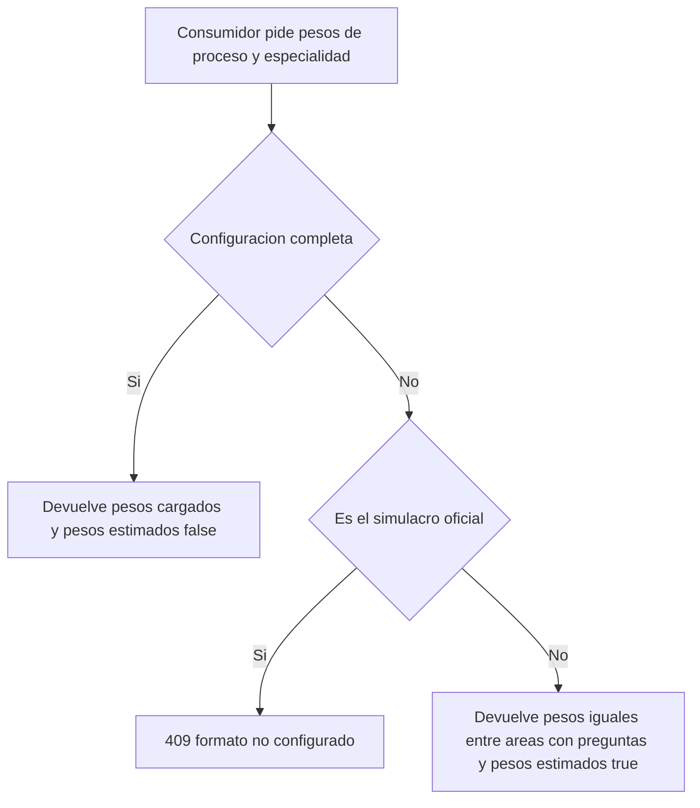

# SIA-E1-03 Pesos por profesión y proceso SERUMS

**Como** admin, **quiero** cargar a mano, para cada proceso SERUMS y cada profesión, el peso y el número de preguntas de cada área, **para** que dashboard, plan, diagnóstico, prácticas y simulacro reflejen el examen real.

## Contexto
Decisión P6 (issue #65): carga manual por admin de pesos por (proceso, especialidad, asignatura) en `proceso_asignaturas`. Hoy esa tabla es `UNIQUE(proceso_id, asignatura_id)` con `numero_preguntas`, `peso_porcentual` y `coeficiente`; hay que añadirle la especialidad. Mientras falten datos, diagnóstico y prácticas usan pesos iguales con `pesos_estimados: true`; el simulacro oficial (SIA-E9-05) queda bloqueado hasta completar la configuración.



## Reglas de negocio
1. `proceso_asignaturas` gana la especialidad (opcional). Regla de unicidad: una única fila por (proceso, especialidad, asignatura) y una sola fila de compatibilidad sin especialidad por (proceso, asignatura). Cómo se garantiza en la base de datos lo decide el architect en un ADR.
2. Las filas existentes quedan sin especialidad: son la configuración general del proceso y siguen vigentes para procesos que no son SERUMS (compatibilidad). La migración no modifica sus valores. Esta historia no edita las filas de compatibilidad y las reglas 4 y 5 no se les aplican.
3. Carga manual por admin: por (proceso, especialidad) se guardan, para cada área, `peso_porcentual`, `numero_preguntas` y `coeficiente`. No se obtienen pesos de fuentes externas.
4. Guardado atómico sin borradores (decisión PO, contrato MVP E1+E2): cada guardado envía la configuración entera de (proceso, especialidad), es decir, todas las áreas que la forman. El guardado reemplaza la configuración anterior: un área que ya no viene en el cuerpo sale de la configuración. Se guarda todo o nada. Los pesos deben sumar 100 % con tolerancia 0,01; si no, 422 `pesos_no_suman_100`, no se guarda nada y la configuración anterior (si existía) queda igual.
5. `numero_preguntas` ≥ 1 y suma por (proceso, especialidad) ≤ 200; si no, 422 `limite_preguntas` y no se guarda nada.
6. El estado de la configuración por (proceso, especialidad) es derivado, no se guarda aparte: `completa` si existe una configuración guardada (que por la regla 4 siempre suma 100); `incompleta` si nunca se guardó ninguna. Solo `completa` se usa como peso real. No hay configuraciones parciales ni borradores.
7. 409 `peso_duplicado` cuando: (a) el cuerpo repite un área; (b) se intenta crear una segunda fila de compatibilidad sin especialidad para (proceso, asignatura) por la API existente; (c) la restricción de unicidad de la base de datos rechaza la escritura (por ejemplo, dos guardados simultáneos).
8. Mientras la configuración no esté `completa`, el servicio de pesos devuelve pesos iguales entre las áreas con preguntas aprobadas y la bandera `pesos_estimados: true`; la consumen el diagnóstico (SIA-E4-01/E4-02), las prácticas y simulacros dirigidos (SIA-E5-04/E5-05), el dashboard (SIA-E5-01), la priorización (SIA-E5-03) y el plan (SIA-E7-02), y cada uno lo informa al usuario.
9. El simulacro oficial (SIA-E9-05) nunca usa pesos estimados: sin configuración `completa` responde 409 `formato_no_configurado`.
10. Cada cambio se audita con valores antes/después.
11. Pantalla de admin en el MVP (decisión PO, Q9 del contrato): es una pantalla simple en el panel admin, junto a los catálogos, hecha con componentes khipu y un formulario formik/yup. El admin elige proceso y especialidad y ve el estado (`completa`/`incompleta`). Edita una tabla de áreas con peso, número de preguntas y coeficiente; puede añadir y quitar áreas. Debajo ve la suma de pesos y el total de preguntas en vivo.
12. Validación en el cliente con las mismas reglas que el servidor (4, 5 y 7): «Guardar» queda deshabilitado mientras la suma no sea 100 (± 0,01), el total pase de 200 o se repita un área, y cada caso muestra su mensaje. Los errores del servidor (422/409) se muestran sin perder lo que el admin escribió.
13. Estados de UI: carga, vacío («Sin configuración: se usan pesos estimados»), error con reintento. La ruta va bajo el guard de admin.

## Criterios de aceptación
```gherkin
Escenario: Configuración completa
  Dado el proceso SERUMS 2026-I y la especialidad Medicina con 6 áreas
  Cuando el admin guarda pesos que suman 100
  Entonces la configuración queda "completa" y se registra en audit_log

Escenario: Suma inválida sin configuración previa
  Dado el proceso SERUMS 2026-I y la especialidad Medicina sin configuración guardada
  Cuando el admin guarda pesos de 6 áreas que suman 95
  Entonces responde 422 "pesos_no_suman_100", no se guarda ninguna fila y la configuración sigue "incompleta"

Escenario: Suma inválida con configuración completa previa
  Dado el proceso SERUMS 2026-I y la especialidad Medicina con configuración "completa"
  Cuando el admin guarda pesos que suman 95
  Entonces responde 422 "pesos_no_suman_100" y la configuración anterior queda intacta y "completa"

Escenario: Reemplazo de la configuración
  Dado una configuración "completa" de Medicina con 6 áreas
  Cuando el admin guarda 5 áreas que suman 100
  Entonces la configuración queda con esas 5 áreas, el área omitida sale de la configuración y audit_log registra los valores antes/después

Escenario: Exceso de preguntas
  Dado el proceso SERUMS 2026-I y la especialidad Medicina con 6 áreas
  Cuando el admin guarda numero_preguntas que suman 210
  Entonces responde 422 "limite_preguntas" y no se guarda nada

Escenario: Pesos distintos por especialidad
  Dado el proceso SERUMS 2026-I con configuración completa para Medicina y para Enfermería
  Cuando se piden los pesos de cada especialidad
  Entonces cada una recibe sus propios pesos y una fila de Medicina no afecta a Enfermería

Escenario: Unicidad
  Dado el proceso SERUMS 2026-I y la especialidad Medicina
  Cuando el admin guarda una configuración que trae dos veces el área Salud pública
  Entonces responde 409 "peso_duplicado" y no se guarda nada

Escenario: Unicidad de la fila de compatibilidad
  Dado una fila sin especialidad de (proceso X, Salud pública)
  Cuando se intenta crear otra fila sin especialidad de (proceso X, Salud pública)
  Entonces responde 409 "peso_duplicado"

Escenario: Compatibilidad
  Dado un proceso no SERUMS con proceso_asignaturas existente sin especialidad
  Cuando se aplica la migración y un usuario crea un simulacro
  Entonces el comportamiento y los valores no cambian

Escenario: Sin configuración
  Dado una especialidad sin pesos completos
  Cuando el diagnóstico, la práctica o el dashboard piden los pesos
  Entonces reciben pesos iguales y la bandera "pesos_estimados": true

Escenario: Simulacro oficial sin configuración
  Dado una especialidad con configuración "incompleta"
  Cuando el simulacro oficial pide los pesos
  Entonces recibe 409 "formato_no_configurado" y no pesos estimados

Escenario: Migración reversible
  Dado el esquema actual con filas en proceso_asignaturas
  Cuando se aplica y revierte la migración
  Entonces las filas sin especialidad quedan intactas

Escenario: Permisos
  Dado un usuario con rol usuario
  Cuando intenta guardar pesos
  Entonces recibe 403

Escenario: Pantalla sin configuración
  Dado el proceso SERUMS 2026-I y la especialidad Enfermería sin configuración guardada
  Cuando el admin los elige en la pantalla de pesos
  Entonces ve el estado "incompleta", el aviso «Sin configuración: se usan pesos estimados» y una tabla vacía para añadir áreas

Escenario: Suma en vivo y guardado bloqueado
  Dado la pantalla de pesos con 6 áreas cuyos pesos suman 95
  Cuando el admin la revisa
  Entonces ve la suma 95, el mensaje de que debe sumar 100 y el botón «Guardar» deshabilitado

Escenario: Guardar desde la pantalla
  Dado la pantalla de pesos con 6 áreas que suman 100 y 120 preguntas
  Cuando el admin pulsa «Guardar»
  Entonces la pantalla muestra el estado "completa" y un mensaje de éxito

Escenario: Error del servidor
  Dado la pantalla de pesos con datos válidos
  Cuando el servidor responde 409 "peso_duplicado" o 500
  Entonces la pantalla muestra el error y conserva los valores escritos

Escenario: Acceso a la pantalla
  Dado un usuario con rol usuario
  Cuando abre la ruta de la pantalla de pesos
  Entonces es redirigido según el guard de rol admin
```

## Fuera de alcance
Obtener los pesos oficiales automáticamente; pesos por tema (solo por área en esta fase); guardar configuraciones parciales o borradores; editar las filas de compatibilidad sin especialidad.

## Dependencias
SIA-E1-01. Proceso «SERUMS 2026-I» dado de alta en el catálogo existente.

## Seguridad y privacidad
Solo admin escribe. Auditoría de cada cambio (valores antes/después).

## i18n
Mensajes y etiquetas es/en, incluida la nota «pesos estimados» y los estados «completa»/«incompleta».

## Definición de terminado
Migración con Down; tests de suma, límites, unicidad por especialidad y compatibilidad; contrato en docs/api/; pantalla con estados carga/vacío/error verificados, claves es/en (`dashboard.serumsIa.pesos.*`) y `tsc`, `lint` y `build` en verde; review limpio.
