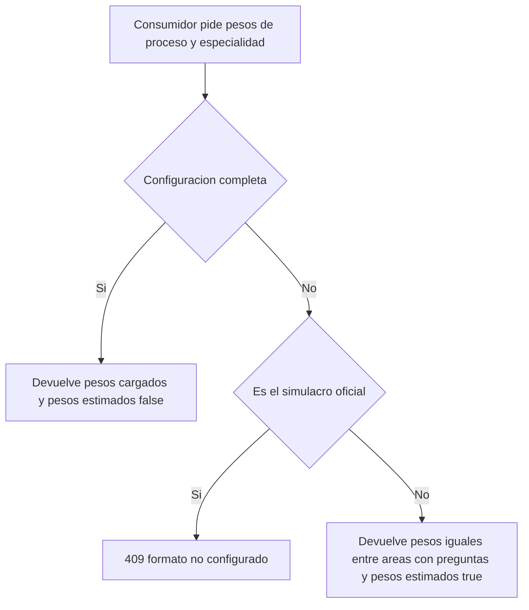

# SIA-E1-03 Pesos por profesión y proceso SERUMS

**Como** admin, **quiero** cargar a mano, para cada proceso SERUMS y cada profesión, el peso y el número de preguntas de cada área, **para** que dashboard, plan, diagnóstico, prácticas y simulacro reflejen el examen real.

## Contexto
Decisión P6 (issue #65): carga manual por admin de pesos por (proceso, especialidad, asignatura) en `proceso_asignaturas`. Hoy esa tabla es `UNIQUE(proceso_id, asignatura_id)` con `numero_preguntas`, `peso_porcentual` y `coeficiente`; hay que añadirle la especialidad. Mientras falten datos, diagnóstico y prácticas usan pesos iguales con `pesos_estimados: true`; el simulacro oficial (SIA-E9-05) queda bloqueado hasta completar la configuración.



## Reglas de negocio
1. `proceso_asignaturas` gana la especialidad (opcional). Regla de unicidad: una única fila por (proceso, especialidad, asignatura) y una sola fila de compatibilidad sin especialidad por (proceso, asignatura). Cómo se garantiza en la base de datos lo decide el tech-lead en un ADR.
2. Las filas existentes quedan sin especialidad: son la configuración general del proceso y siguen vigentes para procesos que no son SERUMS (compatibilidad). La migración no modifica sus valores.
3. Carga manual por admin: por (proceso, especialidad) se guardan, para cada área, `peso_porcentual`, `numero_preguntas` y `coeficiente`. No se obtienen pesos de fuentes externas.
4. Pesos de áreas de una (proceso, especialidad) suman 100 % con tolerancia 0,01; si no, no se puede marcar la configuración como «completa».
5. `numero_preguntas` ≥ 1 y suma por (proceso, especialidad) ≤ 200.
6. Estado de la configuración por (proceso, especialidad): `incompleta` o `completa`. Solo `completa` se usa como peso real.
7. Mientras la configuración no esté `completa`, el servicio de pesos devuelve pesos iguales entre las áreas con preguntas aprobadas y la bandera `pesos_estimados: true`; la consumen el diagnóstico (SIA-E4-01/E4-02), las prácticas y simulacros dirigidos (SIA-E5-04/E5-05), el dashboard (SIA-E5-01), la priorización (SIA-E5-03) y el plan (SIA-E7-02), y cada uno lo informa al usuario.
8. El simulacro oficial (SIA-E9-05) nunca usa pesos estimados: sin configuración `completa` responde 409 `formato_no_configurado`.
9. Cada cambio se audita con valores antes/después.

## Criterios de aceptación
```gherkin
Escenario: Configuración completa
  Dado el proceso SERUMS 2026-I y la especialidad Medicina con 6 áreas
  Cuando el admin guarda pesos que suman 100
  Entonces la configuración queda "completa" y se registra en audit_log

Escenario: Suma inválida
  Dado el proceso SERUMS 2026-I y la especialidad Medicina con 6 áreas
  Cuando el admin guarda pesos que suman 95
  Entonces responde 422 "pesos_no_suman_100" y la configuración queda "incompleta"

Escenario: Exceso de preguntas
  Dado el proceso SERUMS 2026-I y la especialidad Medicina con 6 áreas
  Cuando el admin guarda numero_preguntas que suman 210
  Entonces responde 422 "limite_preguntas"

Escenario: Pesos distintos por especialidad
  Dado el proceso SERUMS 2026-I con configuración completa para Medicina y para Enfermería
  Cuando se piden los pesos de cada especialidad
  Entonces cada una recibe sus propios pesos y una fila de Medicina no afecta a Enfermería

Escenario: Unicidad
  Dado una fila de (SERUMS 2026-I, Medicina, Salud pública)
  Cuando se intenta crear otra fila con la misma combinación
  Entonces responde 409 "peso_duplicado"

Escenario: Unicidad de la fila de compatibilidad
  Dado una fila sin especialidad de (proceso X, Salud pública)
  Cuando se intenta crear otra fila sin especialidad de (proceso X, Salud pública)
  Entonces responde 409 "peso_duplicado"

Escenario: Compatibilidad
  Dado un proceso no SERUMS con proceso_asignaturas existente sin especialidad
  Cuando se aplica la migración y un usuario crea un simulacro
  Entonces el comportamiento y los valores no cambian

Escenario: Sin configuración
  Dado una especialidad sin pesos completos
  Cuando el diagnóstico, la práctica o el dashboard piden los pesos
  Entonces reciben pesos iguales y la bandera "pesos_estimados": true

Escenario: Simulacro oficial sin configuración
  Dado una especialidad con configuración "incompleta"
  Cuando el simulacro oficial pide los pesos
  Entonces recibe 409 "formato_no_configurado" y no pesos estimados

Escenario: Migración reversible
  Dado el esquema actual con filas en proceso_asignaturas
  Cuando se aplica y revierte la migración
  Entonces las filas sin especialidad quedan intactas

Escenario: Permisos
  Dado un usuario con rol usuario
  Cuando intenta guardar pesos
  Entonces recibe 403
```

## Fuera de alcance
Obtener los pesos oficiales automáticamente; pesos por tema (solo por área en esta fase).

## Dependencias
SIA-E1-01. Proceso «SERUMS 2026-I» dado de alta en el catálogo existente.

## Seguridad y privacidad
Solo admin escribe. Auditoría de cada cambio (valores antes/después).

## i18n
Mensajes y etiquetas es/en, incluida la nota «pesos estimados» y los estados «completa»/«incompleta».

## Definición de terminado
Migración con Down; tests de suma, límites, unicidad por especialidad y compatibilidad; contrato en docs/api/; review limpio.
