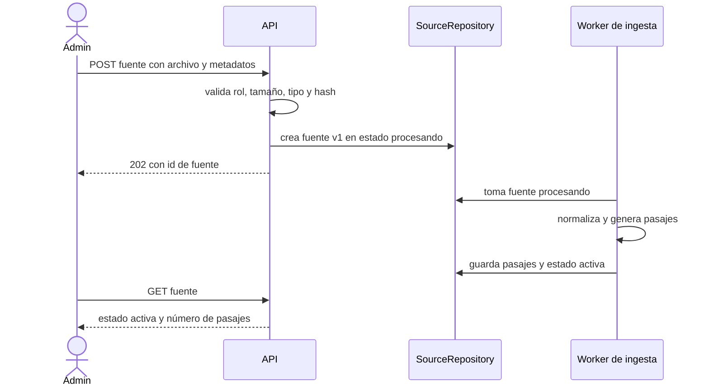

# SIA-E2-03 Ingesta de archivo .md

**Como** admin, **quiero** subir un archivo .md como fuente académica (balotario, guía, norma), **para** que quede disponible para citas y para el parser del balotario.

## Contexto
El producto no puede depender de rutas locales como `assets/`: la subida es por la API. Tipos de fuente: `balotario`, `guia`, `norma`, `otro`.

## Reglas de negocio
1. Límites: 2 MiB, 20 000 líneas, UTF-8 válido, extensión `.md`, tipo `text/markdown` o `text/plain`.
2. Metadatos obligatorios: título (3–150), tipo, profesión(es) aplicables (0..N; ninguna = todas), año y proceso opcionales.
3. Se calcula un hash SHA-256 del contenido; un archivo idéntico a una versión existente de la misma fuente se rechaza (409 `fuente_duplicada`).
4. La ingesta es asíncrona: estado `procesando` → `activa` o `fallida`. Máx. 100 fuentes activas por profesión.
5. El contenido se trata como datos, nunca como instrucciones (se escapa/delimita al enviarlo a IA).
6. Acción auditada.



## Criterios de aceptación
```gherkin
Escenario: Subida correcta
  Dado un admin y un .md de 300 KiB
  Cuando lo sube con título y tipo
  Entonces recibe 202 con el id y la fuente pasa de "procesando" a "activa"

Escenario: Archivo demasiado grande
  Dado un admin autenticado
  Cuando sube un archivo de 3 MiB
  Entonces recibe 413 "archivo_demasiado_grande" y no se crea la fuente

Escenario: Tipo inválido
  Dado un admin autenticado
  Cuando sube un .pdf o un archivo con bytes no UTF-8
  Entonces recibe 422 "archivo_invalido"

Escenario: Duplicado
  Dado una fuente cuya versión vigente tiene un hash determinado
  Cuando el admin sube un archivo con el mismo hash
  Entonces recibe 409 "fuente_duplicada"

Escenario: Falla de procesamiento
  Dado un archivo que genera más de 5000 pasajes
  Cuando el worker lo procesa
  Entonces la fuente queda "fallida" con el motivo y no se publica ningún pasaje

Escenario: Límite por profesión
  Dado 100 fuentes activas de Medicina
  Cuando se sube otra para Medicina
  Entonces recibe 422 "limite_fuentes"

Escenario: Permisos
  Dado un usuario con rol usuario
  Cuando sube un archivo
  Entonces recibe 403

Escenario: Auditoría
  Dado un admin que sube un archivo válido
  Cuando la subida termina con éxito
  Entonces audit_log tiene "fuente.crear" con el id, el hash y el actor
```

## Fuera de alcance
URLs (SIA-E2-04), PDF, versionado por reemplazo (SIA-E2-06).

## Dependencias
SIA-E2-02, SIA-E2-05 (normalización).

## Seguridad y privacidad
Sanear nombre de archivo; no ejecutar contenido; el contenido original no se registra en logs. Advertir en pantalla que no se deben subir documentos con datos personales (padrones); no se suben archivos de assets/.

## i18n
Etiquetas, estados y errores en es/en.

## Definición de terminado
Tests de límites, tipos y permisos; migración con Down; estados de UI cubiertos; review limpio.
