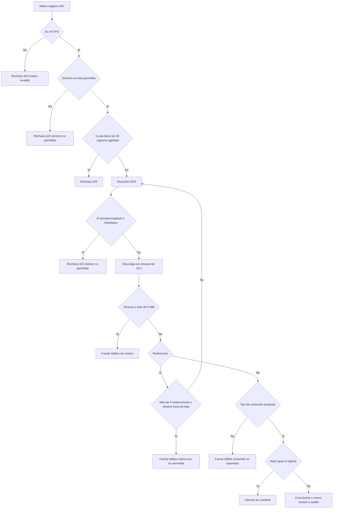

# SIA-E2-04 Ingesta de URL oficial

**Como** admin, **quiero** registrar una URL oficial (por ejemplo, una página de claves de respuesta de MINSA) como fuente, **para** capturar su contenido y poder citarlo.

## Contexto
El servidor descarga la página, extrae el texto principal y lo trata como una fuente más con versión. Riesgo principal: SSRF.

## Reglas de negocio
1. Solo HTTPS; solo dominios de una lista permitida editable por admin (inicial: `gob.pe` y subdominios).
2. Respuesta máx. 5 MiB, timeout 10 s, máx. 3 redirecciones (cada una revalidada contra la lista).
3. Se rechazan IP privadas, loopback, link-local y de metadatos de nube, también tras resolver DNS.
4. Tipos de contenido aceptados: `text/html`, `text/plain`, `text/markdown`.
5. Se guarda la URL final, fecha y hash de captura. Recapturar con contenido distinto crea nueva versión (SIA-E2-06).
6. Máx. 20 capturas de URL por admin por día.
7. Auditoría de alta y recaptura.



## Criterios de aceptación
```gherkin
Escenario: URL permitida
  Dado la URL https de un dominio de la lista permitida
  Cuando el admin la registra
  Entonces recibe 202 y la fuente se crea con el texto extraído y la fecha de captura

Escenario: Dominio no permitido
  Dado un admin autenticado
  Cuando registra una URL fuera de la lista
  Entonces recibe 422 "dominio_no_permitido"

Escenario: SSRF
  Dado un admin autenticado
  Cuando registra una URL que resuelve a 127.0.0.1 o a 169.254.169.254
  Entonces recibe 422 "destino_no_permitido" y no se hace la petición

Escenario: Redirección fuera de la lista
  Dado una URL permitida que redirige a un dominio no permitido
  Cuando el admin la registra
  Entonces la ingesta falla con "redireccion_no_permitida"

Escenario: Contenido excesivo
  Dado una URL permitida cuya respuesta supera 5 MiB
  Cuando el servidor la descarga
  Entonces se corta la lectura y la fuente queda "fallida" con el motivo

Escenario: Sin cambios
  Dado una fuente de URL ya capturada con un hash determinado
  Cuando el admin recaptura y el contenido tiene el mismo hash
  Entonces no se crea nueva versión y se informa "sin_cambios"

Escenario: Límite diario
  Dado un admin con 20 capturas hoy
  Cuando intenta otra
  Entonces recibe 429

Escenario: Permisos
  Dado un usuario con rol usuario
  Cuando registra una URL
  Entonces recibe 403
```

## Fuera de alcance
Rastreo (crawling) de enlaces, descarga de PDF, programación automática de recapturas.

## Dependencias
SIA-E2-02, SIA-E2-05, SIA-E2-06.

## Seguridad y privacidad
Cliente HTTP sin credenciales ni cookies, con User-Agent genérico; no se registra el contenido.

## i18n
Mensajes de error y etiquetas en es/en.

## Definición de terminado
Tests de SSRF (IPv4, IPv6, DNS rebinding, redirecciones); límites verificados; review limpio.
