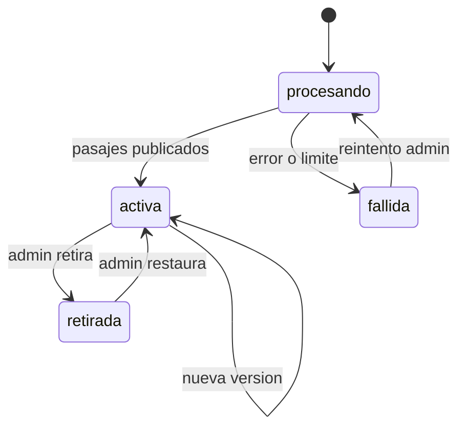

# SIA-E2-06 Versionado y ciclo de vida de fuentes

**Como** admin, **quiero** que cada actualización de una fuente cree una versión nueva y que pueda retirarla, **para** conservar la trazabilidad de las citas y retirar fuentes obsoletas.

## Contexto
Las citas apuntan a (fuente, versión, pasaje). Retirar una fuente afecta el contenido que la cita.



## Reglas de negocio
1. Subir un archivo nuevo para una fuente existente crea versión n+1; la anterior queda guardada y accesible para resolver citas.
2. Máx. 20 versiones por fuente; al superar se archiva la más antigua sin pasajes citados.
3. Retirar una fuente exige motivo (5–500 caracteres) y marca todo contenido que la cita como «requiere revisión»: pasa de aprobado a `en_revision` y deja de mostrarse al alumno hasta que un admin lo revalide (ver SIA-E6-05).
4. Una fuente `retirada` no aparece en búsquedas de pasajes.
5. Restaurar no reaprueba contenido automáticamente.
6. Toda transición se audita.

## Criterios de aceptación
```gherkin
Escenario: Nueva versión
  Dado una fuente activa en versión 1
  Cuando el admin sube un archivo distinto para esa fuente
  Entonces existe la versión 2 activa y la versión 1 sigue resolviendo sus citas

Escenario: Retirar fuente citada
  Dado una fuente citada por 12 preguntas aprobadas
  Cuando el admin la retira con motivo
  Entonces las 12 preguntas pasan a "en_revision" y dejan de mostrarse a alumnos en prácticas y simulacros nuevos

Escenario: Retirar sin motivo
  Dado una fuente activa
  Cuando el admin la retira sin motivo
  Entonces recibe 422

Escenario: Reintentar fallida
  Dado una fuente "fallida"
  Cuando el admin reintenta
  Entonces pasa a "procesando"

Escenario: Transición inválida
  Dado una fuente "procesando"
  Cuando el admin intenta retirarla
  Entonces recibe 409 "estado_invalido"

Escenario: Auditoría
  Dado una fuente que cambia de estado
  Cuando se completa cualquier transición
  Entonces audit_log registra el estado anterior y el nuevo
```

## Fuera de alcance
Comparación visual entre versiones (diff).

## Dependencias
SIA-E2-05; el comportamiento sobre preguntas se completa con SIA-E3-02 y SIA-E6-05.

## Seguridad y privacidad
Estado verificado en servidor. Solo admin.

## i18n
Estados y motivos visibles en es/en.

## Definición de terminado
Tests de cada transición válida e inválida; efecto en preguntas verificado; review limpio.
