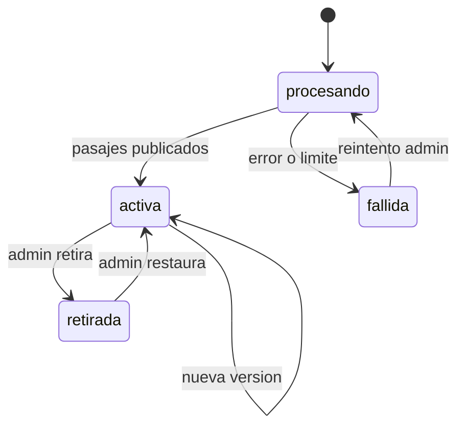

# SIA-E2-06 Versionado, ciclo de vida y marca «oficial verificada»

**Como** admin, **quiero** que cada actualización de una fuente cree una versión nueva, que pueda retirarla y que pueda marcarla como «oficial verificada», **para** conservar la trazabilidad de las citas, retirar fuentes obsoletas y distinguir los balotarios oficiales (ej. MINSA) de los no oficiales.

## Contexto
Las citas apuntan a (fuente, versión, pasaje). Retirar una fuente afecta el contenido que la cita. La marca «oficial verificada» (decisión P2, issue #65) es un atributo de la versión vigente que solo un admin activa de forma explícita; SIA-E3-05 la usa para decidir la ruta de revisión de las preguntas del balotario.



## Reglas de negocio
1. Subir un archivo nuevo para una fuente existente crea versión n+1; la anterior queda guardada y accesible para resolver citas.
2. Máx. 20 versiones por fuente; al superar se archiva la más antigua sin pasajes citados.
3. Retirar una fuente exige motivo (5–500 caracteres) y marca todo contenido que la cita como «requiere revisión»: pasa de aprobado a `en_revision` y deja de mostrarse al alumno hasta que un admin lo revalide (ver SIA-E6-05).
4. Una fuente `retirada` no aparece en búsquedas de pasajes.
5. Restaurar no reaprueba contenido automáticamente.
6. Toda transición se audita.
7. Marca «oficial verificada»: atributo `oficial_verificada` de la versión vigente, `false` al crear la fuente o una versión nueva (nunca se hereda de la versión anterior, porque el contenido cambió). Solo un admin la activa, sobre una fuente `activa`, indicando entidad emisora (3–100 caracteres, ej. «MINSA») y nota de verificación (10–500 caracteres: cómo se comprobó que es el documento oficial).
8. Desmarcar exige motivo (5–500 caracteres). Ni marcar ni desmarcar cambia el estado de preguntas ya aprobadas; solo afecta la ruta de revisión de las preguntas pendientes (SIA-E3-05).
9. Marcar y desmarcar se auditan en `audit_log` con actor, fuente, versión, entidad emisora y nota o motivo.

## Criterios de aceptación
```gherkin
Escenario: Nueva versión
  Dado una fuente activa en versión 1
  Cuando el admin sube un archivo distinto para esa fuente
  Entonces existe la versión 2 activa y la versión 1 sigue resolviendo sus citas

Escenario: Retirar fuente citada
  Dado una fuente citada por 12 preguntas aprobadas
  Cuando el admin la retira con motivo
  Entonces las 12 preguntas pasan a "en_revision" y dejan de mostrarse a alumnos en prácticas y simulacros nuevos

Escenario: Retirar sin motivo
  Dado una fuente activa
  Cuando el admin la retira sin motivo
  Entonces recibe 422

Escenario: Reintentar fallida
  Dado una fuente "fallida"
  Cuando el admin reintenta
  Entonces pasa a "procesando"

Escenario: Transición inválida
  Dado una fuente "procesando"
  Cuando el admin intenta retirarla
  Entonces recibe 409 "estado_invalido"

Escenario: Auditoría
  Dado una fuente que cambia de estado
  Cuando se completa cualquier transición
  Entonces audit_log registra el estado anterior y el nuevo

Escenario: Marcar como oficial verificada
  Dado una fuente "activa" de tipo balotario sin marca oficial
  Cuando el admin la marca como oficial verificada con entidad "MINSA" y una nota de verificación
  Entonces la versión vigente queda con oficial_verificada = true y audit_log registra actor, entidad y nota

Escenario: Marcar sin entidad o nota
  Dado una fuente "activa"
  Cuando el admin intenta marcarla como oficial verificada sin entidad emisora o sin nota
  Entonces recibe 422 y la marca no cambia

Escenario: Marcar una fuente no activa
  Dado una fuente "procesando", "fallida" o "retirada"
  Cuando el admin intenta marcarla como oficial verificada
  Entonces recibe 409 "estado_invalido"

Escenario: Versión nueva no hereda la marca
  Dado una fuente oficial verificada en versión 1
  Cuando el admin sube la versión 2
  Entonces la versión 2 queda con oficial_verificada = false hasta que un admin la vuelva a marcar

Escenario: Desmarcar
  Dado una fuente oficial verificada con preguntas aprobadas y preguntas pendientes
  Cuando el admin la desmarca con motivo
  Entonces las preguntas aprobadas siguen aprobadas, las pendientes pasan a exigir verificación de clave y se audita el motivo
```

## Fuera de alcance
Comparación visual entre versiones (diff).

## Dependencias
SIA-E2-05; el comportamiento sobre preguntas se completa con SIA-E3-02, SIA-E3-05 (ruta de revisión según la marca oficial) y SIA-E6-05.

## Seguridad y privacidad
Estado verificado en servidor. Solo admin.

## i18n
Estados, motivos y la etiqueta «Oficial verificada» visibles en es/en.

## Definición de terminado
Tests de cada transición válida e inválida y de marcar/desmarcar; efecto en preguntas verificado; migración con Down; review limpio.
