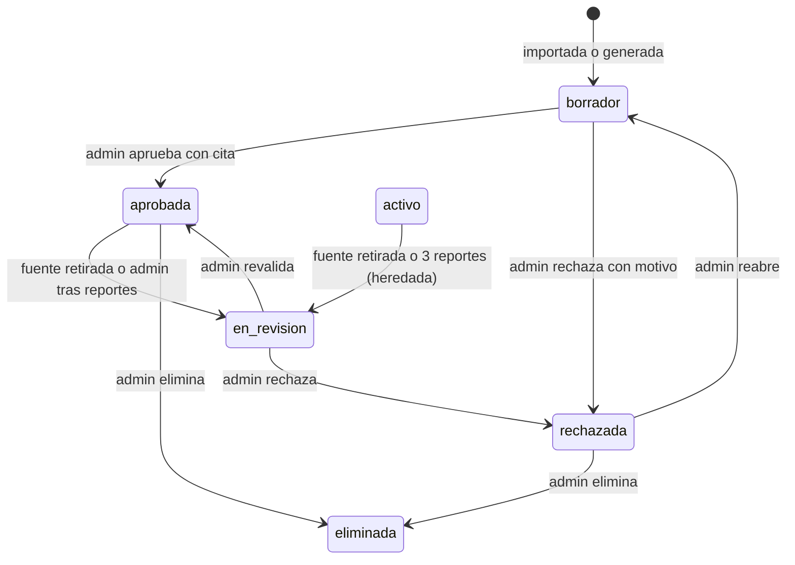

# SIA-E3-02 Estado borrador y trazabilidad pregunta-fuente

**Como** admin, **quiero** que las preguntas tengan un ciclo de vida con `borrador` y un vínculo a su fuente, **para** que ninguna pregunta nueva llegue a un alumno sin pasar por revisión y con origen trazable.

## Contexto
Hoy `preguntas.estado` es `activo`/`eliminada`; no hay `borrador` ni fuente. Las preguntas existentes se mantienen `activo` (grandfathering). Los estados nuevos son `borrador`, `en_revision`, `aprobada`, `rechazada`; `activo` se trata como equivalente a `aprobada` para el contenido ya publicado, con una excepción: ante 3 reportes de postulantes (SIA-E6-09) una pregunta `activo` heredada pasa sola a `en_revision`, mientras que una `aprobada` solo la retira un admin.



## Reglas de negocio
1. Solo preguntas en `aprobada` (o `activo` heredado) se sirven en prácticas, simulacros, diagnóstico y repaso. Se verifica en servidor en cada selección de preguntas.
2. Toda pregunta nueva importada o generada nace en `borrador`.
3. Trazabilidad: cada pregunta guarda 0..N citas (fuente, versión, pasaje) y el origen (`manual`, `balotario`, `ia`). Para aprobar se exige ≥1 cita a pasaje de fuente `activa` (excepción: origen `balotario`, cuya cita es la propia fuente del balotario).
4. Transiciones solo según el diagrama; otras dan 409 `estado_invalido`.
5. Rechazar exige motivo (5–500 caracteres).
6. Las preguntas ya usadas en intentos se conservan al cambiar de estado; los intentos en curso no se alteran.
7. Toda transición se audita (actor, estado anterior/nuevo).
8. Fuente retirada (efecto que se pasó aquí desde SIA-E2-06, decisión PO, contrato MVP E1+E2): esta historia se suscribe al aviso «fuente retirada» de SIA-E2-06. Toda pregunta `aprobada` o `activo` con al menos una cita a cualquier versión de esa fuente pasa a `en_revision` y deja de servirse hasta que un admin la revalide (SIA-E6-05). Cada cambio se audita con el actor del retiro y el motivo «fuente retirada». Restaurar la fuente no reaprueba nada (SIA-E2-06, regla 5). Las preguntas en `borrador` o `rechazada` no cambian de estado. El cambio va en la misma operación que el retiro (todo o nada): si falla, la fuente no queda retirada y el admin recibe el error, de modo que nunca se sirve una pregunta que cita una fuente retirada.

## Criterios de aceptación
```gherkin
Escenario: Borrador no se sirve
  Dado una pregunta en "borrador" de Medicina
  Cuando un usuario crea una práctica de esa asignatura
  Entonces la pregunta no se incluye

Escenario: Aprobar con cita
  Dado una pregunta en borrador con una cita a una fuente activa
  Cuando el admin la aprueba
  Entonces pasa a "aprobada" y puede servirse

Escenario: Aprobar sin cita
  Dado una pregunta de origen "ia" sin citas
  Cuando el admin intenta aprobarla
  Entonces recibe 422 "falta_cita"

Escenario: Transición inválida
  Dado una pregunta "rechazada"
  Cuando el admin intenta aprobarla directamente
  Entonces recibe 409 "estado_invalido"

Escenario: Retirar fuente citada
  Dado una fuente citada por 12 preguntas aprobadas y 3 en borrador
  Cuando el admin la retira con motivo
  Entonces las 12 preguntas pasan a "en_revision", dejan de mostrarse a alumnos en prácticas y simulacros nuevos, cada cambio queda en audit_log y las 3 en borrador no cambian

Escenario: Restaurar no reaprueba
  Dado una fuente retirada cuyas preguntas pasaron a "en_revision"
  Cuando el admin la restaura
  Entonces las preguntas siguen en "en_revision"

Escenario: Compatibilidad con el banco existente
  Dado preguntas existentes en estado "activo"
  Cuando se aplica la migración y un usuario crea una práctica
  Entonces siguen sirviéndose y no cambian tras la migración

Escenario: Intento en curso
  Dado un simulacro en curso con una pregunta que pasa a "en_revision"
  Cuando otro usuario crea un simulacro nuevo
  Entonces el intento en curso conserva la pregunta y los intentos nuevos no la incluyen

Escenario: Migración reversible
  Dado el esquema actual con preguntas existentes
  Cuando se aplica y revierte la migración
  Entonces el banco existente queda intacto
```

## Fuera de alcance
UI de revisión (SIA-E3-05, SIA-E6-05).

## Dependencias
SIA-E1-01, SIA-E2-06.

## Seguridad y privacidad
El estado se valida siempre en servidor; el alumno nunca puede pedir preguntas por id si no están aprobadas.

## i18n
Nombres de estados en es/en para las UI de admin.

## Definición de terminado
Migración con Down; tests de cada transición, de selección de preguntas y del efecto del aviso «fuente retirada»; review limpio.
