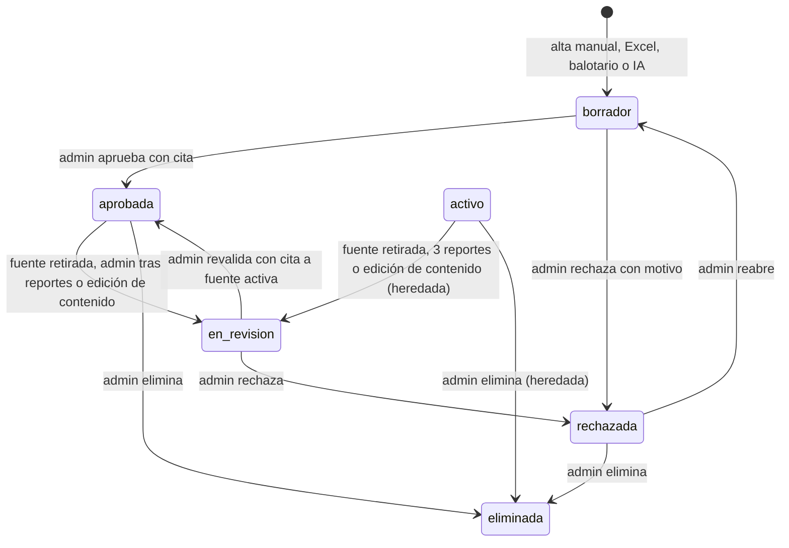

# SIA-E3-02 Estado borrador y trazabilidad pregunta-fuente

**Como** admin, **quiero** que las preguntas tengan un ciclo de vida con `borrador` y un vínculo a su fuente, **para** que ninguna pregunta nueva llegue a un alumno sin pasar por revisión y con origen trazable.

## Contexto
Hoy `preguntas.estado` es `activo`/`eliminada`; no hay `borrador` ni fuente. Las preguntas existentes se mantienen `activo` (grandfathering). Los estados nuevos son `borrador`, `en_revision`, `aprobada`, `rechazada`; `activo` se trata como equivalente a `aprobada` para el contenido ya publicado, con una excepción: ante 3 reportes de postulantes (SIA-E6-09) una pregunta `activo` heredada pasa sola a `en_revision`, mientras que una `aprobada` solo la retira un admin.



## Reglas de negocio
1. Solo preguntas en `aprobada` (o `activo` heredado) se sirven en prácticas, simulacros, diagnóstico y repaso. Se verifica en servidor en cada selección de preguntas.
2. Toda pregunta nueva nace en `borrador`, sea cual sea su vía de entrada: alta manual (`POST /preguntas`), importación Excel (origen `manual`), balotario (SIA-E3-03) o IA. Decisión del PO, P1 del contrato #152: si el alta manual naciera aprobada, sería una forma de saltarse la revisión. La vía para aprobar preguntas manuales y para revalidar, rechazar y reabrir las de cualquier origen es SIA-E3-07 (API) y SIA-E3-08 (pantalla y avisos de las pantallas existentes). **E3-02 no entra en un release sin SIA-E3-07 y SIA-E3-08**. El seed de demo crea una «Fuente demo (no oficial)», sin la marca oficial verificada, y aprueba sus preguntas con las mismas reglas que un admin. Ese seed nunca corre en producción.
3. Trazabilidad: cada pregunta guarda 0..N citas (fuente, versión, pasaje) y el origen (`manual`, `balotario`, `ia`). Para aprobar y para revalidar (`en_revision` → `aprobada`) se exige ≥1 cita a un pasaje de una fuente `activa`; una cita a una fuente retirada no basta (P4). Excepción: el origen `balotario`, cuya cita es la propia fuente del balotario, y solo mientras esa fuente esté `activa`.
4. Transiciones solo según el diagrama; otras dan 409 `estado_invalido`.
5. Rechazar exige motivo (5–500 caracteres).
6. Las preguntas ya usadas en intentos se conservan al cambiar de estado; los intentos en curso no se alteran.
7. Toda transición se audita (actor, estado anterior/nuevo).
8. Fuente retirada (efecto que se pasó aquí desde SIA-E2-06, decisión PO, contrato MVP E1+E2): esta historia se suscribe al aviso «fuente retirada» de SIA-E2-06. Toda pregunta `aprobada` o `activo` con al menos una cita a cualquier versión de esa fuente pasa a `en_revision` y deja de servirse hasta que un admin la revalide (SIA-E3-07 y SIA-E3-08 para cualquier origen). Cada cambio se audita con el actor del retiro y el motivo «fuente retirada». Restaurar la fuente no reaprueba nada (SIA-E2-06, regla 5). Las preguntas en `borrador` o `rechazada` no cambian de estado. El cambio va en la misma operación que el retiro (todo o nada): si falla, la fuente no queda retirada y el admin recibe el error, de modo que nunca se sirve una pregunta que cita una fuente retirada.
9. **Eliminar** (P2): solo desde `aprobada`, `rechazada` y `activo` (este último por compatibilidad con el banco existente). Una pregunta en `borrador` o `en_revision` hay que rechazarla primero; si no, da 409 `estado_invalido`. La deduplicación (SIA-E3-06) resuelve los duplicados rechazando, no eliminando.
10. **Editar** (P3):
    - En `aprobada` o `activo`, cambiar el enunciado, las alternativas, la clave o la explicación pasa la pregunta a `en_revision` en la misma operación, con auditoría y motivo «edición de contenido». Deja de servirse hasta que se revalide (regla 3).
    - Cambiar solo área, tema, etiquetas o dificultad no cambia el estado.
    - En `borrador`, `en_revision` o `rechazada`, editar no cambia el estado.
    - En origen `balotario`, la clave oficial no se puede cambiar: 422 `clave_oficial` (supuesto 4).
    - Consecuencia aceptada por el PO: corregir el contenido de una pregunta `activo` heredada, sin citas, la saca de circulación hasta que un admin la revalide con una cita.

## Criterios de aceptación
```gherkin
Escenario: Borrador no se sirve
  Dado una pregunta en "borrador" de Medicina
  Cuando un usuario crea una práctica de esa asignatura
  Entonces la pregunta no se incluye

Escenario: Aprobar con cita
  Dado una pregunta en borrador con una cita a una fuente activa
  Cuando el admin la aprueba
  Entonces pasa a "aprobada" y puede servirse

Escenario: Aprobar sin cita
  Dado una pregunta de origen "ia" sin citas
  Cuando el admin intenta aprobarla
  Entonces recibe 422 "falta_cita"

Escenario: Transición inválida
  Dado una pregunta "rechazada"
  Cuando el admin intenta aprobarla directamente
  Entonces recibe 409 "estado_invalido"

Escenario: Retirar fuente citada
  Dado una fuente citada por 12 preguntas aprobadas y 3 en borrador
  Cuando el admin la retira con motivo
  Entonces las 12 preguntas pasan a "en_revision", dejan de mostrarse a alumnos en prácticas y simulacros nuevos, cada cambio queda en audit_log y las 3 en borrador no cambian

Escenario: Restaurar no reaprueba
  Dado una fuente retirada cuyas preguntas pasaron a "en_revision"
  Cuando el admin la restaura
  Entonces las preguntas siguen en "en_revision"

Escenario: Compatibilidad con el banco existente
  Dado preguntas existentes en estado "activo"
  Cuando se aplica la migración y un usuario crea una práctica
  Entonces siguen sirviéndose y no cambian tras la migración

Escenario: Intento en curso
  Dado un simulacro en curso con una pregunta que pasa a "en_revision"
  Cuando otro usuario crea un simulacro nuevo
  Entonces el intento en curso conserva la pregunta y los intentos nuevos no la incluyen

Escenario: Alta manual nace en borrador
  Dado un admin
  Cuando crea una pregunta con POST /preguntas o la importa desde Excel
  Entonces queda en "borrador" con origen "manual" y no se sirve a los alumnos

Escenario: Revalidar solo con cita a fuente activa
  Dado una pregunta "en_revision" cuya única cita es a una fuente retirada
  Cuando el admin intenta revalidarla
  Entonces recibe 422 "falta_cita" y sigue en "en_revision"

Escenario: Eliminar un borrador
  Dado una pregunta en "borrador"
  Cuando el admin intenta eliminarla
  Entonces recibe 409 "estado_invalido"; tras rechazarla con motivo, puede eliminarla

Escenario: Eliminar una heredada
  Dado una pregunta "activo" heredada
  Cuando el admin la elimina
  Entonces pasa a "eliminada" y se audita

Escenario: Editar contenido de una aprobada
  Dado una pregunta "aprobada"
  Cuando el admin cambia el texto de una alternativa
  Entonces pasa a "en_revision" en la misma operación, se audita con motivo "edición de contenido" y deja de servirse en prácticas nuevas

Escenario: Editar solo la clasificación
  Dado una pregunta "aprobada"
  Cuando el admin cambia solo su tema
  Entonces sigue "aprobada"

Escenario: Clave oficial del balotario
  Dado una pregunta de origen "balotario"
  Cuando el admin intenta cambiar la clave
  Entonces recibe 422 "clave_oficial" y la pregunta no cambia

Escenario: Migración reversible
  Dado el esquema actual con preguntas existentes
  Cuando se aplica y revierte la migración
  Entonces el banco existente queda intacto
```

## Fuera de alcance
UI de revisión (SIA-E3-07/E3-08 revisión básica; SIA-E3-05 cola del balotario; SIA-E6-05 cola de IA) y avisos de las pantallas existentes (SIA-E3-08). La UI de esta historia se limita a los nombres de estado en es/en, bajo `dashboard.serumsIa.estadosPregunta.*`, que reutilizan las demás.

## Dependencias
SIA-E1-01, SIA-E2-06.

## Seguridad y privacidad
El estado se valida siempre en servidor; el alumno nunca puede pedir preguntas por id si no están aprobadas.

## i18n
Nombres de estados en es/en para las UI de admin, bajo `dashboard.serumsIa.estadosPregunta.*` (esta historia es dueña de esas claves).

## Definición de terminado
Migración con Down; tests de cada transición (incluidas eliminar y edición de contenido), de selección de preguntas, de revalidación con cita a fuente activa y del efecto del aviso «fuente retirada»; seed de demo con «Fuente demo (no oficial)»; review limpio. Validación de qa: incluye «Retirar con confirmación» de SIA-E2-07 con citantes > 0 desde la pantalla (decisión del PO).
