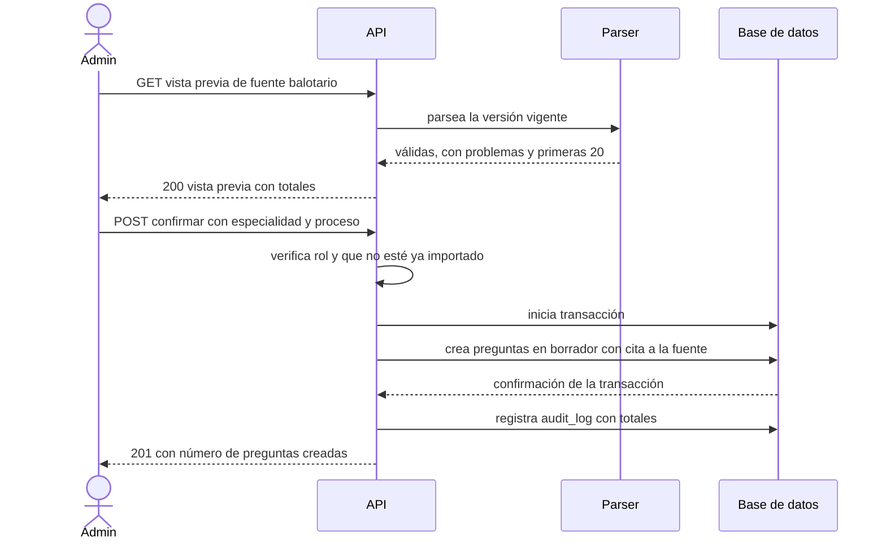

# SIA-E3-03 Importación del balotario con vista previa

**Como** admin, **quiero** ver una vista previa del parseo de un balotario y confirmar la importación, **para** crear preguntas en borrador solo si el resultado es correcto.

## Contexto
Extiende el import con preview existente. Entrada: una fuente de tipo `balotario` ya ingerida (SIA-E2-03).

## Reglas de negocio
1. La vista previa muestra totales (válidas, con problemas, unica/multiple) y las primeras 20 preguntas; las «con problemas» se listan con línea y motivo.
2. Al confirmar se crean solo las preguntas válidas, en `borrador`, con origen `balotario` y cita a la fuente; la especialidad y el proceso se eligen en la confirmación.
3. La confirmación es idempotente por (fuente, versión): importar dos veces no duplica (409 `ya_importado`).
4. Máx. 1 000 preguntas por importación; la operación es atómica (todo o nada).
5. Se audita con la fuente, la versión y los totales.



## Criterios de aceptación
```gherkin
Escenario: Vista previa
  Dado un balotario ingerido con 580 preguntas válidas y 12 con problemas
  Cuando el admin abre la vista previa
  Entonces ve los totales 580 / 12 y las primeras 20 preguntas

Escenario: Confirmar
  Dado una vista previa con 580 preguntas válidas
  Cuando confirma con especialidad Medicina y proceso SERUMS 2026-I
  Entonces se crean 580 preguntas en "borrador" con origen "balotario" y cita a la fuente

Escenario: Doble importación
  Dado una versión de balotario ya importada
  Cuando el admin confirma por segunda vez la misma versión
  Entonces recibe 409 "ya_importado"

Escenario: Fallo parcial
  Dado una importación en curso con un error de base de datos a mitad
  Cuando falla la transacción
  Entonces no se crea ninguna pregunta

Escenario: Sin válidas
  Dado un archivo con 0 preguntas válidas
  Cuando el admin abre la vista previa
  Entonces el botón confirmar está deshabilitado y se explica el motivo

Escenario: Permisos
  Dado un usuario con rol usuario
  Cuando llama al endpoint de importación
  Entonces recibe 403
```

## Fuera de alcance
Clasificación (SIA-E3-04) y deduplicación (SIA-E3-06), que se ejecutan después sobre los borradores.

## Dependencias
SIA-E3-01.

## Seguridad y privacidad
No se importan archivos desde rutas locales; solo fuentes ya ingeridas.

## i18n
Pantalla en es/en, estados carga/vacío/error.

## Definición de terminado
Test de atomicidad e idempotencia; `tsc`, `lint`, `build` en verde; review limpio.
