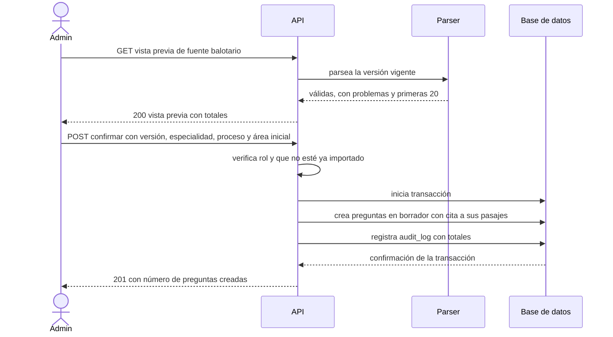

# SIA-E3-03 Importación del balotario con vista previa

**Como** admin, **quiero** ver una vista previa del parseo de un balotario y confirmar la importación, **para** crear preguntas en borrador solo si el resultado es correcto.

## Contexto
Extiende el import con preview existente. Entrada: una fuente de tipo `balotario` ya ingerida (SIA-E2-03).

## Reglas de negocio
1. La vista previa muestra totales (válidas, con problemas, unica/multiple) y las primeras 20 preguntas; las «con problemas» se listan con línea y motivo.
2. Al confirmar se crean solo las preguntas válidas, en `borrador`, con origen `balotario` y cita a la fuente. En la confirmación se eligen la especialidad, el proceso y un **área inicial** del proceso, igual que en la importación Excel (decisión del PO, 12-nov, opción A del architect: `preguntas.asignatura_id` es obligatoria y no se toca el esquema). El área inicial es provisional: SIA-E3-04 propone la definitiva y SIA-E3-05 exige que el admin la confirme al aprobar (SIA-E3-05, regla 10). La pantalla avisa que en un balotario de varias áreas el área inicial no es la real hasta clasificar.
3. La confirmación es idempotente por (fuente, versión): importar dos veces no duplica (409 `ya_importado`).
4. Máx. 1 000 preguntas por importación; la operación es atómica (todo o nada).
5. Se audita con la fuente, la versión y los totales.
6. La vista previa indica si la versión vigente de la fuente es «oficial verificada» (SIA-E2-06) y explica la ruta de revisión que tendrán las preguntas en SIA-E3-05: revisión de clasificación y estructura (fuente oficial verificada) o verificación explícita de clave (fuente no oficial). Decisión P2, issue #65.
7. Cada pregunta creada guarda sus `alertas_estructura` (SIA-E3-01). La ruta de revisión no se fija al importar: se calcula en servidor al aprobar (SIA-E3-05), según la marca vigente de la fuente en ese momento.
8. **Precondición** (decisión del PO, 12-nov): la fuente debe ser de tipo `balotario` (si no, 422 `tipo_fuente_invalido`) y estar `activa` (si no, 422 `fuente_no_activa`). Se comprueba en la vista previa y otra vez al confirmar.
9. **Cita obligatoria:** cada pregunta creada nace con al menos una cita a los pasajes de esa misma versión cuyo rango de líneas se solapa con el de la pregunta. Así cumple la exigencia de cita a una fuente activa para aprobar, que vale para **todos los procesos** (decisión del usuario, supuesto 24 (f)). Desde la pregunta, el admin puede ver el texto original de la fuente. Cómo se representa la cita lo decide el architect. Si ningún pasaje se solapa con las líneas de una pregunta (por ejemplo, líneas que la normalización descartó), esa pregunta se muestra en la vista previa como «con problemas» con el motivo `sin_pasaje` y no se importa: nunca nace un borrador de balotario sin cita.
10. **Versión vista = versión importada:** la confirmación envía el número de versión de la vista previa. Si ya no es la vigente, responde 409 `version_desactualizada` y no crea nada.
11. **Versiones nuevas:** una versión nueva de la misma fuente se puede importar. Sus duplicados frente a la versión anterior los resuelve SIA-E3-06. La idempotencia sigue siendo por (fuente, versión).
12. **Con problemas:** se listan todas, paginadas (20 por defecto, máx. 100), con número de línea y los motivos traducidos. No se importan. Para recuperarlas, el admin corrige el archivo y sube una versión nueva.
13. **Especialidad, proceso y área inicial:** los tres deben existir, la especialidad debe estar activa y el área debe pertenecer al proceso (la misma validación que el alta de preguntas; una referencia inexistente o ajena, como un área de otro proceso, responde 422 `referencia_invalida`). Si la fuente tiene profesiones asignadas, la especialidad elegida debe ser una de ellas (422 `especialidad_no_corresponde`).
14. **Auditoría:** se registra en la misma transacción que la creación (todo o nada), con el actor, la fuente, la versión, la especialidad, el proceso y los totales.
15. **Límite:** el error `limite_preguntas` del parser (más de 1 000 bloques) se responde como 422 `limite_preguntas` desde la vista previa.



## Criterios de aceptación
```gherkin
Escenario: Vista previa
  Dado un balotario ingerido con 580 preguntas válidas y 12 con problemas
  Cuando el admin abre la vista previa
  Entonces ve los totales 580 / 12 y las primeras 20 preguntas

Escenario: Confirmar
  Dado una vista previa con 580 preguntas válidas
  Cuando confirma con especialidad Medicina, proceso SERUMS 2026-I y área inicial Salud Pública
  Entonces se crean 580 preguntas en "borrador" con origen "balotario", cita a la fuente y área Salud Pública provisional

Escenario: Área inicial de otro proceso
  Dado un área que no pertenece a SERUMS 2026-I
  Cuando el admin la elige como área inicial y confirma
  Entonces recibe 422 "referencia_invalida" y no se crea nada

Escenario: Aviso de área provisional
  Dado la pantalla de confirmación
  Cuando el admin elige el área inicial
  Entonces ve el aviso de que el área es provisional hasta la clasificación y la revisión

Escenario: Vista previa de fuente oficial verificada
  Dado un balotario ingerido cuya versión vigente está marcada como oficial verificada por "MINSA"
  Cuando el admin abre la vista previa
  Entonces ve la insignia «Oficial verificada · MINSA» y el aviso de que la revisión será de clasificación y estructura

Escenario: Vista previa de fuente no oficial
  Dado un balotario ingerido sin marca oficial verificada
  Cuando el admin abre la vista previa
  Entonces ve el aviso de que cada pregunta exigirá verificación explícita de la clave

Escenario: Doble importación
  Dado una versión de balotario ya importada
  Cuando el admin confirma por segunda vez la misma versión
  Entonces recibe 409 "ya_importado"

Escenario: Fallo parcial
  Dado una importación en curso con un error de base de datos a mitad
  Cuando falla la transacción
  Entonces no se crea ninguna pregunta

Escenario: Sin válidas
  Dado un archivo con 0 preguntas válidas
  Cuando el admin abre la vista previa
  Entonces el botón confirmar está deshabilitado y se explica el motivo

Escenario: Permisos
  Dado un usuario con rol usuario
  Cuando llama al endpoint de vista previa o de importación
  Entonces recibe 403

Escenario: Cita creada al importar
  Dado una pregunta válida en las líneas 120–126 de la versión 2 y un pasaje de esa versión que cubre las líneas 100–180
  Cuando se confirma la importación
  Entonces la pregunta en borrador cita ese pasaje y el admin puede ver el texto original desde la pregunta

Escenario: Pregunta sin pasaje que la cubra
  Dado una pregunta válida para el parser cuyas líneas no se solapan con ningún pasaje de la versión
  Cuando el admin abre la vista previa y confirma
  Entonces la ve como "con problemas" con motivo "sin_pasaje" y no se crea

Escenario: Fuente no activa
  Dado un balotario retirado
  Cuando el admin abre la vista previa o confirma
  Entonces recibe 422 "fuente_no_activa" y no se crea nada

Escenario: Fuente que no es balotario
  Dado una fuente de otro tipo
  Cuando el admin pide su vista previa
  Entonces recibe 422 "tipo_fuente_invalido"

Escenario: Versión cambiada entre vista previa y confirmación
  Dado una vista previa de la versión 2 y una versión 3 que pasó a vigente después
  Cuando el admin confirma la versión 2
  Entonces recibe 409 "version_desactualizada" y no se crea nada

Escenario: Versión nueva de una fuente ya importada
  Dado la versión 1 ya importada y una versión 2 vigente
  Cuando el admin confirma la versión 2
  Entonces se crean sus preguntas en borrador y los duplicados quedan para SIA-E3-06

Escenario: Especialidad que no corresponde
  Dado un balotario con la profesión Enfermería
  Cuando el admin confirma con la especialidad Medicina
  Entonces recibe 422 "especialidad_no_corresponde"

Escenario: Listado de con problemas
  Dado una vista previa con 45 preguntas con problemas
  Cuando el admin pasa a la página 2 del listado de problemas
  Entonces ve los problemas 21 a 40, con línea y motivos traducidos

Escenario: Exceso de preguntas
  Dado un balotario con 1 001 bloques de pregunta
  Cuando el admin abre la vista previa
  Entonces recibe 422 "limite_preguntas" y la pantalla lo explica

Escenario: Auditoría atómica
  Dado una importación confirmada
  Cuando termina
  Entonces audit_log tiene un registro con fuente, versión, especialidad, proceso y totales, y si la transacción falla no queda ni el registro ni las preguntas
```

## Fuera de alcance
Clasificación (SIA-E3-04) y deduplicación (SIA-E3-06), que se ejecutan después sobre los borradores.

## Dependencias
SIA-E3-01.

## Seguridad y privacidad
No se importan archivos desde rutas locales; solo fuentes ya ingeridas.

## i18n
Pantalla en es/en, con estados de carga, vacío y error. Llevan texto traducido, nunca el código crudo: los ocho motivos y las tres alertas de SIA-E3-01, más el motivo `sin_pasaje`; la insignia, los dos avisos de ruta de revisión y el aviso de área provisional; y los errores `tipo_fuente_invalido`, `fuente_no_activa`, `version_desactualizada`, `ya_importado`, `especialidad_no_corresponde` y `limite_preguntas`.

## Definición de terminado
Tests de atomicidad (incluida la auditoría), de idempotencia, de `version_desactualizada` y de la cita creada. El test de `conflicto_clave` reservado en SIA-E3-07 se valida con SIA-E3-06, no aquí (decisión del PO, 12-nov). `tsc`, `lint` y `build` en verde; review limpio.
