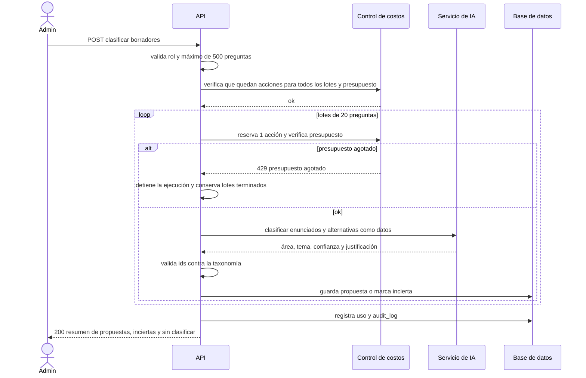

# SIA-E3-04 Clasificación por área y tema con IA

**Como** admin, **quiero** que la IA proponga área y tema para cada pregunta en borrador, con su nivel de confianza, **para** acelerar la clasificación que luego reviso.

## Contexto
Clasificación masiva y barata. La IA solo propone; nunca aplica una clasificación sin revisión (SIA-E3-05). Entrada a la IA: enunciado y alternativas; sin datos personales.

## Reglas de negocio
1. Se clasifica por lotes de máx. 20 preguntas por llamada al LLM y máx. 500 preguntas por ejecución (25 lotes). Un balotario mayor se clasifica en varias ejecuciones (ej. 580 preguntas = 500 + 80).
2. La salida es estructurada: `asignatura_id`, `tema_id` (o nulo), `confianza` 0–1 y `justificacion` (≤300 caracteres). Si el id no existe en la taxonomía de la profesión, la propuesta se descarta y la pregunta queda «sin clasificar». «Sin clasificar» significa sin propuesta válida. La pregunta conserva su área inicial provisional de SIA-E3-03, que nunca cuenta como clasificación (SIA-E3-05, regla 10). La IA nunca cambia `asignatura_id`: solo guarda la propuesta.
3. Confianza < 0,70 o respuesta inválida marca la pregunta como `incierta` (revisión obligatoria y prioritaria).
4. La IA no recibe ni devuelve la clave como si fuera su decisión: la clave oficial no se modifica.
5. Cuota (decisión del tech-lead sobre P3, issue #65): cada llamada al LLM, es decir cada lote, cuenta 1 acción IA real contra el límite de 200 por día del admin (SIA-E6-02). Clasificar 580 preguntas son 29 lotes y 29 acciones. Se registra el uso (tokens, costo en USD, operación) y el gasto se descuenta del presupuesto global de 40 USD/mes.
6. Antes de empezar, el servidor calcula los lotes necesarios (preguntas ÷ 20, redondeado hacia arriba). Si las acciones que le quedan hoy al admin no alcanzan, responde 429 `limite_ia` con cuántas preguntas sí caben y no llama a la IA.
7. Si el presupuesto global llega al 100 % a mitad de una ejecución, se detiene antes del siguiente lote. Las propuestas de los lotes terminados se conservan, el resto queda sin propuesta y la respuesta indica cuántas preguntas faltan (`parcial: presupuesto_agotado`).
8. Un lote que falla no consume acción (SIA-E6-02, regla 6) y sus preguntas quedan sin propuesta.
9. Cada ejecución se audita (actor, nº de preguntas, nº de lotes, acciones consumidas, resultado).



## Criterios de aceptación
```gherkin
Escenario: Clasificación exitosa
  Dado 100 preguntas en borrador
  Cuando el admin ejecuta la clasificación
  Entonces cada pregunta recibe una propuesta con área, tema, confianza y justificación

Escenario: Propuesta inválida
  Dado que la IA devuelve un tema que no existe
  Cuando el servicio valida la propuesta
  Entonces la propuesta se descarta y la pregunta queda "sin_clasificar"

Escenario: Baja confianza
  Dado una propuesta de la IA con confianza 0,55
  Cuando el servicio la guarda
  Entonces la pregunta se marca "incierta"

Escenario: Límite por ejecución
  Dado un admin autenticado con 501 preguntas en borrador
  Cuando pide clasificar 501 preguntas
  Entonces recibe 422 "limite_lote"

Escenario: Lotes de 20 y acciones consumidas
  Dado un admin con 0 acciones IA reales hoy y 80 preguntas en borrador
  Cuando ejecuta la clasificación
  Entonces se hacen 4 llamadas a la IA de 20 preguntas y el admin queda con 4 acciones consumidas

Escenario: Balotario de 580 preguntas
  Dado un admin con 0 acciones IA reales hoy y 580 preguntas en borrador
  Cuando clasifica 500 y luego las 80 restantes
  Entonces se consumen 25 y 4 acciones, 29 en total

Escenario: Acciones insuficientes
  Dado un admin con 195 acciones IA reales hoy y 200 preguntas en borrador
  Cuando pide clasificar las 200
  Entonces recibe 429 "limite_ia" indicando que caben 100 preguntas y no se llama a la IA

Escenario: Presupuesto agotado
  Dado el presupuesto de IA agotado
  Cuando el admin ejecuta la clasificación
  Entonces recibe 429 "presupuesto_agotado" y no se llama a la IA

Escenario: Presupuesto agotado a mitad de ejecución
  Dado una ejecución de 10 lotes en la que el presupuesto llega al 100 % tras el lote 6
  Cuando el servicio va a enviar el lote 7
  Entonces se detiene, conserva las propuestas de los 6 lotes y responde con "parcial: presupuesto_agotado" y 80 preguntas pendientes

Escenario: Lote fallido
  Dado una ejecución en la que la IA falla en un lote
  Cuando termina la ejecución
  Entonces ese lote no consume acción y sus 20 preguntas quedan sin propuesta

Escenario: Sin datos personales
  Dado una ejecución de clasificación en curso
  Cuando el servicio arma la petición a la IA
  Entonces el contenido enviado contiene solo ids opacos, enunciados y alternativas

Escenario: Permisos
  Dado un usuario con rol usuario
  Cuando intenta ejecutar la clasificación
  Entonces recibe 403
```

## Fuera de alcance
Aplicar la clasificación (SIA-E3-05); crear temas nuevos automáticamente.

## Dependencias
SIA-E3-03, SIA-E6-01, SIA-E6-02 (límite de acciones y presupuesto).

## Seguridad y privacidad
Los enunciados se envían delimitados como datos (mitigación de inyección de instrucciones). Sin datos personales en prompts ni logs.

## i18n
Estados y errores en es/en.

## Definición de terminado
Tests con IA simulada (propuesta válida, inválida, baja confianza, lote fallido, corte por presupuesto, acciones insuficientes); uso registrado; review limpio.
