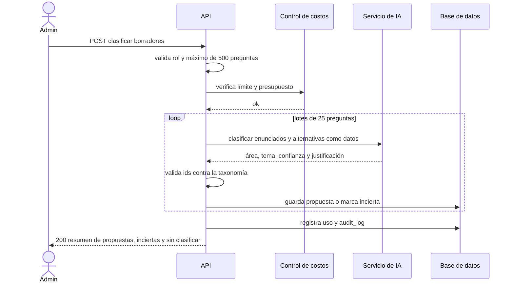

# SIA-E3-04 Clasificación por área y tema con IA

**Como** admin, **quiero** que la IA proponga área y tema para cada pregunta en borrador, con su nivel de confianza, **para** acelerar la clasificación que luego reviso.

## Contexto
Clasificación masiva y barata. La IA solo propone; nunca aplica una clasificación sin revisión (SIA-E3-05). Entrada a la IA: enunciado y alternativas; sin datos personales.

## Reglas de negocio
1. Se clasifica por lotes de máx. 25 preguntas por llamada y máx. 500 preguntas por ejecución.
2. La salida es estructurada: `asignatura_id`, `tema_id` (o nulo), `confianza` 0–1 y `justificacion` (≤300 caracteres). Si el id no existe en la taxonomía de la profesión, la propuesta se descarta y la pregunta queda «sin clasificar».
3. Confianza < 0,70 o respuesta inválida marca la pregunta como `incierta` (revisión obligatoria y prioritaria).
4. La IA no recibe ni devuelve la clave como si fuera su decisión: la clave oficial no se modifica.
5. Se registra el uso (tokens, costo, operación) y se descuenta del presupuesto de admin definido en SIA-E6-02.
6. Cada ejecución se audita (actor, nº de preguntas, resultado).



## Criterios de aceptación
```gherkin
Escenario: Clasificación exitosa
  Dado 100 preguntas en borrador
  Cuando el admin ejecuta la clasificación
  Entonces cada pregunta recibe una propuesta con área, tema, confianza y justificación

Escenario: Propuesta inválida
  Dado que la IA devuelve un tema que no existe
  Cuando el servicio valida la propuesta
  Entonces la propuesta se descarta y la pregunta queda "sin_clasificar"

Escenario: Baja confianza
  Dado una propuesta de la IA con confianza 0,55
  Cuando el servicio la guarda
  Entonces la pregunta se marca "incierta"

Escenario: Límite por ejecución
  Dado un admin autenticado con 501 preguntas en borrador
  Cuando pide clasificar 501 preguntas
  Entonces recibe 422 "limite_lote"

Escenario: Presupuesto agotado
  Dado el presupuesto de IA agotado
  Cuando el admin ejecuta la clasificación
  Entonces recibe 429 "presupuesto_agotado" y no se llama a la IA

Escenario: Sin datos personales
  Dado una ejecución de clasificación en curso
  Cuando el servicio arma la petición a la IA
  Entonces el contenido enviado contiene solo ids opacos, enunciados y alternativas

Escenario: Permisos
  Dado un usuario con rol usuario
  Cuando intenta ejecutar la clasificación
  Entonces recibe 403
```

## Fuera de alcance
Aplicar la clasificación (SIA-E3-05); crear temas nuevos automáticamente.

## Dependencias
SIA-E3-03, SIA-E6-01.

## Seguridad y privacidad
Los enunciados se envían delimitados como datos (mitigación de inyección de instrucciones). Sin datos personales en prompts ni logs.

## i18n
Estados y errores en es/en.

## Definición de terminado
Tests con IA simulada (propuesta válida, inválida, baja confianza); uso registrado; review limpio.
