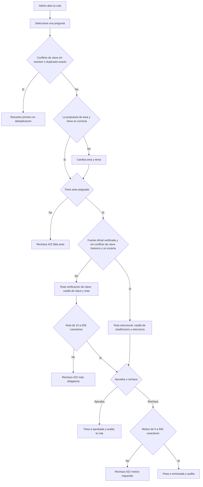

# SIA-E3-05 Revisión humana de la clasificación y de la clave

**Como** admin, **quiero** revisar, corregir y aprobar la clasificación y la pregunta en una cola, con una revisión más ligera para balotarios oficiales verificados y una verificación explícita de clave para el resto, **para** que solo contenido verificado llegue a los alumnos sin revisar dos veces lo que ya es oficial.

## Contexto
Cola de revisión de preguntas en `borrador` de origen `balotario`. Al aprobar, la pregunta pasa a `aprobada` (SIA-E3-02) con el área y tema confirmados. Las generadas por IA se revisan en SIA-E6-05.

Decisión P2 (issue #65), enfoque híbrido. Cada pregunta tiene una **ruta de revisión** que el servidor calcula al aprobar:
- `estructural`: la versión de la fuente está marcada «oficial verificada» (SIA-E2-06), la pregunta no tiene ni tuvo `conflicto_clave` (SIA-E3-06) y su clasificación no es `incierta` (SIA-E3-04). Basta revisar área/tema y consistencia estructural.
- `verificacion_clave`: cualquier otro caso (balotario no oficial, pregunta incierta o con conflicto de clave). Se exige verificación explícita de la clave.

## Reglas de negocio
1. La cola ordena primero las `incierta`, luego las de ruta `verificacion_clave`, luego por menor confianza. Filtro por ruta de revisión.
2. Por pregunta: ver enunciado, alternativas, clave oficial, ruta de revisión y su motivo, insignia de la fuente («Oficial verificada · entidad» o «No oficial»), alertas de estructura (SIA-E3-01), propuesta (área, tema, confianza, justificación) y posibles duplicados (SIA-E3-06); acciones: aceptar propuesta, cambiar área/tema, aprobar, rechazar con motivo.
3. Ruta `estructural`: aprobar exige área asignada y la casilla «Revisé área, tema y estructura: enunciado, alternativas y clave marcada coinciden con el balotario». Las preguntas con alertas de estructura se resaltan para revisarlas una a una.
4. Ruta `verificacion_clave`: aprobar exige área asignada, la casilla «He verificado la clave contra una fuente» y una nota de 10–500 caracteres que indique cómo se verificó.
5. La ruta se recalcula en servidor en cada aprobación con la marca vigente de la fuente; si el cliente envía solo la casilla estructural para una pregunta de ruta `verificacion_clave`, responde 422 `verificacion_clave_requerida`.
6. Aprobación masiva solo para preguntas de ruta `estructural`, con confianza ≥ 0,90, sin duplicados y sin alertas de estructura; máx. 50 por acción. Las de ruta `verificacion_clave` y las `incierta` solo individualmente.
7. Mientras una pregunta tenga `conflicto_clave` sin resolver no puede aprobarse (409 `conflicto_clave`, se resuelve en SIA-E3-06).
8. Si el admin detecta que la clave oficial es incorrecta, la rechaza con motivo; la clave `<mark>` no se reescribe (edición fuera de alcance).
9. Toda aprobación, cambio y rechazo se audita con la ruta aplicada, la casilla marcada y la nota si la hay.
10. Una pregunta sin área no puede aprobarse.



## Criterios de aceptación
```gherkin
Escenario: Ruta estructural con fuente oficial verificada
  Dado una pregunta de un balotario oficial verificado por "MINSA", sin conflicto de clave y con propuesta de confianza 0,95
  Cuando el admin acepta la propuesta, marca la casilla de clasificación y estructura y aprueba
  Entonces pasa a "aprobada" con esa área y tema y audit_log registra la ruta "estructural"

Escenario: Ruta de verificación con fuente no oficial
  Dado una pregunta de un balotario sin marca oficial verificada
  Cuando el admin marca la casilla de clave, escribe una nota de 30 caracteres y aprueba
  Entonces pasa a "aprobada" y audit_log registra la ruta "verificacion_clave" y la nota

Escenario: Fuente no oficial sin verificación de clave
  Dado una pregunta de un balotario sin marca oficial verificada
  Cuando el admin intenta aprobarla marcando solo la casilla de clasificación y estructura
  Entonces recibe 422 "verificacion_clave_requerida" y la pregunta sigue en borrador

Escenario: Fuente no oficial sin nota
  Dado una pregunta de ruta verificacion_clave
  Cuando el admin marca la casilla de clave y aprueba sin nota
  Entonces recibe 422 "nota_obligatoria"

Escenario: Fuente oficial con conflicto de clave histórico
  Dado una pregunta de un balotario oficial verificado con tuvo_conflicto_clave = true y el conflicto ya resuelto
  Cuando el admin abre la pregunta
  Entonces la ruta mostrada es "verificacion_clave" y aprobar exige la casilla de clave y la nota

Escenario: Fuente oficial con clasificación incierta
  Dado una pregunta de un balotario oficial verificado con clasificación "incierta"
  Cuando el admin intenta aprobarla solo con la casilla estructural
  Entonces recibe 422 "verificacion_clave_requerida"

Escenario: Conflicto de clave sin resolver
  Dado una pregunta marcada "conflicto_clave" sin decisión en deduplicación
  Cuando el admin intenta aprobarla
  Entonces recibe 409 "conflicto_clave"

Escenario: Marca retirada antes de aprobar
  Dado una pregunta pendiente cuya fuente se desmarcó como oficial verificada después de importarla
  Cuando el admin intenta aprobarla con la casilla estructural
  Entonces recibe 422 "verificacion_clave_requerida"

Escenario: Corregir
  Dado una pregunta con propuesta de tema distinto al correcto
  Cuando el admin cambia el tema antes de aprobar
  Entonces se guarda el tema elegido y se registra la propuesta original en audit_log

Escenario: Aprobación masiva en ruta estructural
  Dado 30 preguntas de un balotario oficial verificado, con confianza mayor o igual a 0,90, sin duplicados ni alertas de estructura
  Cuando el admin marca la casilla de clasificación y estructura y pulsa aprobación masiva
  Entonces las 30 pasan a "aprobada" y cada una queda en audit_log con la ruta "estructural"

Escenario: Masiva con preguntas de verificación de clave
  Dado 10 preguntas seleccionadas, 2 de ellas de un balotario no oficial
  Cuando el admin pulsa aprobación masiva
  Entonces recibe 422 "incluye_verificacion_clave" y no se aprueba ninguna

Escenario: Incierta no masiva
  Dado 10 preguntas seleccionadas, 3 de ellas inciertas
  Cuando el admin pulsa aprobación masiva
  Entonces recibe 422 "incluye_inciertas" y no se aprueba ninguna

Escenario: Límite masivo
  Dado 51 preguntas seleccionadas de ruta estructural con confianza mayor o igual a 0,90
  Cuando el admin pulsa aprobación masiva
  Entonces recibe 422 "limite_masivo"

Escenario: Sin área
  Dado una pregunta "sin_clasificar"
  Cuando el admin intenta aprobarla
  Entonces recibe 422 "falta_area"

Escenario: Rechazar
  Dado una pregunta en la cola
  Cuando el admin la rechaza con un motivo de 10 caracteres
  Entonces pasa a "rechazada" con el motivo y desaparece de la cola

Escenario: Cola vacía
  Dado ninguna pregunta pendiente de revisión
  Cuando el admin abre la cola
  Entonces ve «No hay preguntas por revisar»

Escenario: Concurrencia
  Dado dos admins que revisan la misma pregunta
  Cuando el segundo intenta aprobar una ya aprobada
  Entonces recibe 409 "estado_invalido"
```

## Fuera de alcance
Edición del texto del enunciado, de las alternativas y de la clave oficial; marcar la fuente como oficial verificada (SIA-E2-06, SIA-E2-07).

## Dependencias
SIA-E3-04; SIA-E3-06 (duplicados y conflicto de clave); SIA-E2-06 (marca «oficial verificada»).

## Seguridad y privacidad
Solo admin; estado y ruta de revisión verificados en servidor; la nota no se registra en logs de aplicación, solo en audit_log.

## i18n
Pantalla completa en es/en con estados carga/vacío/error; textos de las dos casillas, rutas de revisión e insignias en es/en.

## Definición de terminado
`tsc`, `lint`, `build` en verde; tests de ambas rutas, de recálculo de ruta, de límites y de concurrencia; review limpio.
