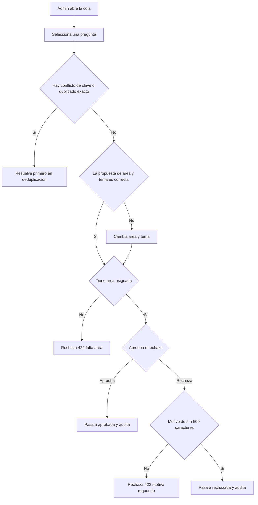

# SIA-E3-05 Revisión humana de la clasificación

**Como** admin, **quiero** revisar, corregir y aprobar la clasificación y la pregunta en una cola, **para** que solo contenido verificado llegue a los alumnos.

## Contexto
Cola de revisión de preguntas en `borrador` de origen `balotario`. Al aprobar, la pregunta pasa a `aprobada` (SIA-E3-02) con el área y tema confirmados. Las generadas por IA se revisan en SIA-E6-05.

## Reglas de negocio
1. La cola ordena primero las `incierta`, luego por menor confianza.
2. Por pregunta: ver enunciado, alternativas, clave oficial, propuesta (área, tema, confianza, justificación), posibles duplicados (SIA-E3-06); acciones: aceptar propuesta, cambiar área/tema, rechazar con motivo.
3. Aprobación masiva solo para preguntas con confianza ≥ 0,90 y sin duplicados; máx. 50 por acción; las `incierta` solo individualmente.
4. Toda aprobación, cambio y rechazo se audita.
5. Una pregunta sin área no puede aprobarse.



## Criterios de aceptación
```gherkin
Escenario: Aceptar propuesta
  Dado una pregunta con propuesta de confianza 0,95
  Cuando el admin la acepta
  Entonces pasa a "aprobada" con esa área y tema

Escenario: Corregir
  Dado una pregunta con propuesta de tema distinto al correcto
  Cuando el admin cambia el tema antes de aprobar
  Entonces se guarda el tema elegido y se registra la propuesta original en audit_log

Escenario: Incierta no masiva
  Dado 10 preguntas seleccionadas, 3 de ellas inciertas
  Cuando el admin pulsa aprobación masiva
  Entonces recibe 422 "incluye_inciertas" y no se aprueba ninguna

Escenario: Límite masivo
  Dado 51 preguntas seleccionadas con confianza mayor o igual a 0,90
  Cuando el admin pulsa aprobación masiva
  Entonces recibe 422 "limite_masivo"

Escenario: Sin área
  Dado una pregunta "sin_clasificar"
  Cuando el admin intenta aprobarla
  Entonces recibe 422 "falta_area"

Escenario: Rechazar
  Dado una pregunta en la cola
  Cuando el admin la rechaza con un motivo de 10 caracteres
  Entonces pasa a "rechazada" con el motivo y desaparece de la cola

Escenario: Cola vacía
  Dado ninguna pregunta pendiente de revisión
  Cuando el admin abre la cola
  Entonces ve «No hay preguntas por revisar»

Escenario: Concurrencia
  Dado dos admins que revisan la misma pregunta
  Cuando el segundo intenta aprobar una ya aprobada
  Entonces recibe 409 "estado_invalido"
```

## Fuera de alcance
Edición del texto del enunciado y las alternativas.

## Dependencias
SIA-E3-04; SIA-E3-06 para mostrar duplicados.

## Seguridad y privacidad
Solo admin; estado verificado en servidor.

## i18n
Pantalla completa en es/en con estados carga/vacío/error.

## Definición de terminado
`tsc`, `lint`, `build` en verde; tests de límites y concurrencia; review limpio.
