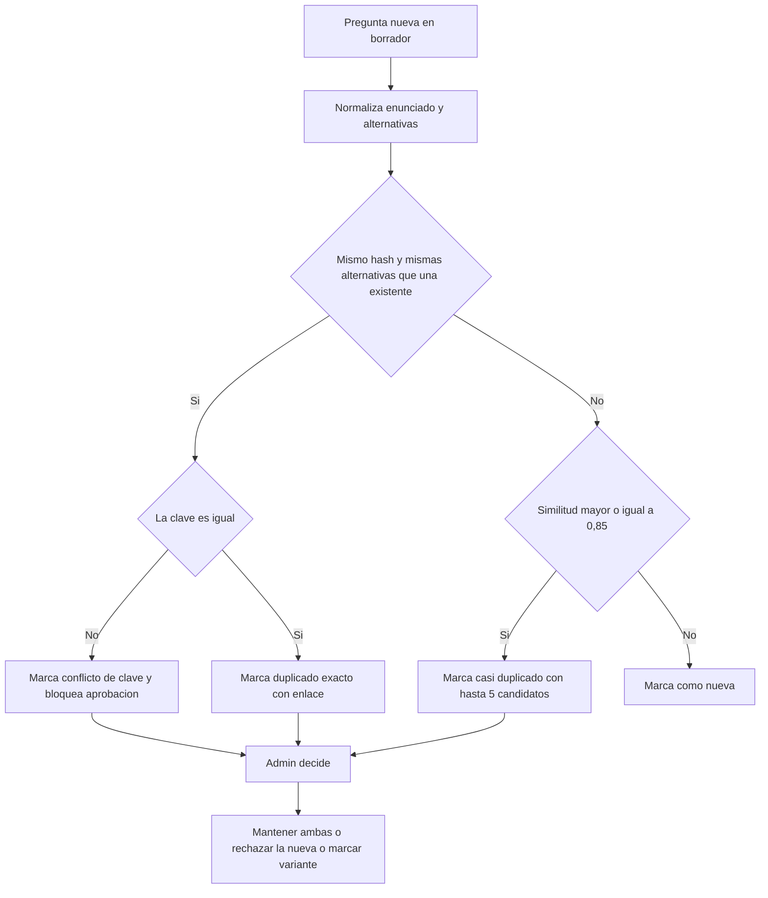

# SIA-E3-06 Deduplicación contra el banco existente

**Como** admin, **quiero** que el sistema detecte preguntas duplicadas o casi iguales al importar o generar, **para** no inflar el banco ni sesgar las estadísticas.

## Contexto
Detección determinista en dos niveles: exacta (hash del enunciado normalizado) y aproximada (similitud de texto sobre enunciado + alternativas). Sin IA.

## Reglas de negocio
1. Normalización previa: minúsculas, sin tildes ni signos, espacios colapsados.
2. Duplicado exacto: mismo hash de enunciado y mismo conjunto de alternativas.
3. Casi duplicado: similitud ≥ 0,85 (umbral configurable) sobre enunciado y alternativas; se lista hasta 5 candidatos por pregunta.
4. La comparación es contra preguntas del banco en cualquier estado excepto `eliminada`, dentro de la misma especialidad.
5. El sistema nunca elimina ni fusiona solo: marca el candidato y el admin decide (mantener ambas, rechazar la nueva, marcar como variante).
6. Si la clave difiere entre duplicados exactos, se señala «conflicto de clave» y bloquea la aprobación hasta decidir.



## Criterios de aceptación
```gherkin
Escenario: Duplicado exacto
  Dado una pregunta importada idéntica a una existente
  Cuando se ejecuta la deduplicación
  Entonces queda marcada "duplicado_exacto" con enlace a la existente

Escenario: Casi duplicado
  Dado una pregunta con similitud 0,90 con otra existente
  Cuando se ejecuta la deduplicación
  Entonces aparece como candidato con el porcentaje

Escenario: Bajo el umbral
  Dado una pregunta con similitud 0,60 con otra existente
  Cuando se ejecuta la deduplicación
  Entonces no se marca

Escenario: Conflicto de clave
  Dado dos preguntas con igual enunciado y distinta clave
  Cuando se ejecuta la deduplicación
  Entonces se marca "conflicto_clave" y no puede aprobarse la nueva hasta resolver

Escenario: Decisión del admin
  Dado una pregunta marcada como duplicado exacto
  Cuando el admin elige "rechazar la nueva"
  Entonces la nueva pasa a "rechazada" con motivo "duplicado" y se audita

Escenario: Rendimiento
  Dado un banco de 20 000 preguntas
  Cuando se deduplican 1 000 nuevas
  Entonces el proceso termina en menos de 120 s

Escenario: Permisos
  Dado un usuario con rol usuario
  Cuando invoca la deduplicación
  Entonces recibe 403
```

## Fuera de alcance
Similitud semántica con embeddings; fusión automática.

## Dependencias
SIA-E3-03.

## Seguridad y privacidad
Sin datos personales; solo texto de preguntas.

## i18n
Etiquetas de estado de duplicado en es/en.

## Definición de terminado
Tests con casos exactos, casi duplicados y conflicto de clave; medición de rendimiento adjunta; review limpio.
