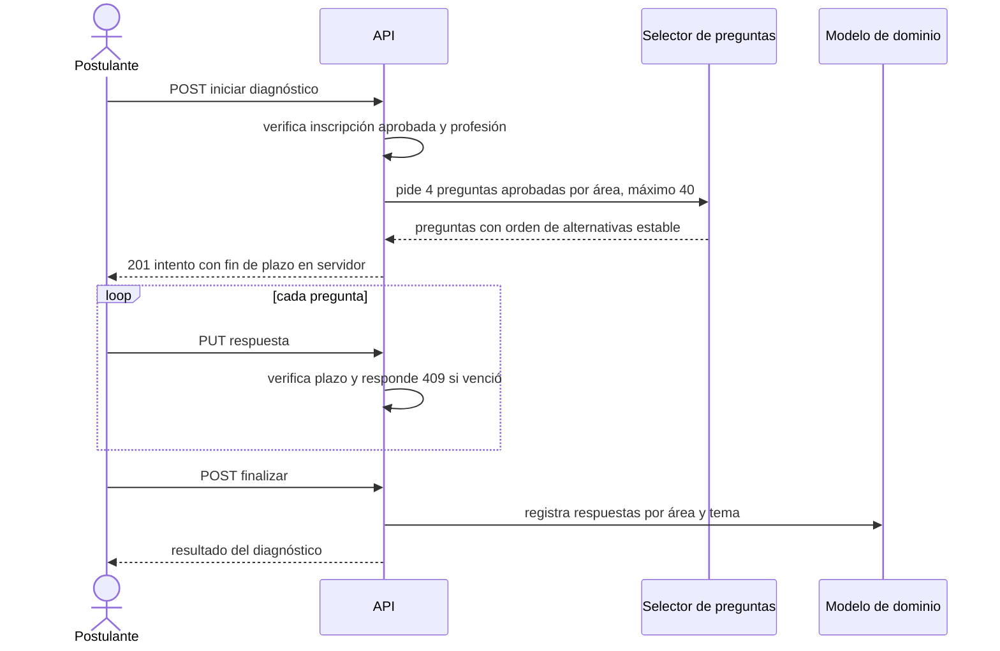

# SIA-E4-01 Test diagnóstico inicial por áreas

**Como** postulante, **quiero** rendir un test corto que mida mi nivel en cada área, **para** saber dónde estoy débil sin hacer un simulacro completo.

## Contexto
El diagnóstico es un intento cronometrado propio, distinto de práctica y simulacro, con preguntas aprobadas de la profesión elegida. Exige inscripción aprobada.



## Reglas de negocio
1. Exige inscripción aprobada al proceso y profesión elegida (403 si no).
2. 4 preguntas por área (mín. 3 si el área tiene pocas), máx. 40 en total; solo preguntas aprobadas, tipo única prioritaria; sin repetir preguntas ya respondidas por el usuario cuando haya alternativas.
3. Selección con dificultad mixta: 1 fácil, 2 medias, 1 difícil por área cuando existan.
4. Tiempo límite 45 min controlado en servidor; pasado el tiempo responde 409 `tiempo_agotado` y el intento se finaliza con lo respondido.
5. Un solo diagnóstico en curso por usuario; se permite repetir el diagnóstico una vez cada 30 días.
6. Si un área tiene menos de 3 preguntas aprobadas, se omite y se informa que no fue medida.
7. La clave y la explicación no se muestran hasta finalizar.

## Criterios de aceptación
```gherkin
Escenario: Inicio
  Dado un usuario con inscripción aprobada y profesión Medicina con 6 áreas con banco suficiente
  Cuando inicia el diagnóstico
  Entonces recibe 24 preguntas aprobadas (4 por área) y el instante de fin a 45 min

Escenario: Sin inscripción
  Dado un usuario con inscripción pendiente
  Cuando inicia el diagnóstico
  Entonces recibe 403

Escenario: Área sin banco
  Dado un área con 2 preguntas aprobadas
  Cuando el usuario inicia el diagnóstico
  Entonces el área no se incluye y el resultado indica «no medida»

Escenario: Tiempo agotado
  Dado un diagnóstico en curso con el plazo de 45 min vencido
  Cuando el usuario responde una pregunta
  Entonces recibe 409 "tiempo_agotado" y el intento queda finalizado

Escenario: Ya en curso
  Dado un diagnóstico en curso
  Cuando inicia otro
  Entonces recibe 409 "diagnostico_en_curso" con el id del vigente

Escenario: Repetición temprana
  Dado un diagnóstico finalizado hace 10 días
  Cuando inicia otro
  Entonces recibe 409 "repeticion_no_permitida" con la fecha en que podrá

Escenario: Aislamiento
  Dado el diagnóstico de otro usuario
  Cuando un usuario consulta ese intento
  Entonces recibe 404

Escenario: Borradores excluidos
  Dado preguntas en borrador o en_revision en las áreas de la profesión
  Cuando el usuario inicia el diagnóstico
  Entonces ninguna pregunta en borrador o en_revision se incluye
```

## Fuera de alcance
Diagnóstico adaptativo (selección dinámica según aciertos); resultado y dominio (SIA-E4-02, E4-03).

## Dependencias
SIA-E3-05 (banco aprobado), SIA-E1-04.

## Seguridad y privacidad
Orden de alternativas estable por intento; la clave no viaja al cliente antes de finalizar. Logs solo con ids.

## i18n
Pantalla, instrucciones y errores en es/en; estados de carga/error.

## Definición de terminado
Tests de plazo en servidor, inscripción, selección y aislamiento; `tsc`, `lint`, `build` en verde; review limpio.
