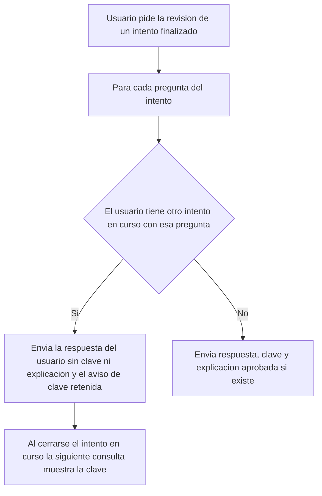

# SIA-E4-02 Resultado del diagnóstico

**Como** postulante, **quiero** ver mi nivel por área al terminar el diagnóstico y revisar mis respuestas, **para** entender mis puntos débiles y empezar a estudiar.

## Reglas de negocio
1. Por área: aciertos/total, nivel (`bajo` < 50 %, `medio` 50–74 %, `alto` ≥ 75 %) y etiqueta de confianza `baja` (menos de 5 respuestas efectivas del área, incluye diagnósticos previos) o `normal`.
2. Se muestra el nivel como orientativo, nunca como nota del examen.
3. Revisión: cada pregunta con tu respuesta, la clave y la explicación aprobada si existe (SIA-E6-08); si no existe, solo la clave oficial.
4. Áreas no medidas se listan aparte.
5. El resultado solo lo ve su dueño; se conserva en el historial.
6. Botón «Ir a mi dashboard» (SIA-E5-01).
7. **Clave retenida por intento en curso** (corrección de auditoría, hallazgo E; regla compartida del módulo): en la revisión de un intento finalizado, la clave y la explicación de una pregunta no se envían al cliente mientras el mismo usuario tenga otro intento en curso (práctica, simulacro o diagnóstico) que contenga esa pregunta. En su lugar se muestra la respuesta del usuario y «La clave se mostrará cuando termines tu intento en curso». Al cerrarse ese intento (finalizado o por tiempo agotado) se muestran normalmente. El filtro se aplica en servidor y esta historia lo implementa también en las revisiones existentes de práctica y simulacro, para que en el MVP no quede ninguna vía de consulta; SIA-E6-08 y SIA-E9-02 lo reutilizan.
8. Los aciertos por área (regla 1) sí se muestran: dicen cuántas acertó, no cuál es la clave.



## Criterios de aceptación
```gherkin
Escenario: Resultado por área
  Dado un diagnóstico finalizado con 3 de 4 aciertos en Salud pública
  Cuando el usuario abre el resultado
  Entonces la pantalla muestra "3/4", nivel "alto" y confianza "baja"

Escenario: Orientativo
  Dado un diagnóstico finalizado
  Cuando el usuario abre el resultado
  Entonces se muestra el aviso «Resultado orientativo, no equivale a tu nota en el examen» (es/en)

Escenario: Revisión
  Dado un diagnóstico finalizado con una explicación aprobada en una pregunta
  Cuando el usuario abre la revisión
  Entonces ve cada pregunta con su respuesta, la clave y la explicación aprobada si existe

Escenario: Clave retenida por una práctica en curso
  Dado un diagnóstico finalizado con la pregunta P y una práctica en curso del mismo usuario que también contiene P
  Cuando el usuario abre la revisión del diagnóstico
  Entonces P muestra su respuesta y «La clave se mostrará cuando termines tu intento en curso», y la respuesta de la API no incluye la clave ni la explicación de P

Escenario: Clave visible al cerrar el intento
  Dado la clave de P retenida por una práctica en curso
  Cuando el usuario finaliza esa práctica y vuelve a abrir la revisión del diagnóstico
  Entonces P muestra la clave y la explicación aprobada si existe

Escenario: Otras preguntas no se retienen
  Dado un diagnóstico finalizado y una práctica en curso que solo comparte la pregunta P
  Cuando el usuario abre la revisión del diagnóstico
  Entonces todas las preguntas salvo P muestran su clave

Escenario: Revisión existente de simulacro
  Dado un simulacro finalizado con la pregunta P y un diagnóstico en curso del mismo usuario que contiene P
  Cuando el usuario abre la revisión del simulacro
  Entonces la API no incluye la clave ni la explicación de P hasta que el diagnóstico se cierre

Escenario: Área no medida
  Dado un diagnóstico con un área omitida por falta de preguntas
  Cuando el usuario abre el resultado
  Entonces el área aparece en «No medidas»

Escenario: Intento en curso
  Dado un diagnóstico no finalizado
  Cuando el usuario pide su resultado
  Entonces recibe 409 "intento_en_curso"

Escenario: Aislamiento
  Dado el diagnóstico finalizado de otro usuario
  Cuando un usuario consulta ese resultado
  Entonces recibe 404

Escenario: Estados de UI
  Dado la pantalla de resultado
  Cuando la petición está en curso o falla
  Entonces hay un estado de carga y un estado de error con reintento
```

## Fuera de alcance
Nota estimada con intervalo (SIA-E9-04).

## Dependencias
SIA-E4-01, SIA-E4-03.

## Seguridad y privacidad
Autorización por dueño del intento. La retención de clave (regla 7) se decide en servidor: la clave no viaja al cliente, no basta con ocultarla en la UI.

## i18n
Todos los textos y niveles en es/en.

## Definición de terminado
`tsc`, `lint`, `build`; tests de umbrales (49,9 %, 50 %, 74,9 %, 75 %) y de retención de clave en las revisiones de diagnóstico, práctica y simulacro; review limpio.
