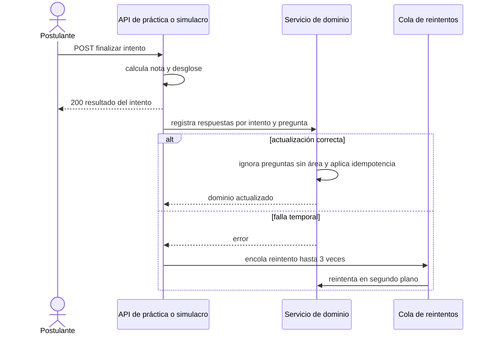

# SIA-E4-04 Actualización del dominio desde práctica y simulacro

**Como** postulante, **quiero** que cada práctica y simulacro que termino actualice mi dominio, **para** que el dashboard siempre refleje mi estado actual.

## Contexto
Se engancha a la finalización de prácticas y simulacros existentes (nota sobre 100, desglose por asignatura). No cambia su comportamiento visible.

## Reglas de negocio
1. Al finalizar un intento (o al responder en práctica con validación), se registran las respuestas de preguntas con área para el dominio.
2. Preguntas sin área se ignoran para el dominio (no fallan el intento).
3. La actualización es idempotente por (intento, pregunta): finalizar dos veces no duplica.
4. Si la actualización falla, el intento se finaliza igual y se reintenta en segundo plano (hasta 3 veces); el fallo no se muestra como error al usuario.
5. Intentos de procesos sin configuración SERUMS actualizan solo el dominio por asignatura.
6. Un intento solo actualiza el dominio de su dueño.



## Criterios de aceptación
```gherkin
Escenario: Finalizar simulacro
  Dado un simulacro con 20 respuestas en 4 áreas
  Cuando el usuario lo finaliza
  Entonces el dominio de cada área se actualiza en menos de 5 s

Escenario: Idempotencia
  Dado un intento cuyas respuestas ya se registraron en el dominio
  Cuando se procesa dos veces el mismo intento
  Entonces el dominio no cambia en la segunda

Escenario: Pregunta sin área
  Dado un intento con 3 preguntas sin área
  Cuando el usuario lo finaliza
  Entonces las 3 se ignoran para el dominio y el intento finaliza normal

Escenario: Falla temporal
  Dado un error al actualizar el dominio
  Cuando el usuario finaliza el intento
  Entonces el intento queda finalizado, el usuario ve su resultado y se reintenta hasta 3 veces

Escenario: Tiempo agotado
  Dado un simulacro finalizado por 409 tiempo_agotado
  Cuando el servidor cierra el intento
  Entonces se actualiza el dominio con lo respondido

Escenario: Comportamiento existente
  Dado un simulacro con nota, desglose y revisión ya existentes
  Cuando el usuario lo finaliza con la actualización de dominio activa
  Entonces nota sobre 100, desglose y revisión no cambian
```

## Fuera de alcance
Cambios en pantallas de práctica y simulacro.

## Dependencias
SIA-E4-03.

## Seguridad y privacidad
Sin datos personales en logs de reintentos.

## i18n
No hay texto nuevo visible.

## Definición de terminado
Tests de integración con práctica y simulacro; idempotencia y reintentos verificados; review limpio.
