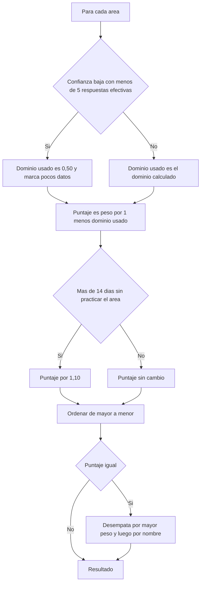

# SIA-E5-03 Priorización de áreas débiles

**Como** postulante, **quiero** que el sistema ordene mis áreas por urgencia, **para** invertir mi tiempo donde más suma a mi nota.

## Contexto
Cálculo determinista, reutilizado por el dashboard, las acciones rápidas y el plan (SIA-E7-02).



## Reglas de negocio
1. `puntaje = peso_area × (1 − dominio_usado)`; peso en fracción (0–1).
2. Con confianza baja se usa dominio 0,50 para no sobre-reaccionar a pocos datos.
3. Bono de 10 % si el área lleva más de 14 días sin práctica.
4. «Área débil» = dominio_usado < 0,50 (nivel bajo) o estar entre las 3 primeras por puntaje; máx. 3 áreas destacadas.
5. Resultado reproducible: mismas entradas, mismo orden; desempate por mayor peso y luego nombre.
6. Si todas las áreas tienen dominio ≥ 0,75, no hay áreas débiles y se informa.

## Criterios de aceptación
```gherkin
Escenario: Orden por puntaje
  Dado Área A peso 0,30 dominio 0,40 y Área B peso 0,10 dominio 0,20
  Cuando el sistema calcula la prioridad
  Entonces A tiene puntaje 0,18, B tiene 0,08 y A va primero

Escenario: Pocos datos
  Dado un área con dominio 0,90 pero confianza baja
  Cuando el sistema calcula la prioridad
  Entonces se usa 0,50 para el puntaje y se marca «pocos datos»

Escenario: Bono por inactividad
  Dado un área con 20 días sin práctica y puntaje 0,20
  Cuando el sistema calcula la prioridad
  Entonces el puntaje es 0,22

Escenario: Empate
  Dado dos áreas con igual puntaje
  Cuando el sistema ordena las áreas
  Entonces va primero la de mayor peso

Escenario: Todo alto
  Dado todas las áreas con dominio mayor o igual a 0,75
  Cuando el sistema calcula la prioridad
  Entonces se muestra «Sin áreas débiles» y ninguna área destacada

Escenario: Reproducibilidad
  Dado los mismos datos de dominio y pesos
  Cuando se calcula dos veces la prioridad
  Entonces el orden es idéntico
```

## Fuera de alcance
Priorización por tema.

## Dependencias
SIA-E5-01, SIA-E1-03.

## Seguridad y privacidad
Cálculo por usuario; sin datos de otros.

## i18n
Etiquetas «área débil», «pocos datos», «sin áreas débiles» en es/en.

## Definición de terminado
Tests con tabla de casos (incluye empates y bono); review limpio.
