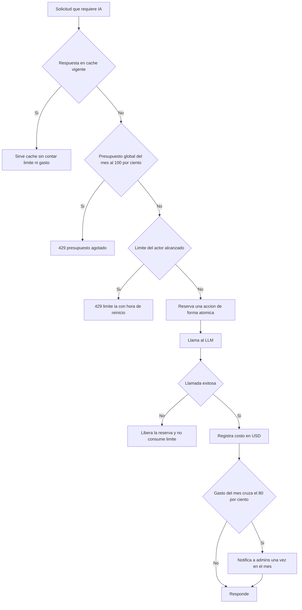

# SIA-E6-02 Control de costos: presupuesto, límites y caché

**Como** admin, **quiero** límites de uso de IA por usuario y por admin, un presupuesto global en USD y una caché, **para** que el costo sea predecible y no haya abusos.

## Contexto
Valores aprobados por el usuario (P3, issue #65). Una **acción IA real** es una solicitud que provoca al menos una llamada al LLM. No son acciones IA reales: una respuesta servida de caché, el reintento de una operación fallida ni encolar una solicitud administrativa sin llamada al LLM (SIA-E5-06). Los contadores antifraude sobreviven al borrado de datos de aprendizaje bajo `HMAC(usuario_id)` (P8, SIA-E9-07).



## Reglas de negocio
1. Límite por postulante: 5 acciones IA reales por día y 60 por mes. Límite por admin: 200 acciones IA reales por día. Máx. 20 preguntas por solicitud de generación (SIA-E6-03). La clasificación con IA (SIA-E3-04) va en lotes de hasta 20 preguntas y cada lote, que es una llamada al LLM, cuenta 1 acción del admin (580 preguntas = 29 acciones). Todos configurables por admin.
2. Presupuesto global mensual inicial: 40 USD (configurable). Al llegar al 80 % (32 USD) se notifica a todos los admins una sola vez en el mes; al llegar al 100 % se corta toda nueva llamada al LLM (429 `presupuesto_agotado`) hasta el inicio del mes siguiente o hasta que un admin suba el presupuesto. Las respuestas de caché y todas las funciones sin IA siguen operando.
3. El costo de cada llamada se registra en USD a partir del uso devuelto por el servicio de IA (SIA-E6-01); el mes es calendario en America/Lima.
4. Verificación en servidor antes de cada llamada; excedido = 429 `limite_ia` (día) o `limite_ia_mensual` (mes) con la hora de reinicio (America/Lima).
5. Caché: misma operación + misma entrada normalizada + misma versión de fuente = respuesta reutilizada, sin contar contra el límite ni el presupuesto; vigencia 30 días o hasta cambio de fuente.
6. El reintento de una operación fallida no consume límite; una llamada que falla libera su reserva.
7. Encolar una solicitud administrativa sin llamada al LLM (SIA-E5-06) no descuenta cuota del postulante; la generación que luego hace el admin al atenderla descuenta del límite del admin.
8. Admins configuran límites y presupuesto desde un panel; cada cambio se audita con valor anterior y nuevo.
9. El postulante obtiene su consumo restante (día y mes) por la API; su vista se construye después (regla 20). El admin ve en el panel el gasto del mes en USD, el porcentaje del presupuesto y su propio consumo del día.
10. Operaciones concurrentes no pueden superar el límite ni el presupuesto (control atómico).
11. Contadores antifraude: los contadores de acciones IA del postulante se guardan por `HMAC(usuario_id)` con un secreto de servidor (variable de entorno), sin otros datos personales, para que borrar los datos de aprendizaje (SIA-E9-07) no reinicie la cuota. Se conservan solo hasta el fin del mes en curso.

**Decisiones del PO (12-nov, contrato de E6-02):**

12. **Orden de verificación:** caché → presupuesto → límite mensual → límite diario. Si fallan varios, se responde el código del primero que falla en ese orden. La caché vigente se sirve aunque el presupuesto o el límite del actor estén agotados.
13. **Presupuesto y llamadas en curso:** el costo se conoce después de la llamada, así que el corte se aplica cuando el gasto registrado es ≥ presupuesto, antes de llamar. Se acepta que las llamadas que ya estaban en curso lo superen un poco. No se reserva un costo estimado. El control atómico estricto de la regla 10 vale para los límites de acciones, no para los USD.
14. **Costo de una llamada fallida:** la llamada libera su acción (regla 6), pero su costo real en USD, si el servicio de IA lo informa, sí suma al gasto del mes.
15. **Reserva por lote:** se puede consultar cuántas acciones le quedan al actor y reservar N de una vez, de forma atómica (todo o nada), para la regla 6 de SIA-E3-04. Si no alcanzan, responde 429 sin reservar nada.
16. **Gasto estable ante borrados:** el gasto del mes no baja cuando SIA-E9-07 borra o anonimiza los registros de uso de un usuario. Cómo se logra lo decide el architect.
17. **Rangos de configuración:** postulante, 0–50 por día y 0–1000 por mes, con el diario ≤ el mensual; admin, 1–1000 por día; presupuesto, 1–1000 USD con 2 decimales. Un valor fuera de rango, o un diario mayor que el mensual, responde 422 `validacion`.
18. **Cambios de configuración:** bajar un límite por debajo de lo ya consumido no es retroactivo; las siguientes solicitudes reciben 429. Subir el presupuesto por encima del gasto reabre las llamadas de inmediato. Bajarlo a un valor igual o menor que el gasto corta las llamadas en ese momento (regla 2). Cualquier cambio de valor, al subir o al bajar, rearma la alerta del 80 % una vez para el nuevo valor. Si tras el cambio el gasto ya está en o por encima del 80 % del nuevo valor, la alerta se envía en ese momento, una vez. Los contadores del admin no necesitan HMAC (la regla 11 es solo para postulantes); su forma la decide el architect.
19. **Canal de la alerta:** notificación in-app (campana existente) a todos los admins activos. El correo queda fuera de alcance.
20. **Consumo del postulante:** en el MVP el postulante no tiene ninguna acción IA real (SIA-E5-06 solo encola y SIA-E6-08 la genera el admin). Esta historia entrega los límites del postulante y la API de su consumo propio; la vista para el postulante se construye en la primera historia que le dé una acción IA real. Los escenarios de cuota del postulante se verifican por API o por servicio. El admin sí ve su consumo del día en el panel. Cambio de alcance aprobado por el usuario (issue #40).
21. **Pruebas sin proveedor real:** los escenarios se verifican con el doble del servicio de IA (SIA-E6-01) configurado con un costo por llamada. Elegir el proveedor y el modelo reales y construir su adaptador es SIA-E6-10, que requiere la aprobación del usuario y no bloquea esta historia.

## Criterios de aceptación
```gherkin
Escenario: Dentro del límite
  Dado un postulante con 2 acciones IA reales hoy
  Cuando solicita otra que requiere llamada al LLM
  Entonces se ejecuta y su consumo muestra 3 de 5

Escenario: Límite diario
  Dado un postulante con 5 acciones IA reales hoy
  Cuando solicita otra
  Entonces recibe 429 "limite_ia" con la hora de reinicio y no se llama al proveedor

Escenario: Límite mensual
  Dado un postulante con 60 acciones IA reales en el mes
  Cuando solicita otra
  Entonces recibe 429 "limite_ia_mensual"

Escenario: Límite de admin
  Dado un admin con 200 acciones IA reales hoy
  Cuando pide otra generación
  Entonces recibe 429 "limite_ia" y no se llama al proveedor

Escenario: Caché
  Dado una operación idéntica ya hecha con la misma versión de fuente
  Cuando un usuario la solicita de nuevo
  Entonces se sirve de caché, no se llama al proveedor y no consume límite ni presupuesto

Escenario: Invalidación
  Dado una respuesta en caché asociada a una fuente
  Cuando la fuente cambia de versión y se repite la operación
  Entonces la caché asociada deja de usarse

Escenario: Solicitud administrativa sin LLM
  Dado un postulante con 5 acciones IA reales hoy
  Cuando encola una solicitud de material al equipo (SIA-E5-06)
  Entonces la solicitud se crea y su consumo sigue en 5 de 5

Escenario: Concurrencia
  Dado un postulante con 4 acciones y 3 peticiones simultáneas
  Cuando se procesan las 3 peticiones a la vez
  Entonces solo 1 se ejecuta y las demás reciben 429

Escenario: Alerta de presupuesto al 80 %
  Dado un presupuesto mensual de 40 USD con 31,90 USD gastados
  Cuando una llamada lleva el gasto a 32,10 USD
  Entonces todos los admins reciben una notificación una sola vez en el mes

Escenario: Corte al 100 %
  Dado un presupuesto mensual de 40 USD con 40 USD gastados
  Cuando se solicita cualquier acción que requiere llamada al LLM
  Entonces responde 429 "presupuesto_agotado" y no se llama al proveedor

Escenario: Caché con presupuesto agotado
  Dado el presupuesto del mes agotado y una respuesta vigente en caché
  Cuando un usuario repite esa operación
  Entonces se sirve de caché sin error

Escenario: Reinicio mensual
  Dado el presupuesto agotado el 30 de un mes
  Cuando empieza el día 1 del mes siguiente en America/Lima
  Entonces las llamadas al LLM vuelven a permitirse

Escenario: Contador tras borrado de datos
  Dado un postulante con 5 acciones IA reales hoy
  Cuando borra sus datos de aprendizaje (SIA-E9-07) y solicita otra acción IA ese mismo día
  Entonces recibe 429 "limite_ia"

Escenario: Contador sin datos personales
  Dado los contadores de acciones IA de postulantes guardados
  Cuando se inspecciona la tabla de contadores de postulantes
  Entonces solo contienen el HMAC del usuario, el periodo y el número, sin id en claro, nombre, DNI ni email

Escenario: Auditoría
  Dado un admin en el panel de límites
  Cuando cambia un límite o el presupuesto
  Entonces audit_log registra valor anterior y nuevo

Escenario: Exceso por llamadas en curso
  Dado un presupuesto de 40 USD con 39,90 USD gastados y dos llamadas en curso de 0,20 USD cada una
  Cuando ambas terminan
  Entonces el gasto queda en 40,30 USD y la siguiente solicitud recibe 429 "presupuesto_agotado"

Escenario: Costo de una llamada fallida
  Dado un admin con 10 acciones hoy
  Cuando una llamada falla y el servicio de IA informa un costo de 0,05 USD
  Entonces el admin sigue con 10 acciones y el gasto del mes sube 0,05 USD

Escenario: Caché con el límite del actor agotado
  Dado un admin con 200 acciones hoy y una respuesta vigente en caché
  Cuando repite esa operación
  Entonces se sirve de caché sin error y sigue con 200 acciones

Escenario: Precedencia de errores
  Dado el presupuesto agotado y un postulante con 5 acciones hoy
  Cuando solicita una acción que requiere llamada al LLM
  Entonces recibe 429 "presupuesto_agotado"

Escenario: Reserva de un lote
  Dado un admin con 195 acciones hoy
  Cuando pide reservar 10 acciones de una vez
  Entonces recibe 429 "limite_ia" con 5 acciones disponibles y no se reserva ninguna

Escenario: Gasto estable tras un borrado
  Dado un gasto del mes de 12 USD, parte de él generado por un postulante
  Cuando ese postulante borra sus datos de aprendizaje (SIA-E9-07)
  Entonces el gasto del mes sigue en 12 USD

Escenario: Valor fuera de rango
  Dado un admin en el panel de límites
  Cuando guarda un límite diario de postulante de 51
  Entonces recibe 422 "validacion" y no cambia nada

Escenario: Diario mayor que el mensual
  Dado un admin en el panel de límites
  Cuando guarda un límite diario de postulante de 30 con el mensual en 20
  Entonces recibe 422 "validacion" y no cambia nada

Escenario: Bajar un límite no es retroactivo
  Dado un admin con 150 acciones hoy
  Cuando otro admin baja el límite diario de admin a 100
  Entonces sus acciones de hoy no se anulan y su siguiente solicitud recibe 429 "limite_ia"

Escenario: Subir el presupuesto tras el corte
  Dado el presupuesto de 40 USD agotado y la alerta del 80 % ya enviada
  Cuando un admin lo sube a 60 USD
  Entonces las llamadas al LLM se permiten de inmediato y la alerta se envía una vez más al llegar a 48 USD

Escenario: Bajar el presupuesto
  Dado un presupuesto de 40 USD con 20 USD gastados y la alerta del mes sin enviar
  Cuando un admin lo baja a 24 USD
  Entonces todos los admins reciben la alerta del 80 % en ese momento, una vez, y las llamadas siguen permitidas hasta llegar a 24 USD

Escenario: Consumo propio del postulante
  Dado un postulante con 2 acciones hoy y 10 en el mes
  Cuando consulta su consumo por la API
  Entonces recibe 3 restantes del día y 50 del mes con las horas de reinicio en America/Lima, y nunca el consumo de otro usuario
```

## Fuera de alcance
Cobro al usuario o planes de pago; presupuestos por profesión; proveedor y adaptador real (SIA-E6-10); alerta por correo; vista del consumo para el postulante (regla 20), que se construye en la primera historia que le dé una acción IA real.

## Dependencias
SIA-E6-01.

## Seguridad y privacidad
Los contadores son por `HMAC(usuario_id)`; el secreto del HMAC vive solo en variables de entorno. El consumo de un usuario solo lo ve él y los admins en agregado.

## i18n
Panel de admin (límites, presupuesto, gasto en USD y porcentaje, consumo propio del día), la notificación del 80 % y los errores `limite_ia`, `limite_ia_mensual`, `presupuesto_agotado` y `validacion` en es/en, con la hora en el formato del locale. Ningún código se muestra crudo. **Excepción de moneda** (decisión del PO, 12-nov, review del #204): los montos en USD usan siempre la receta `formatearMonto` de khipu (`$ 1,234.56`), sin importar el idioma de la pantalla. Es el formato habitual en Perú (punto decimal), el panel es solo para admins y adaptarlo exigiría cambiar khipu antes. Las etiquetas que acompañan al monto («Gasto del mes», «USD») sí van en es/en.

## Definición de terminado
Tests de concurrencia, de corte al 100 %, de reinicio diario y mensual por zona horaria Lima y de persistencia del contador tras borrado; migración con Down; `tsc`, `lint`, `build`; review limpio.
