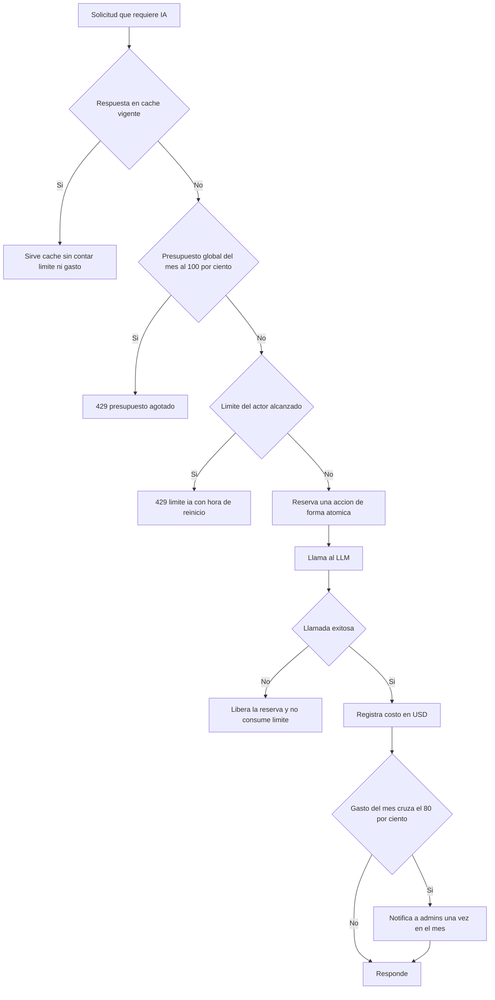

# SIA-E6-02 Control de costos: presupuesto, límites y caché

**Como** admin, **quiero** límites de uso de IA por usuario y por admin, un presupuesto global en USD y una caché, **para** que el costo sea predecible y no haya abusos.

## Contexto
Valores aprobados por el usuario (P3, issue #65). Una **acción IA real** es una solicitud que provoca al menos una llamada al LLM. No son acciones IA reales: una respuesta servida de caché, el reintento de una operación fallida ni encolar una solicitud administrativa sin llamada al LLM (SIA-E5-06). Los contadores antifraude sobreviven al borrado de datos de aprendizaje bajo `HMAC(usuario_id)` (P8, SIA-E9-07).



## Reglas de negocio
1. Límite por postulante: 5 acciones IA reales por día y 60 por mes. Límite por admin: 200 acciones IA reales por día. Máx. 20 preguntas por solicitud de generación (SIA-E6-03). La clasificación con IA (SIA-E3-04) va en lotes de hasta 20 preguntas y cada lote, que es una llamada al LLM, cuenta 1 acción del admin (580 preguntas = 29 acciones). Todos configurables por admin.
2. Presupuesto global mensual inicial: 40 USD (configurable). Al llegar al 80 % (32 USD) se notifica a todos los admins una sola vez en el mes; al llegar al 100 % se corta toda nueva llamada al LLM (429 `presupuesto_agotado`) hasta el inicio del mes siguiente o hasta que un admin suba el presupuesto. Las respuestas de caché y todas las funciones sin IA siguen operando.
3. El costo de cada llamada se registra en USD a partir del uso devuelto por el servicio de IA (SIA-E6-01); el mes es calendario en America/Lima.
4. Verificación en servidor antes de cada llamada; excedido = 429 `limite_ia` (día) o `limite_ia_mensual` (mes) con la hora de reinicio (America/Lima).
5. Caché: misma operación + misma entrada normalizada + misma versión de fuente = respuesta reutilizada, sin contar contra el límite ni el presupuesto; vigencia 30 días o hasta cambio de fuente.
6. El reintento de una operación fallida no consume límite; una llamada que falla libera su reserva.
7. Encolar una solicitud administrativa sin llamada al LLM (SIA-E5-06) no descuenta cuota del postulante; la generación que luego hace el admin al atenderla descuenta del límite del admin.
8. Admins configuran límites y presupuesto desde un panel; cada cambio se audita con valor anterior y nuevo.
9. El postulante ve su consumo restante (día y mes); el admin ve el gasto del mes en USD y el porcentaje del presupuesto.
10. Operaciones concurrentes no pueden superar el límite ni el presupuesto (control atómico).
11. Contadores antifraude: los contadores de acciones IA del postulante se guardan por `HMAC(usuario_id)` con un secreto de servidor (variable de entorno), sin otros datos personales, para que borrar los datos de aprendizaje (SIA-E9-07) no reinicie la cuota. Se conservan solo hasta el fin del mes en curso.

## Criterios de aceptación
```gherkin
Escenario: Dentro del límite
  Dado un postulante con 2 acciones IA reales hoy
  Cuando solicita otra que requiere llamada al LLM
  Entonces se ejecuta y su consumo muestra 3 de 5

Escenario: Límite diario
  Dado un postulante con 5 acciones IA reales hoy
  Cuando solicita otra
  Entonces recibe 429 "limite_ia" con la hora de reinicio y no se llama al proveedor

Escenario: Límite mensual
  Dado un postulante con 60 acciones IA reales en el mes
  Cuando solicita otra
  Entonces recibe 429 "limite_ia_mensual"

Escenario: Límite de admin
  Dado un admin con 200 acciones IA reales hoy
  Cuando pide otra generación
  Entonces recibe 429 "limite_ia" y no se llama al proveedor

Escenario: Caché
  Dado una operación idéntica ya hecha con la misma versión de fuente
  Cuando un usuario la solicita de nuevo
  Entonces se sirve de caché, no se llama al proveedor y no consume límite ni presupuesto

Escenario: Invalidación
  Dado una respuesta en caché asociada a una fuente
  Cuando la fuente cambia de versión y se repite la operación
  Entonces la caché asociada deja de usarse

Escenario: Solicitud administrativa sin LLM
  Dado un postulante con 5 acciones IA reales hoy
  Cuando encola una solicitud de material al equipo (SIA-E5-06)
  Entonces la solicitud se crea y su consumo sigue en 5 de 5

Escenario: Concurrencia
  Dado un postulante con 4 acciones y 3 peticiones simultáneas
  Cuando se procesan las 3 peticiones a la vez
  Entonces solo 1 se ejecuta y las demás reciben 429

Escenario: Alerta de presupuesto al 80 %
  Dado un presupuesto mensual de 40 USD con 31,90 USD gastados
  Cuando una llamada lleva el gasto a 32,10 USD
  Entonces todos los admins reciben una notificación una sola vez en el mes

Escenario: Corte al 100 %
  Dado un presupuesto mensual de 40 USD con 40 USD gastados
  Cuando se solicita cualquier acción que requiere llamada al LLM
  Entonces responde 429 "presupuesto_agotado" y no se llama al proveedor

Escenario: Caché con presupuesto agotado
  Dado el presupuesto del mes agotado y una respuesta vigente en caché
  Cuando un usuario repite esa operación
  Entonces se sirve de caché sin error

Escenario: Reinicio mensual
  Dado el presupuesto agotado el 30 de un mes
  Cuando empieza el día 1 del mes siguiente en America/Lima
  Entonces las llamadas al LLM vuelven a permitirse

Escenario: Contador tras borrado de datos
  Dado un postulante con 5 acciones IA reales hoy
  Cuando borra sus datos de aprendizaje (SIA-E9-07) y solicita otra acción IA ese mismo día
  Entonces recibe 429 "limite_ia"

Escenario: Contador sin datos personales
  Dado los contadores de acciones IA guardados
  Cuando se inspecciona la tabla de contadores
  Entonces solo contienen el HMAC del usuario, el periodo y el número, sin id en claro, nombre, DNI ni email

Escenario: Auditoría
  Dado un admin en el panel de límites
  Cuando cambia un límite o el presupuesto
  Entonces audit_log registra valor anterior y nuevo
```

## Fuera de alcance
Cobro al usuario o planes de pago; presupuestos por profesión.

## Dependencias
SIA-E6-01.

## Seguridad y privacidad
Los contadores son por `HMAC(usuario_id)`; el secreto del HMAC vive solo en variables de entorno. El consumo de un usuario solo lo ve él y los admins en agregado.

## i18n
Consumo, errores, gasto en USD y panel en es/en (formato de moneda del locale).

## Definición de terminado
Tests de concurrencia, de corte al 100 %, de reinicio diario y mensual por zona horaria Lima y de persistencia del contador tras borrado; migración con Down; `tsc`, `lint`, `build`; review limpio.
