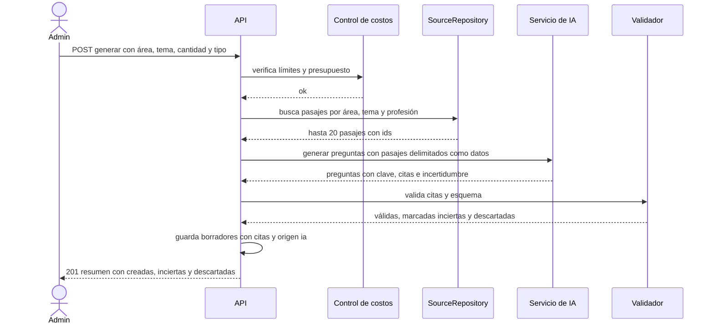

# SIA-E6-03 Generación de preguntas borrador con citas

**Como** admin, **quiero** pedir a la IA preguntas tipo SERUMS de un área o tema basadas en las fuentes, **para** ampliar el banco con material trazable que luego reviso.

## Contexto
Las preguntas se generan solo a partir de pasajes recuperados del repositorio. Entran como `borrador` (SIA-E3-02); nunca se sirven a alumnos sin aprobación.



## Reglas de negocio
1. Parámetros: área (obligatoria), tema (opcional), cantidad 1–20, tipo `unica`|`multiple`, dificultad opcional.
2. Si no hay al menos 3 pasajes relevantes de fuentes activas, se rechaza con 422 `fuentes_insuficientes` (no se inventa).
3. Cada pregunta debe incluir: enunciado, 4 alternativas (única) o 4–5 (múltiple), clave(s), ≥1 cita (id de pasaje) a un pasaje que sustente la clave, y un campo de incertidumbre.
4. Origen `ia`, estado `borrador`; el modelo y la versión de prompt se guardan como metadatos de procedencia.
5. Máx. 20 preguntas por solicitud y 200 por día por admin.
6. Se aplica deduplicación (SIA-E3-06) a los borradores creados.
7. Consume límites y registra uso (SIA-E6-02).
8. Se audita (actor, parámetros, n creadas).

## Criterios de aceptación
```gherkin
Escenario: Generación exitosa
  Dado fuentes activas con pasajes de "Salud pública"
  Cuando el admin pide 10 preguntas únicas
  Entonces se crean hasta 10 borradores con clave, citas y origen "ia"

Escenario: Fuentes insuficientes
  Dado un tema con 2 pasajes relevantes
  Cuando el admin pide generar preguntas de ese tema
  Entonces recibe 422 "fuentes_insuficientes" y no se llama a la IA

Escenario: Cantidad fuera de límite
  Dado un admin autenticado
  Cuando pide 21 preguntas
  Entonces recibe 422

Escenario: Límite diario
  Dado un admin con 200 preguntas generadas hoy
  Cuando pide generar más preguntas
  Entonces recibe 429 "limite_ia"

Escenario: Pregunta sin cita
  Dado una respuesta de la IA con una pregunta sin citas
  Cuando el validador la procesa
  Entonces se descarta y se cuenta como "descartada"

Escenario: Estado
  Dado preguntas generadas en estado borrador
  Cuando un usuario crea una práctica del área
  Entonces ninguna pregunta generada se sirve a alumnos mientras esté en borrador

Escenario: Procedencia
  Dado una generación exitosa
  Cuando el admin abre un borrador generado
  Entonces cada borrador guarda modelo, versión de prompt y ids de pasajes

Escenario: Permisos
  Dado un usuario con rol usuario
  Cuando llama al endpoint de generación
  Entonces recibe 403
```

## Fuera de alcance
Generación para alumnos; aprobación (SIA-E6-05).

## Dependencias
SIA-E6-02, SIA-E2-06, SIA-E3-02.

## Seguridad y privacidad
Contenido de pasajes delimitado como datos; sin datos personales en prompts ni logs.

## i18n
Pantalla y errores en es/en; el contenido generado está en español.

## Definición de terminado
Tests con IA simulada (válida, sin cita, fuentes insuficientes, límites); `tsc`, `lint`, `build`; review limpio.
