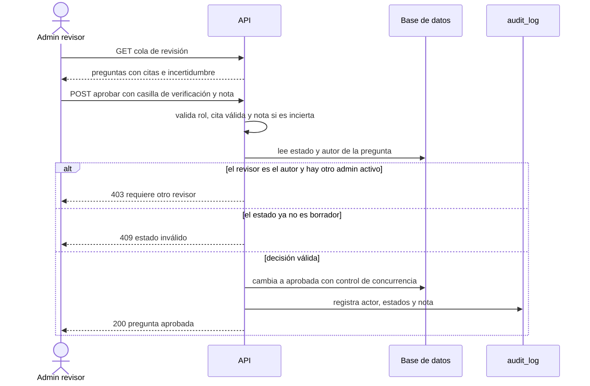

# SIA-E6-05 Cola de aprobación de preguntas (admin)

**Como** admin, **quiero** revisar cada pregunta generada con sus citas y aprobarla o rechazarla, **para** garantizar que ningún contenido médico llegue al alumno sin verificación humana.

## Contexto
Complementa la revisión de clasificación del balotario (SIA-E3-05). Aplica el ciclo de vida de SIA-E3-02 (borrador, en_revision, aprobada, rechazada).

## Reglas de negocio
1. Cola ordenada: `incierto` primero, luego antigüedad. Filtros: estado, área, origen, incierto.
2. Ver por pregunta: enunciado, alternativas, clave, citas con el extracto resaltado dentro del pasaje y enlace a la fuente, motivos de incertidumbre, procedencia (modelo, versión de prompt).
3. Aprobar exige: ≥1 cita válida, área asignada y que el admin marque «He verificado la clave contra la fuente». Para `incierto` además: nota obligatoria de 10–500 caracteres.
4. Rechazar exige motivo (5–500 caracteres) y opcionalmente reportar al generador.
5. Aprobación masiva no existe para contenido `origen = ia`; solo una a una.
6. Quien aprueba queda registrado; un admin no puede aprobar lo que él mismo importó/generó si hay otro admin activo (revisión por segundo par) — configurable; por defecto activo.
7. Estado verificado en servidor; concurrencia protegida (409).
8. Toda decisión se audita (actor, pregunta, estado anterior/nuevo, nota).



## Criterios de aceptación
```gherkin
Escenario: Aprobar contenido claro
  Dado una pregunta no incierta con 2 citas válidas
  Cuando el admin marca la verificación y aprueba
  Entonces pasa a "aprobada" y puede servirse

Escenario: Incierta sin nota
  Dado una pregunta incierta
  Cuando el admin intenta aprobar sin nota
  Entonces recibe 422 "nota_obligatoria"

Escenario: Incierta con nota
  Dado una pregunta incierta en la cola
  Cuando aprueba con la casilla y una nota de 20 caracteres
  Entonces pasa a "aprobada" y la nota queda en audit_log

Escenario: Sin verificación marcada
  Dado una pregunta con citas válidas
  Cuando aprueba sin marcar la casilla
  Entonces recibe 422 "verificacion_requerida"

Escenario: Segundo par
  Dado que el admin A generó la pregunta y hay otro admin activo
  Cuando A intenta aprobarla
  Entonces recibe 403 "requiere_otro_revisor"

Escenario: Sin masivo para IA
  Dado varias preguntas de origen "ia" seleccionadas
  Cuando intenta aprobarlas masivamente
  Entonces recibe 422 "masivo_no_permitido"

Escenario: Rechazar
  Dado una pregunta en la cola
  Cuando rechaza con motivo
  Entonces pasa a "rechazada" y no se sirve nunca

Escenario: Concurrencia
  Dado dos admins sobre la misma pregunta
  Cuando el segundo decide después de que el primero aprobó
  Entonces recibe 409 "estado_invalido"

Escenario: Cola vacía
  Dado ninguna pregunta pendiente
  Cuando el admin abre la cola
  Entonces ve «No hay preguntas por revisar»

Escenario: Alumno
  Dado un usuario con rol usuario
  Cuando consulta la cola
  Entonces recibe 403
```

## Fuera de alcance
Edición libre del enunciado (se rechaza y se regenera).

## Dependencias
SIA-E6-04, SIA-E3-02.

## Seguridad y privacidad
Solo admin; el extracto y el pasaje no se registran en logs, solo ids.

## i18n
Pantalla completa en es/en con estados carga/vacío/error.

## Definición de terminado
`tsc`, `lint`, `build`; tests de cada regla; contrato en docs/api/; review limpio.
