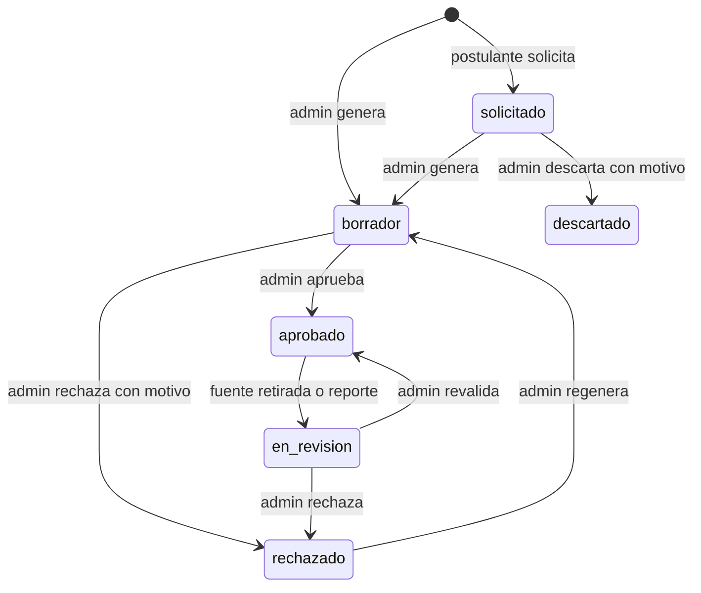

# SIA-E6-06 Generación de material de estudio con citas

**Como** admin, **quiero** generar material de estudio de un área o tema basado en las fuentes, con cada afirmación citada, y atender solicitudes de postulantes, **para** ofrecer resúmenes verificados.

## Contexto
El postulante no genera material en vivo (decisión de seguridad médica): solicita (SIA-E5-06) y un admin genera y aprueba.



## Reglas de negocio
1. Parámetros: área (obligatoria), tema (opcional), longitud objetivo 300–1 500 palabras.
2. Salida estructurada: secciones con título y párrafos; cada párrafo o afirmación clave lleva ≥1 cita (pasaje + extracto) validada según SIA-E6-04; párrafos sin cita válida se eliminan.
3. Se requieren ≥3 pasajes relevantes (422 `fuentes_insuficientes`).
4. Marca de incertidumbre por párrafo; el material con párrafos inciertos exige revisión explícita con nota (misma regla que SIA-E6-05).
5. Solicitudes de postulantes: máx. 1 abierta por (usuario, área, tema); el admin las ve en una cola con conteo de solicitantes (sin nombres ni datos personales, solo número).
6. Aprobar exige casilla de verificación; se audita todo.
7. Límites de admin: 200 operaciones de IA por día (SIA-E6-02).

## Criterios de aceptación
```gherkin
Escenario: Generar
  Dado fuentes suficientes de un tema
  Cuando el admin genera material de 800 palabras
  Entonces se crea un material "borrador" con secciones y citas por párrafo

Escenario: Párrafo sin cita
  Dado un párrafo generado cuyas citas son inválidas
  Cuando el validador procesa el material
  Entonces el párrafo se elimina y el material lleva la marca "contenido_eliminado"

Escenario: Aprobar
  Dado un material en borrador sin párrafos inciertos
  Cuando el admin marca la verificación y aprueba
  Entonces pasa a "aprobado"

Escenario: Incierto
  Dado un material con un párrafo incierto
  Cuando el admin aprueba sin nota
  Entonces recibe 422 "nota_obligatoria"

Escenario: Solicitud de postulante
  Dado una solicitud abierta de 3 postulantes sobre el mismo tema
  Cuando el admin abre la cola de solicitudes
  Entonces la cola muestra el tema con "3 solicitudes" y sin datos personales

Escenario: Longitud inválida
  Dado un admin autenticado
  Cuando pide 2 000 palabras
  Entonces recibe 422

Escenario: Fuentes insuficientes
  Dado un tema con menos de 3 pasajes relevantes
  Cuando el admin genera material
  Entonces recibe 422 "fuentes_insuficientes"

Escenario: Permisos
  Dado un usuario con rol usuario
  Cuando intenta generar o aprobar material
  Entonces recibe 403
```

## Fuera de alcance
Edición manual del material; formato PDF.

## Dependencias
SIA-E6-05 (reglas de aprobación), SIA-E6-02.

## Seguridad y privacidad
Sin datos personales en la cola ni en prompts.

## i18n
Pantallas es/en; contenido en español.

## Definición de terminado
Tests con IA simulada; `tsc`, `lint`, `build`; contrato en docs/api/; review limpio.
