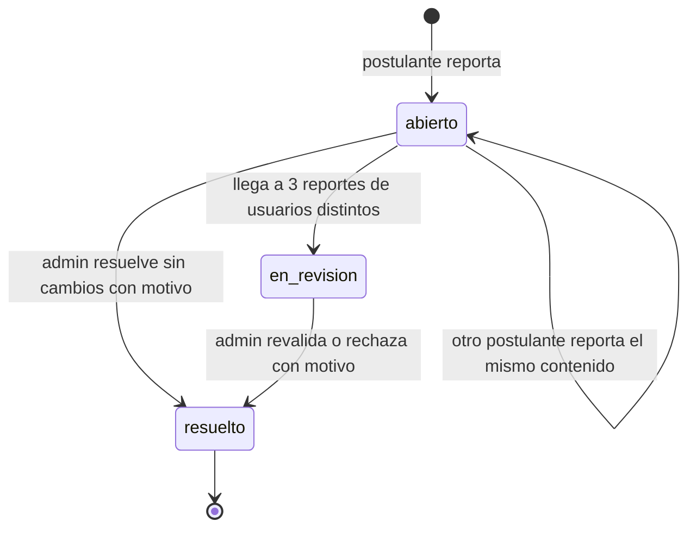

# SIA-E6-09 Reporte de contenido erróneo por el postulante

**Como** postulante, **quiero** reportar una pregunta, explicación o material que creo incorrecto, **para** que el equipo lo revise rápido. (Recomendación del PO: es la última defensa en contenido médico.)

## Reglas de negocio
1. Se puede reportar una pregunta, explicación o material que el usuario haya visto (verificado en servidor).
2. Motivo (lista fija: clave incorrecta, enunciado ambiguo, explicación incorrecta, desactualizado, otro) y comentario opcional ≤500 caracteres.
3. Máx. 1 reporte abierto por (usuario, contenido) y 20 reportes por usuario por día.
4. Al llegar a 3 reportes abiertos de usuarios distintos, el contenido pasa a `en_revision` y deja de servirse.
5. El admin ve la cola de reportes con conteo y motivos, sin datos personales del reportante; resuelve con «sin cambios» o con rechazo/revalidación del contenido (motivo obligatorio 5–500).
6. Decisiones auditadas. El usuario recibe una notificación in-app cuando se resuelve.



## Criterios de aceptación
```gherkin
Escenario: Reportar
  Dado un usuario que revisó una pregunta
  Cuando reporta "clave incorrecta"
  Entonces se crea un reporte abierto y ve confirmación

Escenario: Contenido no visto
  Dado un contenido que el usuario nunca vio
  Cuando intenta reportarlo
  Entonces recibe 404

Escenario: Duplicado
  Dado un reporte abierto suyo sobre un contenido
  Cuando reporta el mismo contenido de nuevo
  Entonces recibe 409 "reporte_abierto"

Escenario: Límite diario
  Dado un usuario con 20 reportes hoy
  Cuando intenta enviar otro reporte
  Entonces recibe 429

Escenario: Umbral
  Dado 2 reportes abiertos de usuarios distintos sobre una pregunta aprobada
  Cuando un tercer usuario distinto la reporta
  Entonces el contenido pasa a "en_revision" y deja de servirse en intentos nuevos

Escenario: Resolución
  Dado un reporte abierto
  Cuando el admin resuelve con motivo
  Entonces el reportante recibe una notificación in-app y se audita

Escenario: Privacidad
  Dado reportes abiertos de varios usuarios
  Cuando el admin abre la cola de reportes
  Entonces la cola no muestra nombre, DNI ni email del reportante

Escenario: Permisos
  Dado un usuario con rol usuario
  Cuando consulta la cola de reportes
  Entonces recibe 403
```

## Fuera de alcance
Respuestas por email al reportante.

## Dependencias
SIA-E6-05, notificaciones in-app existentes.

## Seguridad y privacidad
Comentario libre tratado como texto no confiable (escape); sin datos personales hacia el admin.

## i18n
Motivos, mensajes y notificaciones en es/en.

## Definición de terminado
Tests de umbral, límites y privacidad; `tsc`, `lint`, `build`; review limpio.
