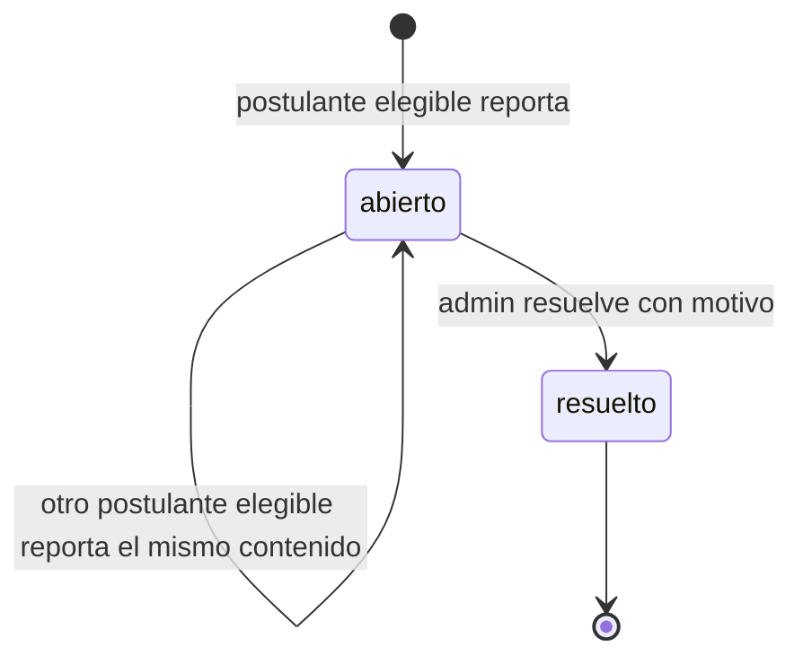
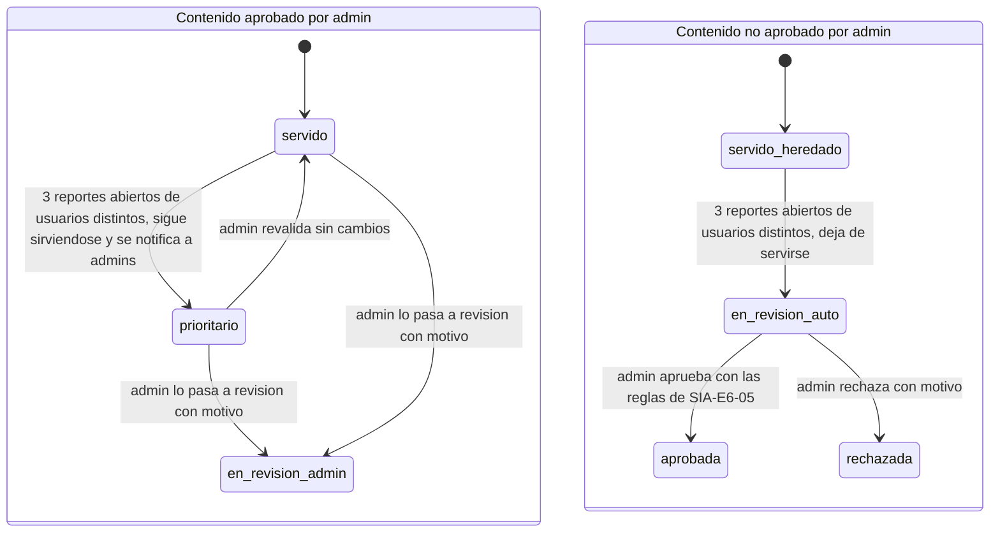

# SIA-E6-09 Reporte de contenido erróneo por el postulante

**Como** postulante, **quiero** reportar una pregunta, explicación o material que creo incorrecto, **para** que el equipo lo revise rápido. (Recomendación del PO: es la última defensa en contenido médico.)

## Contexto
Decisión del usuario (corrección de auditoría, hallazgo D). Los reportes **nunca ocultan automáticamente contenido aprobado por un admin**: un grupo pequeño de cuentas podría retirar contenido correcto. Al llegar al umbral, ese contenido sube al primer lugar de la cola de revisión y se avisa a los admins. Solo el contenido **no aprobado por un admin** (preguntas `activo` heredadas del banco anterior, sin aprobación registrada en el flujo de SIA-E3-02) se oculta al llegar al umbral.

**Contenido aprobado por un admin** = pregunta `aprobada`, explicación `aprobada` (SIA-E6-08) o material `aprobado` (SIA-E6-06) con aprobador registrado.

## Reglas de negocio
1. Quién puede reportar (verificado en servidor):
   - una **pregunta** o su **explicación**: solo un usuario que respondió esa pregunta en un intento **finalizado** (práctica, simulacro o diagnóstico);
   - un **material**: solo un usuario que lo abrió estando aprobado.
2. Si el usuario nunca tuvo el contenido en un intento ni lo abrió, se responde 404 (no se revela que existe). Si lo tuvo pero no cumple la regla 1 (por ejemplo, el intento sigue en curso o la dejó sin responder), se **rechaza** con 403 `reporte_no_permitido` y el mensaje «Puedes reportar una pregunta después de responderla y finalizar el intento». Se rechaza en vez de registrarlo sin contar porque: (a) un reporte guardado que no cuenta engaña al usuario, que cree que influyó; (b) mete ruido en la cola del admin; (c) reportar durante un intento en curso no aporta, ya que el usuario puede hacerlo al finalizar.
3. Motivo (lista fija: clave incorrecta, enunciado ambiguo, explicación incorrecta, desactualizado, otro) y comentario opcional ≤500 caracteres.
4. Máx. 1 reporte abierto por (usuario, contenido) y 20 reportes por usuario por día.
5. Umbral: 3 reportes abiertos de usuarios distintos sobre el mismo contenido.
   - **Contenido aprobado por un admin:** sigue sirviéndose. Se marca `prioritario`, pasa al primer lugar de la cola de revisión del admin (por delante de toda pregunta pendiente) y se envía una notificación in-app a todos los admins. La notificación sale una sola vez por cruce del umbral; si se resuelve y se vuelve a cruzar, se notifica de nuevo.
   - **Contenido no aprobado por un admin:** pasa a `en_revision` y deja de servirse en intentos nuevos (SIA-E3-02). Los intentos en curso no se alteran.
6. Solo un admin puede sacar de circulación contenido aprobado: desde la cola, revalida («sin cambios») o lo pasa a `en_revision`/`rechazada` con motivo (5–500 caracteres), con las reglas de SIA-E6-05.
7. El admin ve la cola de reportes con conteo, motivos y comentarios, sin datos personales del reportante.
8. Resolver cierra todos los reportes abiertos de ese contenido; cada reportante recibe una notificación in-app con el resultado.
9. Decisiones auditadas (actor, contenido, nº de reportes, decisión, motivo).





## Criterios de aceptación
```gherkin
Escenario: Reportar
  Dado un usuario que respondió una pregunta en una práctica finalizada
  Cuando reporta "clave incorrecta"
  Entonces se crea un reporte abierto y ve confirmación

Escenario: Contenido no visto
  Dado una pregunta que el usuario nunca tuvo en un intento
  Cuando intenta reportarla
  Entonces recibe 404

Escenario: Intento en curso
  Dado un usuario con un simulacro en curso que contiene la pregunta
  Cuando intenta reportarla antes de finalizar
  Entonces recibe 403 "reporte_no_permitido" y no se registra ningún reporte

Escenario: Pregunta sin responder
  Dado un usuario que dejó la pregunta sin responder en un intento finalizado
  Cuando intenta reportarla
  Entonces recibe 403 "reporte_no_permitido" y no se registra ningún reporte

Escenario: Explicación
  Dado un usuario que respondió una pregunta en un diagnóstico finalizado y ve su explicación aprobada
  Cuando reporta "explicación incorrecta"
  Entonces se crea un reporte abierto sobre la explicación

Escenario: Material
  Dado un usuario que abrió un material aprobado
  Cuando lo reporta como "desactualizado"
  Entonces se crea un reporte abierto sobre el material

Escenario: Duplicado
  Dado un reporte abierto suyo sobre un contenido
  Cuando reporta el mismo contenido de nuevo
  Entonces recibe 409 "reporte_abierto"

Escenario: Límite diario
  Dado un usuario con 20 reportes hoy
  Cuando intenta enviar otro reporte
  Entonces recibe 429

Escenario: Umbral en contenido aprobado
  Dado 2 reportes abiertos de usuarios distintos sobre una pregunta "aprobada" por un admin
  Cuando un tercer usuario distinto y elegible la reporta
  Entonces la pregunta sigue en "aprobada" y sirviéndose, queda "prioritario" en el primer lugar de la cola de revisión y todos los admins reciben una notificación in-app

Escenario: Nunca se oculta lo aprobado
  Dado una pregunta "aprobada" con 10 reportes abiertos de usuarios distintos
  Cuando otro usuario crea una práctica de esa área
  Entonces la pregunta puede incluirse en la práctica

Escenario: Umbral en contenido no aprobado
  Dado 2 reportes abiertos de usuarios distintos sobre una pregunta "activo" heredada sin aprobación registrada
  Cuando un tercer usuario distinto y elegible la reporta
  Entonces la pregunta pasa a "en_revision" y deja de servirse en intentos nuevos

Escenario: Mismo usuario no suma
  Dado 2 reportes abiertos de usuarios distintos sobre una pregunta aprobada
  Cuando uno de esos dos usuarios intenta reportarla otra vez
  Entonces recibe 409 "reporte_abierto" y el conteo sigue en 2

Escenario: Revalidar contenido prioritario
  Dado una pregunta aprobada marcada "prioritario"
  Cuando el admin la revalida "sin cambios" con motivo
  Entonces deja de ser prioritaria, sus reportes quedan resueltos, cada reportante recibe una notificación in-app y se audita

Escenario: Admin retira contenido aprobado
  Dado una pregunta aprobada marcada "prioritario"
  Cuando el admin la pasa a "en_revision" con motivo
  Entonces deja de servirse en intentos nuevos y se audita

Escenario: Privacidad
  Dado reportes abiertos de varios usuarios
  Cuando el admin abre la cola de reportes
  Entonces la cola no muestra nombre, DNI ni email del reportante

Escenario: Permisos
  Dado un usuario con rol usuario
  Cuando consulta la cola de reportes
  Entonces recibe 403
```

## Fuera de alcance
Respuestas por email al reportante; reputación o ponderación de reportantes.

## Dependencias
SIA-E6-05, notificaciones in-app existentes.

## Seguridad y privacidad
Comentario libre tratado como texto no confiable (escape); sin datos personales hacia el admin. La elegibilidad (regla 1) se verifica en servidor contra los intentos del propio usuario.

## i18n
Motivos, mensajes (incluido «Puedes reportar una pregunta después de responderla y finalizar el intento») y notificaciones en es/en.

## Definición de terminado
Tests de elegibilidad, de umbral en contenido aprobado y no aprobado, de límites y de privacidad; `tsc`, `lint`, `build`; review limpio.
