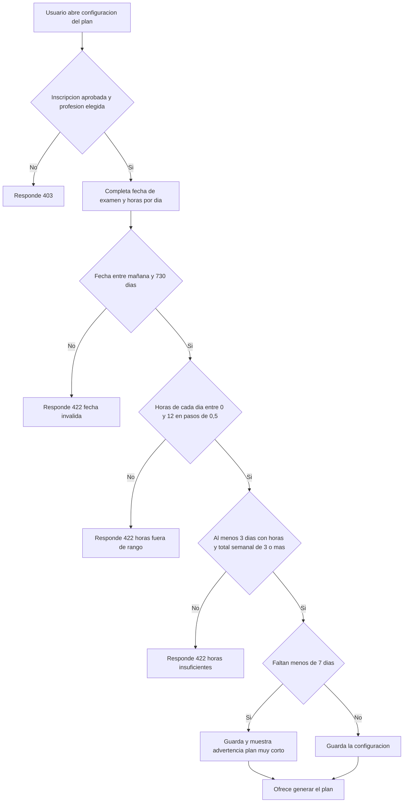

# SIA-E7-01 Configuración del plan (fecha y horas)

**Como** postulante, **quiero** indicar la fecha de mi examen y las horas que puedo estudiar cada día, **para** que el sistema pueda armar mi plan.

## Reglas de negocio
1. Datos: fecha de examen (por defecto la del cronograma del proceso si existe, editable), horas por día de la semana (0–12 en pasos de 0,5; 7 valores) y fecha de inicio (hoy o posterior).
2. La fecha de examen debe estar entre mañana y 730 días; la fecha en America/Lima.
3. Debe haber al menos 3 días con horas > 0 por semana y el total semanal ≥ 3 horas; si no, 422 `horas_insuficientes`.
4. Un solo plan activo por (usuario, proceso, profesión); guardar la configuración no genera el plan (SIA-E7-02).
5. Exige inscripción aprobada y profesión elegida.
6. Si faltan menos de 7 días para el examen se advierte «Plan muy corto» pero se permite.



## Criterios de aceptación
```gherkin
Escenario: Configuración válida
  Dado una fecha de examen a 60 días y 2 horas de lunes a viernes
  Cuando guarda
  Entonces recibe 200 con la configuración

Escenario: Fecha pasada
  Dado un usuario con inscripción aprobada
  Cuando elige una fecha de ayer
  Entonces recibe 422 "fecha_invalida"

Escenario: Fecha lejana
  Dado un usuario con inscripción aprobada
  Cuando elige una fecha a 731 días
  Entonces recibe 422 "fecha_invalida"

Escenario: Horas fuera de rango
  Dado un usuario con inscripción aprobada
  Cuando pone 13 horas en un día
  Entonces recibe 422

Escenario: Pocas horas
  Dado un usuario con inscripción aprobada
  Cuando suma 2 horas por semana
  Entonces recibe 422 "horas_insuficientes"

Escenario: Plan corto
  Dado una fecha de examen a 5 días
  Cuando guarda la configuración
  Entonces se guarda y se muestra la advertencia «Plan muy corto»

Escenario: Sin inscripción aprobada
  Dado un usuario sin inscripción aprobada
  Cuando intenta guardar la configuración
  Entonces recibe 403

Escenario: Aislamiento
  Dado la configuración de otro usuario
  Cuando un usuario consulta esa configuración
  Entonces recibe 404
```

## Fuera de alcance
Generación del plan (SIA-E7-02); horas por fecha específica (excepciones).

## Dependencias
SIA-E4-03, SIA-E1-04.

## Seguridad y privacidad
Datos del dueño únicamente.

## i18n
Formulario, ayudas y errores en es/en; fechas con formato del locale.

## Definición de terminado
Validación en cliente (yup) y servidor; `tsc`, `lint`, `build`; review limpio.
