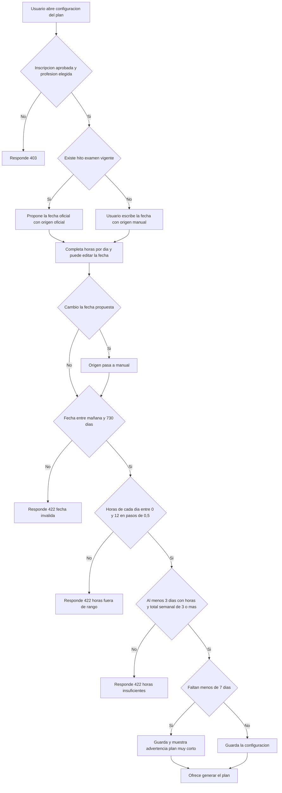
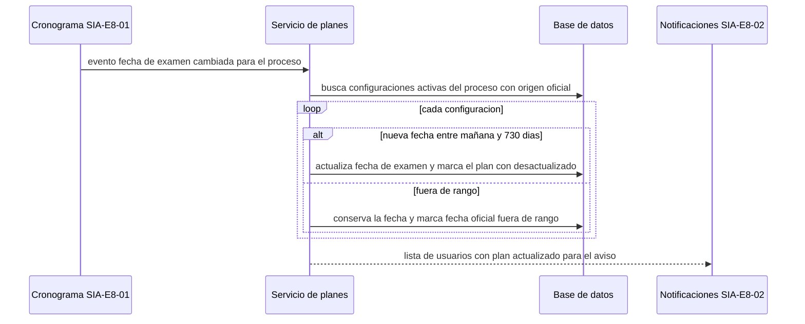

# SIA-E7-01 Configuración del plan (fecha y horas) y fecha oficial del examen

**Como** postulante, **quiero** indicar la fecha de mi examen y las horas que puedo estudiar cada día, y que la fecha se actualice sola si cambia la fecha oficial, **para** que el sistema arme mi plan sobre la fecha real.

## Contexto
Decisión P5 (issue #65): la fecha del hito `examen` la carga un admin con fuente `.gob.pe` (SIA-E8-01) y sus cambios se propagan automáticamente a los planes que usan la fecha oficial; no a los que el postulante fijó manualmente. Cada configuración guarda el origen de su fecha: `oficial` o `manual`.





## Reglas de negocio
1. Datos: fecha de examen, horas por día de la semana (0–12 en pasos de 0,5; 7 valores) y fecha de inicio (hoy o posterior).
2. La fecha de examen debe estar entre mañana y 730 días; la fecha en America/Lima.
3. Debe haber al menos 3 días con horas > 0 por semana y el total semanal ≥ 3 horas; si no, 422 `horas_insuficientes`.
4. Un solo plan activo por (usuario, proceso, profesión); guardar la configuración no genera el plan (SIA-E7-02).
5. Exige inscripción aprobada y profesión elegida.
6. Si faltan menos de 7 días para el examen se advierte «Plan muy corto» pero se permite.
7. Origen de la fecha: si existe un hito `examen` vigente (SIA-E8-01), se propone su fecha con origen `oficial` y se muestra su enlace de fuente. Si el postulante cambia la fecha, el origen pasa a `manual`. La acción «Usar fecha oficial» vuelve a origen `oficial` con la fecha vigente del hito.
8. Propagación: cuando cambia la fecha del hito `examen`, toda configuración activa del proceso con origen `oficial` recibe la nueva fecha automáticamente, sin acción del postulante. Las de origen `manual` no cambian.
9. Si la nueva fecha oficial queda fuera del rango de la regla 2, la configuración conserva su fecha anterior y muestra «La fecha oficial cambió y no pudimos aplicarla; revisa tu plan».
10. Tras la propagación el plan generado sigue en estado `activo` (ciclo de vida de SIA-E7-02 sin cambios) y se marca con la bandera `desactualizado = true`, que se limpia al regenerar: la vista del plan (SIA-E7-03) muestra «La fecha del examen cambió» con el botón «Regenerar plan» (SIA-E7-02); en v2 además dispara la propuesta de replanificación (SIA-E7-04). Los bloques ya marcados hechos no se tocan.
11. La propagación es idempotente por (configuración, cambio de hito) y no aplica a planes `finalizado` o `reemplazado`.
12. El aviso al postulante lo envía SIA-E8-02 en un único mensaje junto con «La fecha cambió».

## Criterios de aceptación
```gherkin
Escenario: Configuración válida
  Dado una fecha de examen a 60 días y 2 horas de lunes a viernes
  Cuando guarda
  Entonces recibe 200 con la configuración

Escenario: Fecha oficial por defecto
  Dado un proceso con hito "examen" vigente el 2026-12-14
  Cuando el usuario abre la configuración por primera vez
  Entonces la fecha propuesta es 2026-12-14 con origen "oficial" y el enlace a la fuente oficial

Escenario: Fecha manual
  Dado una configuración con origen "oficial"
  Cuando el usuario cambia la fecha a otra válida y guarda
  Entonces la configuración queda con origen "manual"

Escenario: Volver a la fecha oficial
  Dado una configuración con origen "manual"
  Cuando el usuario pulsa «Usar fecha oficial» y guarda
  Entonces la fecha es la del hito vigente y el origen es "oficial"

Escenario: Propagación a plan con fecha oficial
  Dado una configuración activa con origen "oficial" y fecha 2026-12-14
  Cuando el admin cambia el hito "examen" al 2026-12-21
  Entonces la configuración pasa a 2026-12-21 sin acción del usuario y el plan activo queda con desactualizado = true

Escenario: Sin propagación a plan con fecha manual
  Dado una configuración activa con origen "manual" y fecha 2026-12-20
  Cuando el admin cambia el hito "examen" al 2026-12-21
  Entonces la configuración conserva 2026-12-20

Escenario: Nueva fecha oficial fuera de rango
  Dado una configuración activa con origen "oficial"
  Cuando el admin cambia el hito "examen" a una fecha anterior a mañana
  Entonces la configuración conserva su fecha y el usuario ve «La fecha oficial cambió y no pudimos aplicarla; revisa tu plan»

Escenario: Propagación idempotente
  Dado un cambio de fecha del hito ya propagado
  Cuando el evento de cambio se procesa por segunda vez
  Entonces la configuración no cambia de nuevo y no se crea un segundo aviso

Escenario: Bloques hechos conservados
  Dado un plan con 5 bloques marcados hechos y origen "oficial"
  Cuando se propaga una nueva fecha de examen
  Entonces los 5 bloques hechos se conservan sin cambios

Escenario: Fecha pasada
  Dado un usuario con inscripción aprobada
  Cuando elige una fecha de ayer
  Entonces recibe 422 "fecha_invalida"

Escenario: Fecha lejana
  Dado un usuario con inscripción aprobada
  Cuando elige una fecha a 731 días
  Entonces recibe 422 "fecha_invalida"

Escenario: Horas fuera de rango
  Dado un usuario con inscripción aprobada
  Cuando pone 13 horas en un día
  Entonces recibe 422

Escenario: Pocas horas
  Dado un usuario con inscripción aprobada
  Cuando suma 2 horas por semana
  Entonces recibe 422 "horas_insuficientes"

Escenario: Plan corto
  Dado una fecha de examen a 5 días
  Cuando guarda la configuración
  Entonces se guarda y se muestra la advertencia «Plan muy corto»

Escenario: Sin inscripción aprobada
  Dado un usuario sin inscripción aprobada
  Cuando intenta guardar la configuración
  Entonces recibe 403

Escenario: Aislamiento
  Dado la configuración de otro usuario
  Cuando un usuario consulta esa configuración
  Entonces recibe 404
```

## Fuera de alcance
Generación del plan (SIA-E7-02); horas por fecha específica (excepciones); regenerar el plan sin acción del usuario.

## Dependencias
SIA-E4-03, SIA-E1-04, SIA-E8-01 (hito `examen` y evento de cambio de fecha).

## Seguridad y privacidad
Datos del dueño únicamente; la propagación la ejecuta el servidor y no expone a un usuario la configuración de otros.

## i18n
Formulario, ayudas, origen de la fecha («Fecha oficial» / «Fecha elegida por ti»), avisos y errores en es/en; fechas con formato del locale.

## Definición de terminado
Validación en cliente (yup) y servidor; tests de propagación (oficial, manual, fuera de rango, idempotencia); migración con Down; `tsc`, `lint`, `build`; review limpio.
