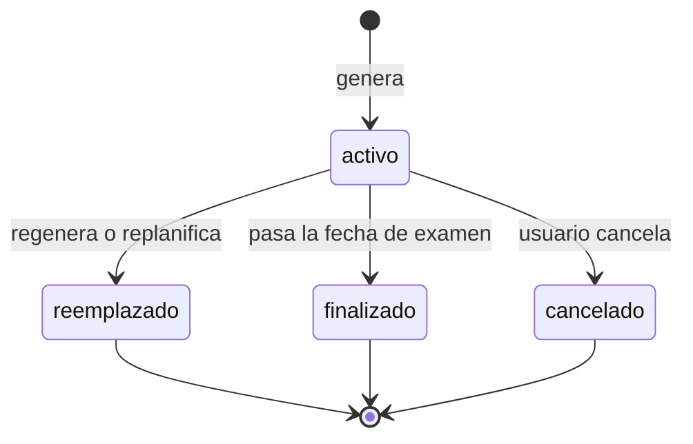

# SIA-E7-02 Generador del plan

**Como** postulante, **quiero** que el sistema genere un plan diario con qué estudiar y cuántos minutos, **para** repartir mi tiempo según mi nivel y el peso de cada área.

## Contexto
Algoritmo determinista (sin IA): mismas entradas, mismo plan. Ciclo de vida del plan:



## Reglas de negocio
1. Días del plan: desde el inicio hasta el día anterior al examen; el último día es de repaso general (sin contenido nuevo).
2. Minutos por día = horas configuradas para ese día de la semana × 60.
3. Reparto por día entre áreas en proporción al puntaje de prioridad (SIA-E5-03) con mínimo de 15 min por bloque; máx. 3 áreas por día; la rotación evita repetir las mismas 3 áreas más de 3 días seguidos si hay más de 3 áreas.
4. Cada bloque: área (y tema bajo si hay datos), tipo (`material`, `practica`, `repaso`) y minutos. Proporción por defecto: 40 % material/lectura, 40 % práctica, 20 % repaso; sin material aprobado se reasigna a práctica.
5. Cada semana incluye 1 simulacro completo o dirigido en el día con más horas, desde 3 semanas antes del examen.
6. Los últimos 7 días solo contienen práctica y repaso.
7. Regenerar archiva el plan vigente (estado reemplazado) y conserva el cumplimiento registrado.
8. Sin diagnóstico previo, se genera con prioridades por peso solamente y se recomienda rendir el diagnóstico.
9. Máx. 730 días × 3 bloques; la respuesta paginada por semanas.

## Criterios de aceptación
```gherkin
Escenario: Plan con datos
  Dado un diagnóstico, examen en 30 días y 2 horas diarias
  Cuando genera el plan
  Entonces cada día tiene bloques que suman 120 minutos y cada bloque dura al menos 15 minutos

Escenario: Prioridad
  Dado un área con el doble de puntaje que otra
  Cuando genera el plan
  Entonces recibe aproximadamente el doble de minutos totales (diferencia máxima 10 %)

Escenario: Último día
  Dado un plan con fecha de examen definida
  Cuando genera el plan
  Entonces el día anterior al examen es de repaso general sin material nuevo

Escenario: Simulacros semanales
  Dado un examen en 28 días
  Cuando genera el plan
  Entonces hay 1 simulacro por semana en las últimas 3 semanas

Escenario: Sin diagnóstico
  Dado un usuario sin diagnóstico previo
  Cuando genera el plan
  Entonces el plan se genera por peso y se muestra la sugerencia de rendir el diagnóstico

Escenario: Reproducibilidad
  Dado los mismos datos de dominio, pesos y configuración
  Cuando se genera dos veces
  Entonces los planes son idénticos

Escenario: Regenerar
  Dado un plan activo con cumplimiento registrado
  Cuando regenera
  Entonces el anterior queda "reemplazado" y su historial se conserva

Escenario: Sin configuración
  Dado un usuario sin fecha ni horas configuradas
  Cuando genera el plan
  Entonces recibe 409 "plan_sin_configuracion"

Escenario: Aislamiento
  Dado el plan de otro usuario
  Cuando un usuario consulta ese plan
  Entonces recibe 404
```

## Fuera de alcance
Uso de IA para redactar el plan; replanificación automática (SIA-E7-04).

## Dependencias
SIA-E7-01, SIA-E5-03.

## Seguridad y privacidad
Datos solo del dueño.

## i18n
Nombres de tipos de bloque y mensajes en es/en.

## Definición de terminado
Tests de suma de minutos, proporciones y reproducibilidad; migración con Down; review limpio.
