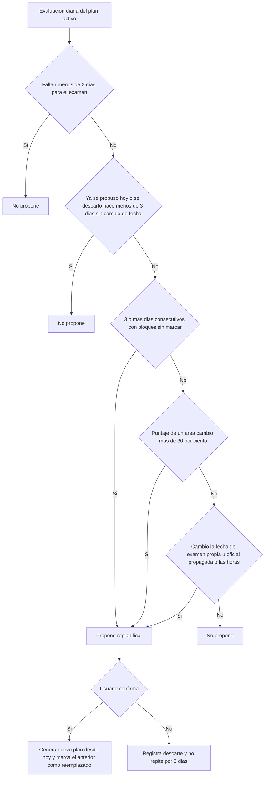

# SIA-E7-04 Replanificación automática

**Como** postulante, **quiero** que el plan se ajuste cuando me atraso o cambia mi dominio, **para** no quedar con un plan obsoleto.

## Reglas de negocio
1. Se propone replanificar (no se hace sin confirmación) cuando: (a) hay ≥ 3 días consecutivos con bloques sin marcar, o (b) el puntaje de prioridad de un área cambió más de 30 % desde la generación, o (c) cambió la fecha de examen o las horas, incluida la propagación automática de la fecha oficial del hito `examen` (SIA-E7-01, decisión P5, issue #65).
2. La propuesta se muestra con un resumen de los cambios; al confirmar se ejecuta el generador (SIA-E7-02) desde hoy y el plan anterior queda `reemplazado`.
3. Máx. 1 propuesta por día; si el usuario la descarta, no se repite en 3 días salvo cambio de fecha.
4. El bloque marcado hecho nunca se modifica.
5. No se replanifica a menos de 2 días del examen.
6. Un cambio de fecha propagado desde el cronograma genera la propuesta en la siguiente evaluación diaria aunque el usuario haya descartado otra en los últimos 3 días; la propuesta indica «La fecha oficial del examen cambió» con la fecha anterior y la nueva.



## Criterios de aceptación
```gherkin
Escenario: Atraso
  Dado 3 días consecutivos sin marcar
  Cuando corre la evaluación diaria del plan
  Entonces el sistema muestra la propuesta de replanificar

Escenario: Cambio de dominio
  Dado un área cuyo puntaje subió 35 % desde la generación
  Cuando corre la evaluación diaria del plan
  Entonces se propone replanificar

Escenario: Fecha oficial propagada
  Dado un plan con fecha de origen oficial y una propuesta descartada hace 1 día
  Cuando se propaga una nueva fecha del hito "examen" y corre la evaluación diaria
  Entonces se propone replanificar con «La fecha oficial del examen cambió», la fecha anterior y la nueva

Escenario: Confirmar
  Dado una propuesta de replanificación visible
  Cuando confirma
  Entonces el nuevo plan arranca hoy y el anterior queda "reemplazado" con lo hecho conservado

Escenario: Descartar
  Dado una propuesta de replanificación visible
  Cuando descarta
  Entonces no se vuelve a proponer durante 3 días

Escenario: Cerca del examen
  Dado un examen en 1 día
  Cuando corre la evaluación diaria del plan
  Entonces no se propone replanificar

Escenario: Sin plan
  Dado un usuario sin plan activo
  Cuando intenta replanificar
  Entonces recibe 409 "plan_sin_configuracion"

Escenario: Aislamiento
  Dado el plan de otro usuario
  Cuando un usuario intenta replanificarlo
  Entonces recibe 404
```

## Fuera de alcance
Replanificación sin confirmación.

## Dependencias
SIA-E7-03.

## Seguridad y privacidad
Autorización por dueño.

## i18n
Textos de propuesta es/en.

## Definición de terminado
Tests de cada disparador y límite; review limpio.
