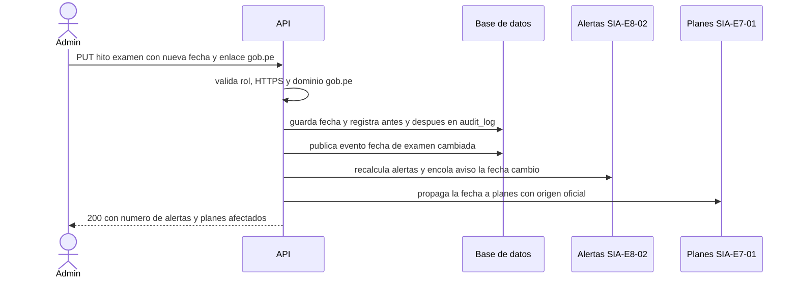

# SIA-E8-01 Cronograma de procesos (admin)

**Como** admin, **quiero** cargar los hitos de cada proceso SERUMS (inscripción, examen, resultados) con su fuente oficial `.gob.pe`, **para** que los postulantes vean fechas oficiales verificables, reciban alertas y sus planes usen la fecha real del examen.

## Contexto
Decisión P5 (issue #65): carga manual por admin, con fuente oficial obligatoria en un dominio `.gob.pe`; la plataforma no extrae fechas de sitios externos. Un cambio de fecha del hito `examen` se propaga automáticamente a los planes de estudio que usan la fecha oficial (la propagación la implementa SIA-E7-01, que depende de esta historia).



## Reglas de negocio
1. Hito: proceso, tipo (`inscripcion_inicio`, `inscripcion_fin`, `examen`, `resultados`, `otro`), título (3–120), fecha y hora (America/Lima) y **enlace de fuente oficial obligatorio**: HTTPS, ≤300 caracteres, cuyo host es `gob.pe` o termina en `.gob.pe` (ej. `www.gob.pe`, `www.minsa.gob.pe`). Otro dominio responde 422 `fuente_no_oficial`.
2. Máx. 30 hitos por proceso; máx. un hito `examen` vigente por proceso (409 `examen_duplicado`).
3. Al cambiar la fecha de un hito se encolan las alertas afectadas (SIA-E8-02) y se audita (antes/después, enlace de fuente).
4. El hito `examen` es la fecha oficial del proceso: es la fecha por defecto en SIA-E7-01 y, al cambiar, se propaga automáticamente a los planes con fecha de origen `oficial` (SIA-E7-01); los planes con fecha fijada manualmente por el postulante no cambian.
5. La respuesta al admin informa cuántos planes recibieron la nueva fecha (número, sin datos personales).
6. Los postulantes con inscripción aprobada en el proceso ven el cronograma en modo lectura, con el enlace a la fuente oficial de cada hito.
7. Eliminar un hito es lógico (queda en auditoría); eliminar el hito `examen` no borra la fecha de los planes: quedan con origen `manual` y se avisa al postulante.

## Criterios de aceptación
```gherkin
Escenario: Crear hito con fuente oficial
  Dado un admin
  Cuando crea el hito "Examen" el 2026-12-14 09:00 con enlace "https://www.gob.pe/minsa"
  Entonces recibe 201 y se registra en audit_log con el enlace

Escenario: Sin enlace de fuente
  Dado un admin en el formulario de hito
  Cuando guarda un hito sin enlace de fuente oficial
  Entonces recibe 422 "enlace_obligatorio"

Escenario: Dominio no oficial
  Dado un admin en el formulario de hito
  Cuando pone el enlace "https://www.ejemplo.com/serums"
  Entonces recibe 422 "fuente_no_oficial"

Escenario: Dominio que imita gob.pe
  Dado un admin en el formulario de hito
  Cuando pone el enlace "https://gob.pe.ejemplo.com/serums"
  Entonces recibe 422 "fuente_no_oficial"

Escenario: Enlace sin HTTPS
  Dado un admin en el formulario de hito
  Cuando pone el enlace "http://www.gob.pe/minsa"
  Entonces recibe 422 "enlace_invalido"

Escenario: Límite
  Dado un proceso con 30 hitos
  Cuando el admin crea otro hito
  Entonces recibe 422 "limite_hitos"

Escenario: Segundo hito de examen
  Dado un proceso con un hito "examen" vigente
  Cuando el admin crea otro hito de tipo "examen"
  Entonces recibe 409 "examen_duplicado"

Escenario: Cambio de fecha
  Dado un hito con alertas pendientes
  Cuando el admin cambia la fecha
  Entonces las alertas se recalculan y se registra antes/después

Escenario: Cambio de fecha del examen informa planes afectados
  Dado un hito "examen" y 12 planes con fecha de origen oficial y 3 con fecha manual
  Cuando el admin cambia la fecha del examen
  Entonces la respuesta indica 12 planes actualizados y los 3 con fecha manual no cambian

Escenario: Vista de postulante
  Dado un usuario con inscripción aprobada en el proceso
  Cuando abre el cronograma e intenta editar un hito
  Entonces ve los hitos en orden cronológico con su enlace oficial y recibe 403 al intentar editarlos

Escenario: Sin hitos
  Dado un proceso sin hitos publicados
  Cuando el postulante abre el cronograma
  Entonces ve «Aún no hay fechas publicadas»

Escenario: Usuario sin inscripción
  Dado un usuario sin inscripción aprobada en el proceso
  Cuando pide los hitos del proceso
  Entonces recibe 404 y no ve hitos de procesos en los que no está inscrito
```

## Fuera de alcance
Importar o extraer fechas desde sitios web; verificar automáticamente el contenido de la página enlazada; calendario por profesión.

## Dependencias
SIA-E1-03. La propagación a planes se implementa en SIA-E7-01; las alertas en SIA-E8-02.

## Seguridad y privacidad
Solo admin escribe; auditoría completa. El servidor no descarga el enlace (solo valida su forma y dominio), así no hay riesgo de SSRF.

## i18n
Tipos de hito, errores de fuente y pantallas en es/en; fechas con el locale.

## Definición de terminado
Migración con Down; `tsc`, `lint`, `build`; tests de dominio `.gob.pe` (válidos, imitaciones y subdominios), permisos, examen único y recálculo; review limpio.
