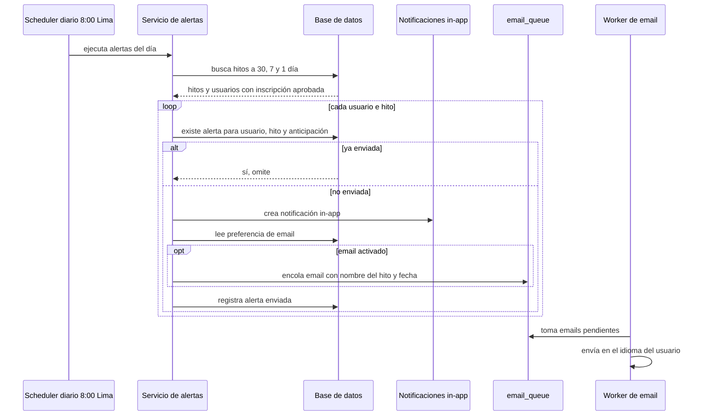

# SIA-E8-02 Alertas de próximos procesos

**Como** postulante, **quiero** recibir avisos antes de cada hito de mi proceso, **para** no perder una fecha de inscripción ni el examen.

## Reglas de negocio
1. Cadencia por hito: 30, 7 y 1 día antes, a las 8:00 America/Lima; si el hito se crea con menos días, solo se envían las alertas que aún no pasaron.
2. Canales: notificación in-app siempre y email vía `email_queue` salvo que el usuario lo desactive en preferencias.
3. Destinatarios: usuarios con inscripción aprobada en el proceso.
4. Idempotencia: una alerta por (usuario, hito, anticipación); no se reenvía.
5. Si el hito cambia de fecha, las alertas ya enviadas no se repiten para la misma anticipación salvo que la nueva fecha esté dentro de esa ventana; se envía un aviso «La fecha cambió».
6. El email no incluye datos sensibles: solo nombre del hito, fecha y enlace a la plataforma.
7. Preferencia de email: activar/desactivar por tipo (alertas de procesos, plan, reporte semanal); toda alerta de email incluye cómo desactivarlas.



## Criterios de aceptación
```gherkin
Escenario: Alerta a 7 días
  Dado un hito en 7 días y un usuario con inscripción aprobada
  Cuando corre el trabajo diario de las 8:00
  Entonces el usuario recibe una notificación in-app y se encola un email

Escenario: Sin duplicados
  Dado una alerta ya enviada a un usuario para un hito
  Cuando el trabajo corre dos veces el mismo día
  Entonces el usuario recibe una sola alerta

Escenario: Email desactivado
  Dado un usuario con email de alertas desactivado
  Cuando corre el trabajo diario
  Entonces recibe solo la notificación in-app

Escenario: Hito creado tarde
  Dado un hito creado a 3 días de su fecha
  Cuando corre el trabajo diario
  Entonces solo se envían las alertas de 1 día

Escenario: Cambio de fecha
  Dado un hito con alertas enviadas
  Cuando el admin cambia la fecha del hito
  Entonces el usuario recibe «La fecha cambió» con la nueva fecha

Escenario: Usuario no inscrito
  Dado un usuario sin inscripción aprobada en el proceso
  Cuando corre el trabajo diario
  Entonces no recibe alertas de ese proceso

Escenario: Contenido del email
  Dado un email de alerta encolado
  Cuando el worker lo envía
  Entonces el email no contiene DNI ni datos personales distintos del saludo
```

## Fuera de alcance
SMS, push móvil, WhatsApp.

## Dependencias
SIA-E8-01; notificaciones in-app y `email_queue` existentes.

## Seguridad y privacidad
Sin datos personales en el cuerpo del email salvo el nombre de pila; sin PII en logs.

## i18n
Notificaciones y emails en el idioma preferido del usuario (es/en).

## Definición de terminado
Tests de idempotencia y cadencia; plantilla es/en; review limpio.
