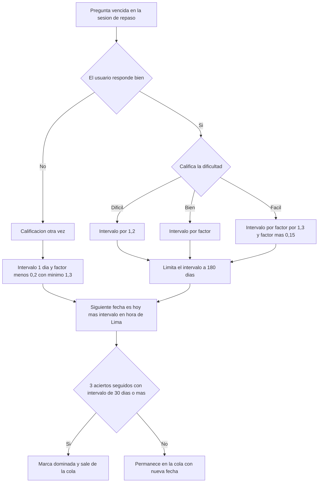

# SIA-E9-01 Repaso espaciado de preguntas falladas

**Como** postulante, **quiero** repasar las preguntas que fallé en intervalos crecientes, **para** fijarlas en la memoria antes del examen.

## Contexto
Algoritmo inicial: SM-2 simplificado (decisión PO). FSRS queda como evolución futura, fuera de alcance.

## Reglas de negocio
1. Una pregunta entra a la cola de repaso al fallarse (en práctica, simulacro o diagnóstico finalizados) con intervalo inicial 1 día.
2. Al repasar se califica: `otra_vez` (falló), `dificil`, `bien`, `facil`. Intervalos: falló → 1 día y factor −0,2 (mín. 1,3); `dificil` → intervalo × 1,2; `bien` → intervalo × factor; `facil` → intervalo × factor × 1,3 y factor +0,15; factor inicial 2,5; intervalo máx. 180 días.
3. En repaso con respuesta objetiva, el sistema califica `otra_vez` si responde mal; si acierta, el usuario elige `dificil`/`bien`/`facil`.
4. Sesión de repaso: máx. 30 preguntas por sesión; las vencidas se ordenan por antigüedad del vencimiento; se cuentan «vencidas hoy».
5. Solo preguntas aprobadas; si una pasa a `en_revision` o `rechazada`, sale de la cola.
6. Una pregunta acertada 3 veces seguidas con intervalo ≥ 30 días se marca «dominada» y sale de la cola.
7. Fecha de vencimiento en America/Lima; solo el dueño accede a su cola.



## Criterios de aceptación
```gherkin
Escenario: Entra a la cola
  Dado un simulacro finalizado con 5 preguntas falladas
  Cuando el sistema procesa el intento finalizado
  Entonces las 5 entran a la cola con vencimiento mañana

Escenario: Intervalos
  Dado un intervalo de 6 días, factor 2,5 y calificación "bien"
  Cuando el usuario califica la pregunta
  Entonces el nuevo intervalo es 15 días

Escenario: Fallo en repaso
  Dado una pregunta en repaso con factor 1,4
  Cuando falla la pregunta en repaso
  Entonces el intervalo vuelve a 1 día y el factor baja 0,2 sin pasar de 1,3

Escenario: Máximo de intervalo
  Dado una pregunta cuyo intervalo resultaría de 200 días
  Cuando el usuario califica "bien"
  Entonces el intervalo se limita a 180

Escenario: Sesión limitada
  Dado 50 preguntas vencidas
  Cuando inicia el repaso
  Entonces recibe 30, las más atrasadas primero

Escenario: Pregunta en revisión
  Dado una pregunta de la cola que pasa a "en_revision"
  Cuando el usuario inicia una sesión de repaso
  Entonces sale de la cola y no se incluye

Escenario: Dominada
  Dado 3 aciertos seguidos con intervalo de 30 días o más
  Cuando el usuario califica el tercer acierto
  Entonces se marca "dominada" y sale de la cola

Escenario: Cola vacía
  Dado un usuario sin repasos vencidos
  Cuando abre el repaso
  Entonces ve «No tienes repasos pendientes hoy»

Escenario: Aislamiento
  Dado la cola de repaso de otro usuario
  Cuando un usuario consulta esa cola
  Entonces recibe 404
```

## Fuera de alcance
FSRS; repaso de preguntas acertadas a la primera.

## Dependencias
SIA-E4-04.

## Seguridad y privacidad
Datos del dueño únicamente; calificación validada en servidor.

## i18n
Calificaciones y mensajes en es/en.

## Definición de terminado
Migración con Down; tests de la fórmula con tabla; `tsc`, `lint`, `build`; review limpio.
