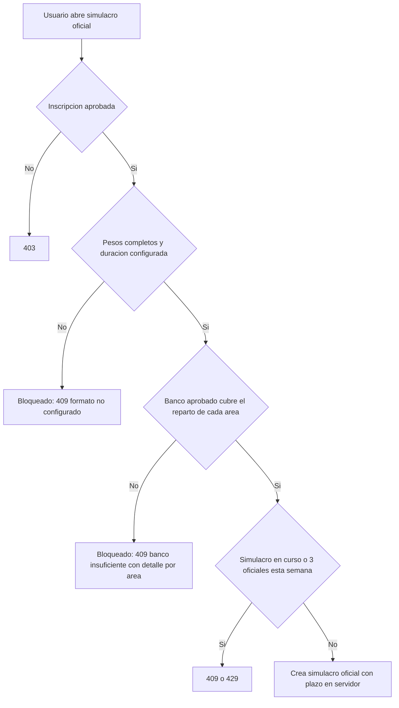

# SIA-E9-05 Simulacro con formato y duración oficiales

**Como** postulante, **quiero** un simulacro con el número de preguntas, el reparto por área y la duración del examen real, **para** ensayar en las mismas condiciones.

## Contexto
Extiende `simulacros` (tiempo en servidor, múltiple, nota sobre 100). Los parámetros oficiales vienen de la configuración de SIA-E1-03 más la duración que define el admin. Decisión P6 (issue #65): el simulacro oficial queda **bloqueado** hasta que la configuración de pesos de la profesión esté `completa` y el banco aprobado cubra el reparto; nunca usa pesos estimados.



## Reglas de negocio
1. El admin define por (proceso, profesión): `numero_preguntas_total`, duración en minutos (1–360) y reparto por área (ya en SIA-E1-03); sin esa configuración `completa`, el simulacro oficial no está disponible (409 `formato_no_configurado`). Nunca se usan pesos estimados (`pesos_estimados: true`) para el simulacro oficial.
2. El simulacro toma de cada área el nº de preguntas del reparto desde preguntas aprobadas; si faltan, 409 `banco_insuficiente` con el detalle por área.
3. Disponibilidad: un endpoint de lectura indica si el simulacro oficial está disponible para (proceso, profesión) y, si no, el motivo (`formato_no_configurado` o `banco_insuficiente` con faltantes por área). La UI muestra la opción deshabilitada con «Disponible cuando tengamos el formato oficial completo y suficientes preguntas revisadas». El admin ve el mismo detalle en la configuración.
4. Se marca `formato = oficial`; el historial permite filtrar oficiales y separa su nota de los dirigidos.
5. Todo el comportamiento de tiempo, orden estable y múltiple del simulacro existente se mantiene.
6. Un simulacro en curso por usuario y proceso; máx. 3 simulacros oficiales por semana (429 si excede).
7. Exige inscripción aprobada.
8. El resultado incluye nota sobre 100 y desglose por área con comparación contra el dominio previo.

## Criterios de aceptación
```gherkin
Escenario: Crear oficial
  Dado una configuración de 100 preguntas, 150 min y reparto por área completo
  Cuando el usuario crea el simulacro oficial
  Entonces recibe 100 preguntas con el reparto exacto y el plazo de 150 min en servidor

Escenario: Formato no configurado
  Dado un proceso sin configuración de formato oficial
  Cuando el usuario crea el simulacro oficial
  Entonces recibe 409 "formato_no_configurado"

Escenario: Pesos estimados no habilitan el oficial
  Dado una profesión con configuración de pesos "incompleta" y banco aprobado suficiente
  Cuando el usuario crea el simulacro oficial
  Entonces recibe 409 "formato_no_configurado" y no se crea con pesos estimados

Escenario: Opción bloqueada en la UI
  Dado una profesión sin configuración completa o con banco insuficiente
  Cuando el usuario abre la pantalla de simulacros
  Entonces la opción «Simulacro oficial» aparece deshabilitada con el motivo

Escenario: Desbloqueo
  Dado una profesión bloqueada por banco insuficiente en un área
  Cuando el admin aprueba las preguntas que faltaban en esa área
  Entonces la disponibilidad pasa a "disponible" y el usuario puede crear el simulacro oficial

Escenario: Banco insuficiente
  Dado un área con menos preguntas aprobadas que las requeridas
  Cuando el usuario crea el simulacro oficial
  Entonces recibe 409 "banco_insuficiente" con el detalle del área

Escenario: Tiempo agotado
  Dado un simulacro oficial con el plazo de 150 min vencido
  Cuando el usuario responde una pregunta
  Entonces recibe 409 "tiempo_agotado"

Escenario: Límite semanal
  Dado 3 simulacros oficiales en la semana
  Cuando el usuario crea otro simulacro oficial
  Entonces recibe 429

Escenario: Historial
  Dado simulacros oficiales y dirigidos finalizados
  Cuando el usuario filtra el historial por oficiales
  Entonces los oficiales se identifican y pueden filtrarse

Escenario: Sin inscripción aprobada
  Dado un usuario sin inscripción aprobada
  Cuando crea el simulacro oficial
  Entonces recibe 403

Escenario: Configuración por admin
  Dado un admin y un usuario con rol usuario
  Cuando el admin guarda duración 150 y total 100, y el usuario intenta lo mismo
  Entonces se audita el cambio del admin y el usuario recibe 403
```

## Fuera de alcance
Obtener el formato oficial automáticamente.

## Dependencias
SIA-E1-03 (configuración `completa`), banco aprobado suficiente (SIA-E3-05 y SIA-E6-05 en operación), simulacros existentes; el alta del cronograma (SIA-E8-01) es contexto, no bloqueante.

## Seguridad y privacidad
Estado y tiempo en servidor; autorización por dueño.

## i18n
Etiqueta «Oficial» y errores en es/en.

## Definición de terminado
Tests de reparto, banco insuficiente, tiempo y límite semanal; migración con Down; `tsc`, `lint`, `build`; review limpio.
