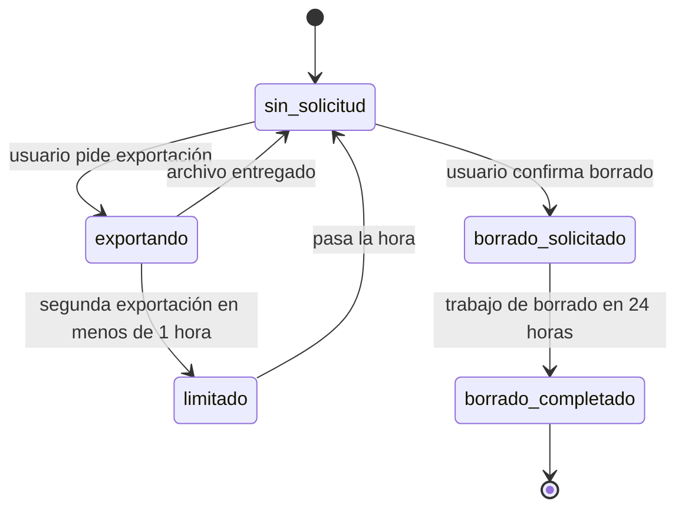

# SIA-E9-07 Privacidad: exportar y borrar datos de aprendizaje

**Como** postulante, **quiero** descargar o borrar mis datos de aprendizaje (dominio, plan, errores, repaso, notas), **para** controlar mi información personal. (Recomendación del PO; cumplimiento de datos personales.)

## Reglas de negocio
1. Exportar: archivo JSON con diagnóstico, dominio, plan y cumplimiento, cuaderno de errores y notas, cola de repaso y preferencias; excluye contenido médico generado (solo ids de preguntas). Máx. 1 exportación por hora.
2. Borrar: elimina dominio, plan, cuaderno, notas, cola de repaso y preferencias del módulo tras confirmar escribiendo «BORRAR»/«DELETE». Los intentos de práctica/simulacro y su nota se rigen por la política existente y no se tocan aquí.
3. Las estadísticas agregadas de preguntas se conservan (anonimizadas, sin vínculo al usuario).
4. El borrado es irreversible y se ejecuta en ≤ 24 h; el usuario ve el estado (`solicitado`, `completado`); se envía confirmación in-app.
5. Se registra en audit_log el hecho (usuario opaco, fecha) sin el contenido borrado.
6. Los registros de uso de IA conservan solo el id opaco sin contenido; tras el borrado se desvinculan del usuario.
7. Solo el dueño puede solicitarlo; un admin no puede exportar datos de un usuario desde esta función.
8. Plazos aprobados (decisión P8, issue #65): máx. 1 exportación por hora por usuario; borrado completado en ≤ 24 h desde la confirmación.
9. Contadores antifraude que **no se borran**: el contador de acciones IA (SIA-E6-02) y el cooldown de diagnóstico de 30 días (SIA-E4-01). Se conservan bajo `HMAC(usuario_id)` con un secreto de servidor, sin id en claro ni otros datos personales, para que borrar y volver a empezar no reinicie la cuota ni la espera. Cada uno se elimina al vencer su periodo (fin del mes en curso; 30 días desde el último diagnóstico).
10. La pantalla de borrado informa antes de confirmar que la cuota de IA del mes y la espera del diagnóstico se mantienen.



## Criterios de aceptación
```gherkin
Escenario: Exportar
  Dado un usuario con datos de aprendizaje
  Cuando pulsa «Descargar mis datos»
  Entonces obtiene un JSON con sus datos de aprendizaje y ninguno de otro usuario

Escenario: Límite de exportación
  Dado una exportación hecha hace 30 minutos
  Cuando pide otra exportación
  Entonces recibe 429

Escenario: Borrar con confirmación
  Dado un usuario con datos de aprendizaje
  Cuando confirma escribiendo la palabra requerida
  Entonces se crea la solicitud "solicitado" y 24 h después consta "completado"

Escenario: Confirmación incorrecta
  Dado la pantalla de borrado de datos
  Cuando escribe otra palabra y pulsa confirmar
  Entonces no se envía la solicitud

Escenario: Efecto del borrado
  Dado una solicitud de borrado en proceso
  Cuando el trabajo de borrado termina
  Entonces dominio, plan, cuaderno y repaso quedan vacíos y las estadísticas agregadas de preguntas se conservan

Escenario: Plazo de borrado
  Dado una solicitud de borrado confirmada
  Cuando pasan 24 h desde la confirmación
  Entonces la solicitud consta "completado"

Escenario: Contadores antifraude conservados
  Dado un usuario con 5 acciones IA reales hoy y un diagnóstico finalizado hace 10 días
  Cuando su borrado se completa
  Entonces el contador de IA y el cooldown de diagnóstico siguen vigentes bajo el HMAC del usuario y no queda ningún otro dato de aprendizaje suyo

Escenario: Aviso previo sobre contadores
  Dado la pantalla de borrado de datos
  Cuando el usuario la abre
  Entonces ve que su cuota de IA del mes y la espera del diagnóstico se mantienen tras el borrado

Escenario: Auditoría
  Dado una solicitud de borrado completada
  Cuando se revisa audit_log
  Entonces registra la solicitud y su finalización sin contenido

Escenario: Admin sin acceso
  Dado un admin autenticado
  Cuando intenta exportar los datos de un usuario
  Entonces recibe 403

Escenario: Aislamiento
  Dado la exportación de otro usuario
  Cuando un usuario pide esa exportación
  Entonces recibe 404
```

## Fuera de alcance
Borrado de la cuenta completa y de intentos históricos (política existente).

## Dependencias
SIA-E4-03 y las tablas de E7 y E9 que existan al momento; contadores HMAC de SIA-E6-02 y SIA-E4-01.

## Seguridad y privacidad
Exportación solo autenticada, sin URL pública; sin PII en logs. El secreto del HMAC vive solo en variables de entorno; los contadores HMAC no se incluyen en la exportación porque no son datos de aprendizaje.

## i18n
Pantalla, confirmación y notificaciones en es/en (palabra de confirmación por idioma).

## Definición de terminado
Tests de aislamiento y borrado completo por tabla; `tsc`, `lint`, `build`; review limpio.
