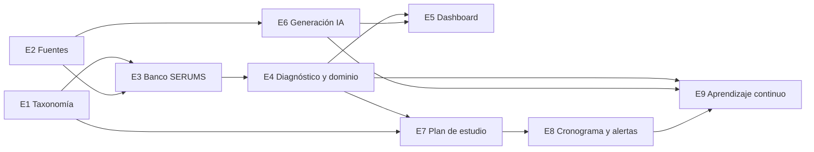
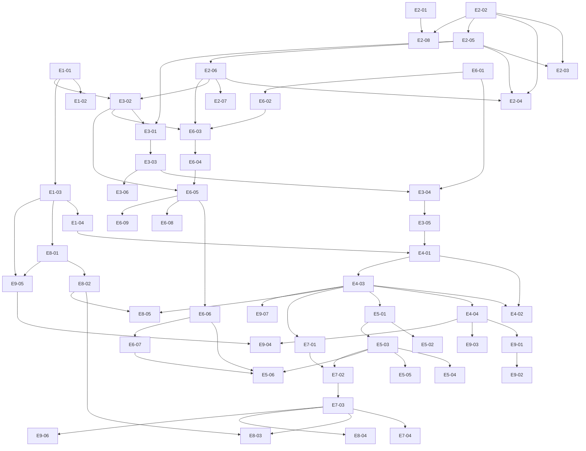

# Módulo «Aprendizaje asistido por IA para SERUMS» — historias de usuario

Fuente: «Prompt 1» del requerimiento (capacidades 1–9 y restricciones). Alcance decidido por el usuario: todo el módulo, con fases MVP, v2 y v3.

## Índice de épicas

| Épica | Archivo | Historias | Issue |
|---|---|---|---|
| E1 Taxonomía SERUMS | [E1-epica-taxonomia.md](E1-epica-taxonomia.md) | 4 | #2 |
| E2 Repositorio de fuentes académicas | [E2-epica-fuentes.md](E2-epica-fuentes.md) | 8 | #3 |
| E3 Banco SERUMS | [E3-epica-banco.md](E3-epica-banco.md) | 6 | #4 |
| E4 Diagnóstico y modelo de dominio | [E4-epica-diagnostico-dominio.md](E4-epica-diagnostico-dominio.md) | 4 | #5 |
| E5 Dashboard de rendimiento y acciones rápidas | [E5-epica-dashboard.md](E5-epica-dashboard.md) | 6 | #6 |
| E6 Generación con IA, citas y aprobación | [E6-epica-generacion-ia.md](E6-epica-generacion-ia.md) | 9 | #7 |
| E7 Plan de estudio personalizado | [E7-epica-plan-estudio.md](E7-epica-plan-estudio.md) | 4 | #8 |
| E8 Cronograma, alertas y reporte semanal | [E8-epica-cronograma-alertas.md](E8-epica-cronograma-alertas.md) | 5 | #9 |
| E9 Aprendizaje continuo | [E9-epica-aprendizaje-continuo.md](E9-epica-aprendizaje-continuo.md) | 7 | #10 |

Total: 53 historias. Cada historia vive en `E<n>-<nn>-<slug>.md` en esta carpeta.

## Ajuste a las épicas propuestas

Se mantienen las 9 épicas. Ajustes: (a) E6 incluye también el registro de uso y el control de costos de IA porque son prerrequisito de toda generación; (b) las «explicaciones con cita» viven en E6 (generación) y se referencian desde E9; (c) E9 absorbe también las recomendaciones propias del PO (metas y racha, privacidad de datos de aprendizaje) y E6 el reporte de contenido erróneo por el alumno.

## Mapa de dependencias (épicas e historias clave)

## Supuestos explícitos (decididos por el PO)

1. **Mapeo de dominio:** profesión SERUMS = `especialidad` del catálogo; área = `asignatura`; **tema** = nuevo nivel bajo la asignatura (tabla propia `temas`, no etiqueta, para poder asignar peso y dominio por tema). El proceso «SERUMS 2026-I» es un `proceso` del catálogo existente. Los pesos por profesión extienden `proceso_asignaturas` (peso, numero_preguntas, coeficiente).
2. **Rol «postulante»** = rol `usuario` existente. Admin = rol `admin`. No se crean roles nuevos.
3. **Acceso:** el módulo exige inscripción aprobada al proceso (igual que práctica/simulacro). El diagnóstico y el plan se asocian a (usuario, proceso, especialidad).
4. **Contenido médico:** ninguna pregunta, clave, explicación o material generado se muestra a un alumno sin (a) al menos una cita a un pasaje de una fuente activa y (b) aprobación de un admin. Contenido marcado como incierto por la IA no puede aprobarse sin confirmación explícita del admin (casilla + nota obligatoria). Las preguntas oficiales importadas del balotario cuentan como contenido con fuente (el balotario) y siguen pasando por revisión de clasificación; la clave oficial `<mark>` no se reescribe.
5. **Agnóstico de proveedor:** las historias hablan de «el servicio de IA»; proveedor, modelo, prompts y costos reales son decisión técnica del tech-lead.
6. **Estimación:** puntos relativos (1,2,3,5,8). Una historia de 5–8 puntos puede dividirse en tareas técnicas de 1–3 h al repartir trabajo; ninguna historia supera 8.
7. **Zona horaria** de fechas de examen, alertas y reportes: `America/Lima` (UTC-5, sin horario de verano).
8. **Idiomas:** todo texto visible en `es` y `en` bajo el namespace `dashboard` (claves `dashboard.serumsIa.*`); toda clave existe en ambos archivos. El contenido generado (material, preguntas) se produce solo en español (el examen es en español); la interfaz es bilingüe.
9. **UI:** todas las pantallas usan khipu. Si falta un componente, se abre primero PR en khipu-design-system (regla del repo) y la historia lo declara como dependencia.

10. **Sin generación en vivo para el postulante:** el postulante nunca dispara una generación que llegue a él sin aprobación; solicita al equipo (SIA-E5-06 / SIA-E6-06) y recibe contenido solo tras aprobación de admin. El presupuesto de IA por usuario aplica a esas solicitudes y a usos de IA personalizados futuros.
11. **Segundo revisor:** por defecto, quien generó o importó un contenido no puede aprobarlo si hay otro admin activo (SIA-E6-05).
12. **Fases:** MVP 33 historias / 129 pts, v2 16 historias / 56 pts, v3 4 historias / 18 pts (total 53 / 203 pts).
13. **Preferencias de notificación** (activar/desactivar alertas, recordatorios y reporte semanal) se definen en SIA-E8-02 y se reutilizan en E8-03 y E8-05.

## Límites propuestos (aplican donde se citan)

| Entrada | Límite |
|---|---|
| Archivo .md de fuente | 2 MiB, 20 000 líneas, solo UTF-8, extensión `.md` y tipo `text/markdown` o `text/plain` |
| URL de fuente | solo HTTPS, 5 MiB de respuesta, 10 s de timeout, máx. 3 redirecciones, solo dominios de una lista permitida por admin, bloqueo de IP privadas/loopback/metadata |
| Fuentes activas | máx. 100 por especialidad y 500 en total |
| Pasajes | 150–800 palabras cada uno; máx. 5 000 por fuente |
| Balotario importado | máx. 1 000 preguntas por archivo; alternativas 2–6 por pregunta |
| Diagnóstico | 4 preguntas por área (mín. 3), máx. 40 preguntas en total, tiempo límite en servidor 45 min |
| Generación de preguntas (admin) | máx. 20 por solicitud, 200 por día por admin |
| Generación por alumno (material o preguntas) | máx. 5 operaciones por día y 60 por mes por usuario (valores configurables) |
| Preguntas por práctica/simulacro dirigido | 5–100 |
| Plan de estudio | horas por día 0,5–12 en pasos de 0,5; fecha de examen entre mañana y 730 días |
| Texto libre (notas, motivos) | máx. 500 caracteres |
| Listados | paginación máx. 100 por página, 20 por defecto |

## Requisitos transversales (se citan como criterios en cada historia donde aplican)

- Autorización por recurso: un usuario nunca lee ni modifica datos de otro (404 si el recurso no es suyo).
- Estado verificado en servidor (tiempo, inscripción, estado de la pregunta, presupuesto de IA).
- Sin datos personales (nombre, DNI, email, teléfono) en logs ni en lo enviado a la IA; los prompts llevan solo identificadores opacos y contenido académico.
- Toda acción de admin registra una entrada en `audit_log` (actor, acción, recurso, antes/después resumido, fecha).
- Errores con `jsonError` y códigos HTTP: 401 sin sesión, 403 sin rol/inscripción, 404 recurso ajeno o inexistente, 409 estado inválido, 422 validación, 429 límite de uso.

## Preguntas abiertas para el usuario

Ver el mensaje de entrega del PO; resumen: proveedor/plan de NotebookLM (spike), política de publicación de preguntas oficiales importadas sin aprobación adicional, límites de presupuesto de IA por usuario, nivel de aprobación del admin (uno o dos revisores) y calendario real de procesos SERUMS.
